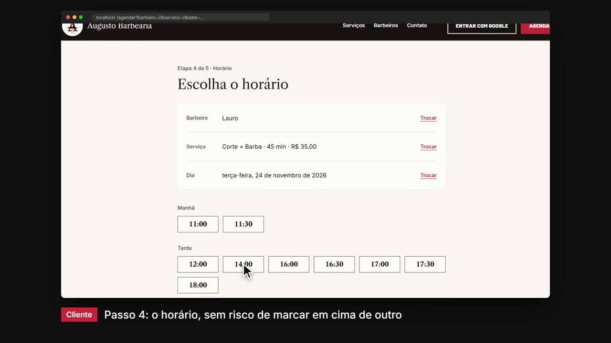
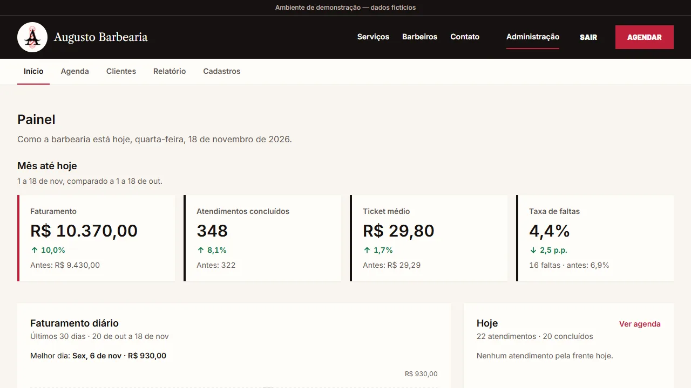
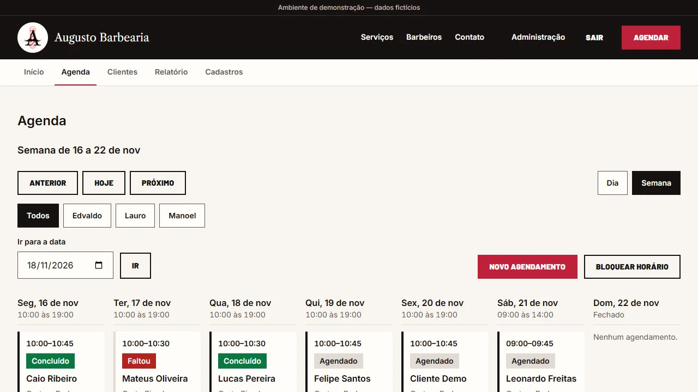
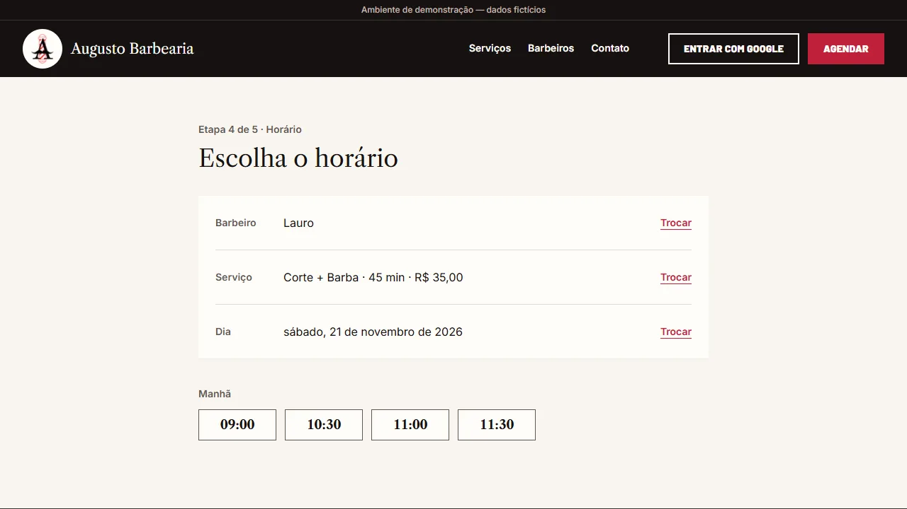
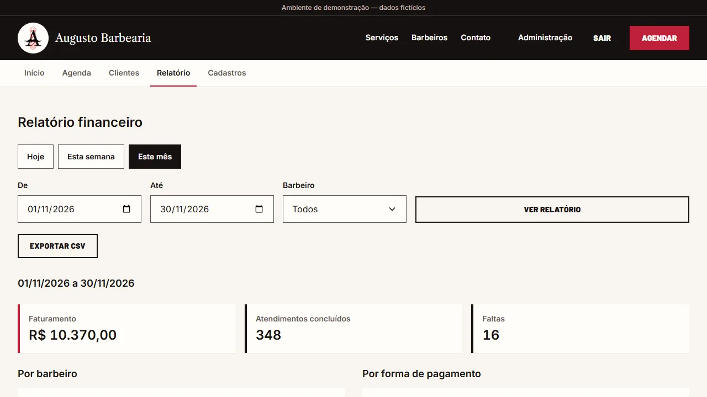
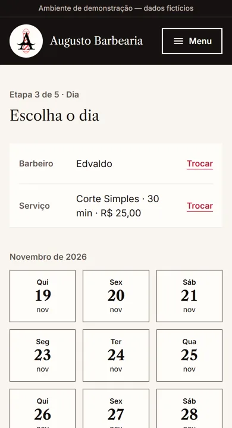
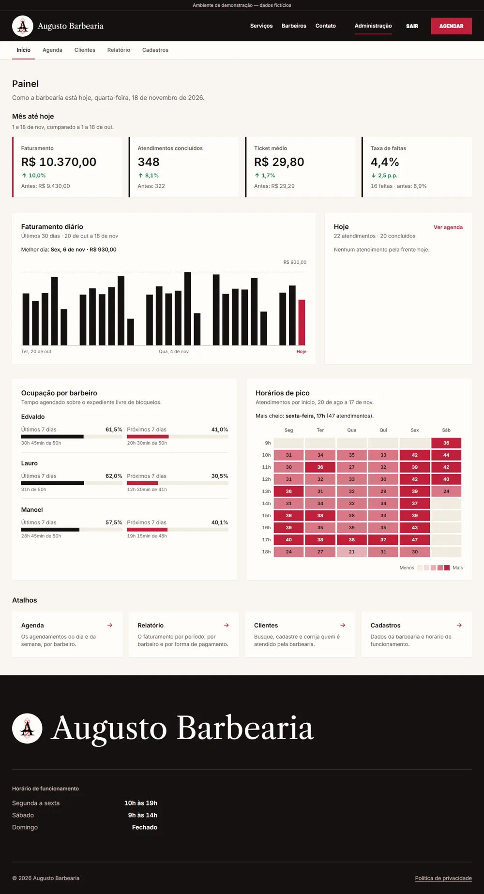
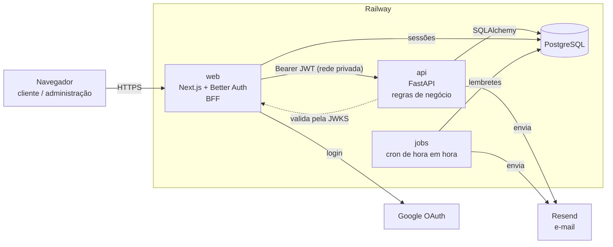

<div align="center">


# Augusto Barbearia

**Agendamento online e gestão para uma barbearia real com três barbeiros.**
O cliente agenda pelo celular; a equipe cuida da agenda, dos atendimentos, dos pagamentos e do faturamento.

[](https://github.com/vitorazevedop7/AugustoBarbearia/actions/workflows/ci.yml)


[Vídeo](#demonstração) · [Funcionalidades](#funcionalidades) · [Arquitetura](#arquitetura) · [Destaques de engenharia](#destaques-de-engenharia) · [Rodar localmente](#rodar-localmente) · [Documentação](#documentação)

</div>

## Demonstração

[](docs/media/demonstracao.mp4)

Em 1min11, o vídeo percorre o sistema clicando nas telas reais: o cliente agenda pela vitrine (barbeiro, serviço, dia, horário e confirmação) e acompanha os horários em "Meus agendamentos"; o mesmo fluxo aparece no celular; a administração entra no painel de indicadores, abre a agenda do dia e da semana, conclui um atendimento com o pagamento e consulta o relatório financeiro. Os dados são fictícios e foram gerados pelo seed da demonstração. **[Baixar o vídeo (MP4, 10 MB)](docs/media/demonstracao.mp4)**

Para ver com mais calma, a **[versão completa, de 2min34 (MP4, 6 MB)](docs/media/demo.mp4)** inclui também a busca de clientes, os cadastros e o agendamento feito pela administração. O vídeo de 1 minuto é gerado por código, com o [Remotion](https://www.remotion.dev/), no projeto [`promo/`](promo/README.md).

<table>
  <tr>
    <td width="50%"><br><sub><b>Painel</b>: o mês até hoje comparado ao mês anterior</sub></td>
    <td width="50%"><br><sub><b>Agenda</b>: dia ou semana, de todos ou de um barbeiro</sub></td>
  </tr>
  <tr>
    <td><br><sub><b>Agendar</b>: só aparecem horários que a API garante livres</sub></td>
    <td><br><sub><b>Relatório</b>: por barbeiro e por forma de pagamento, com exportação em CSV</sub></td>
  </tr>
</table>

<p align="center">
  
  &nbsp;&nbsp;
  
  &nbsp;&nbsp;
  
</p>

## Funcionalidades

**Para o cliente**
- Vitrine pública com serviços, equipe, horário de funcionamento e contato, tudo vindo da API.
- Agendamento em cinco passos: barbeiro, serviço, dia, horário e confirmação. O estado fica na URL e o fluxo funciona sem JavaScript.
- Login com Google, pedido só na hora de confirmar.
- "Meus agendamentos": remarcar e cancelar dentro das regras de prazo, com aviso quando a mudança é em cima da hora.
- E-mail de confirmação, remarcação, cancelamento e lembrete 24 horas antes. O agendamento também pode ser baixado em `.ics` para o calendário.

**Para a administração**
- **Painel de indicadores**: faturamento, atendimentos, ticket médio e taxa de faltas com variação sobre o mês anterior, faturamento diário, ocupação por barbeiro e mapa de horários de pico. Os gráficos são SVG gerados no servidor, sem biblioteca de gráficos.
- **Agenda** do dia e da semana. Permite agendar por telefone ou no balcão, remarcar, cancelar e bloquear horários (almoço, folga).
- **Conclusão do atendimento** com valor e forma de pagamento (Pix, crédito, débito, dinheiro), registro de falta e correção do pagamento.
- **Relatório financeiro** por período, barbeiro e forma de pagamento, com exportação em CSV pronta para o Excel em português.
- **Cadastros** de clientes (inclusive quem não tem conta Google), barbeiros, serviços, dados da barbearia e horário de funcionamento.

## Arquitetura



- **web** (Next.js App Router, TypeScript strict, Tailwind) é o único serviço público. Ele funciona como **BFF**: Server Components leem, Server Actions alteram, e o navegador nunca chama a API diretamente.
- **api** (FastAPI, SQLAlchemy 2, Alembic, Pydantic v2) concentra **todas** as regras de negócio. Ela é organizada em 14 módulos (`router → service → models`), e cada regra cita o código `RN-xx` que a define.
- O login é com Google pelo Better Auth no web. A API valida o JWT pela JWKS do web e tira o papel de cada usuário de uma lista de e-mails autorizados.
- O contrato entre web e API é o **OpenAPI**. Os tipos TypeScript são gerados a partir dele, e o CI falha se ficarem desatualizados.

Detalhes em [docs/arquitetura.md](docs/arquitetura.md); o porquê de cada escolha está nos [ADRs](docs/decisoes/).

## Destaques de engenharia

- **Conflito de horário bloqueado pelo próprio banco.** Uma *exclusion constraint* do PostgreSQL (`btree_gist` sobre o intervalo de cada barbeiro) impede dois agendamentos sobrepostos, mesmo com reservas simultâneas. A disponibilidade é uma função pura testada à parte. As travas (`FOR SHARE`, `FOR NO KEY UPDATE`, `FOR UPDATE`) seguem uma ordem combinada entre agendar, remarcar, bloquear horário e editar o expediente, o que evita deadlock. Os testes de concorrência usam conexões reais.
- **E-mail confiável sem desfazer a ação.** A notificação é registrada na mesma transação da ação (padrão *outbox*) e enviada depois do commit. Se o envio falhar, o agendamento continua valendo. O lembrete é um job idempotente (`FOR UPDATE SKIP LOCKED`), então duas execuções ao mesmo tempo não mandam e-mail duplicado.
- **Tempo e dinheiro tratados com cuidado.** O banco guarda `timestamptz`, a conversão para São Paulo acontece só nas bordas, e o relógio é injetado nas rotas para os testes o fixarem. Valores em dinheiro usam `Decimal` / `numeric(10,2)`, nunca `float`, e trafegam como string decimal.
- **Regras de negócio documentadas e rastreáveis.** São 41 regras (`RN-xx`) em [docs/dominio/regras.md](docs/dominio/regras.md), cada uma com teste que leva o código no nome (ex.: `test_rn14_…`). Cada funcionalidade tem uma spec com critérios de aceite em [docs/specs/](docs/specs/).
- **Qualidade no CI.** Ruff, Pyright em modo strict, mais de 970 testes de API com pytest contra PostgreSQL real, ESLint, Prettier, `tsc` e Vitest no web, conferência do contrato OpenAPI e builds Docker multi-stage com usuário não-root.
- **Acessibilidade e mobile first.** As telas funcionam a partir de 360px, usam só os tokens da identidade visual e seguem um checklist de acessibilidade. Os fluxos principais funcionam sem JavaScript.
- **Processo de produto.** O trabalho começou da documentação: visão, regras, modelo de domínio e 11 ADRs. Depois veio um kanban de issues por sprint, uma issue por PR, merge por rebase e documentação atualizada no mesmo PR.

## Rodar localmente

Pré-requisito: Docker com o Compose v2.

```bash
cp .env.example .env
```

No `.env`, para entrar sem conta Google:

```bash
BETTER_AUTH_SECRET=<openssl rand -base64 32>
DEMO_LOGIN_ENABLED=true
ADMIN_EMAILS=admin@demo.augustobarbearia.local
```

```bash
docker compose up -d
docker compose exec api alembic upgrade head
docker compose exec web pnpm auth:migrate
```

Abra http://localhost:3000/entrar e escolha **Entrar como administração (demo)** ou **Entrar como cliente (demo)**. A documentação interativa da API fica em http://localhost:8000/docs.

Para uma cópia com meses de dados fictícios (agenda cheia, painel e relatório preenchidos) e um link público, use `scripts/demo.sh up` ([docs/specs/demonstracao-local.md](docs/specs/demonstracao-local.md)). O [modo demonstração](docs/specs/modo-demonstracao.md) fica desligado por padrão e é recusado numa imagem de produção sem uma confirmação explícita.

Testes e verificações:

```bash
docker compose exec api uv run pytest
docker compose exec api sh -c "uv run ruff check . && uv run pyright"
docker compose exec web sh -c "pnpm lint && pnpm typecheck && pnpm test"
```

O passo a passo completo (login com Google, e-mail, migrações, contrato OpenAPI, imagens de produção) está no [guia de desenvolvimento](docs/desenvolvimento.md).

## Documentação

| | |
|---|---|
| [Visão do produto](docs/produto/visao.md) e [roadmap](docs/produto/roadmap.md) | O problema, os usuários, o que está dentro e fora do escopo |
| [Regras de negócio](docs/dominio/regras.md) e [modelo de domínio](docs/dominio/modelo.md) | As `RN-xx` e as entidades, com o glossário PT ↔ código |
| [Arquitetura](docs/arquitetura.md) e [ADRs](docs/decisoes/) | Onde cada coisa mora e por que foi escolhida |
| [Specs](docs/specs/) | O contrato de cada funcionalidade, com critérios de aceite |
| [Identidade visual](docs/design/identidade-visual.md) e [design system](docs/design/design-system.md) | Marca, tokens, componentes e acessibilidade |
| [Guia de desenvolvimento](docs/desenvolvimento.md) e [CLAUDE.md](CLAUDE.md) | Como rodar e as regras do repositório |

## Estrutura

```
api/                 FastAPI: app/modules/<módulo>/{router,service,models,schemas}.py, alembic/, tests/
web/                 Next.js: src/app (rotas), src/components, src/lib/api (cliente tipado gerado)
docs/                produto, domínio, arquitetura, ADRs, specs, design, mídia
scripts/demo.sh      demonstração com dados fictícios e link público
docker-compose*.yml  desenvolvimento e demonstração
```

---

<sub>Projeto feito para a Augusto Barbearia, com autorização dos proprietários para os nomes e as informações publicadas. As fotos dos barbeiros e todos os dados das telas e do vídeo são fictícios.</sub>
