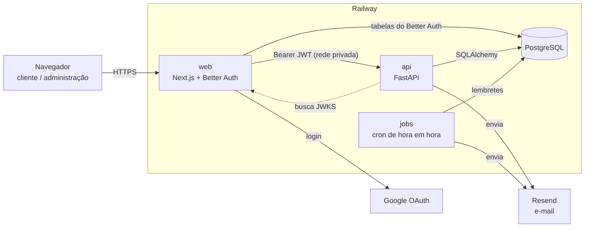
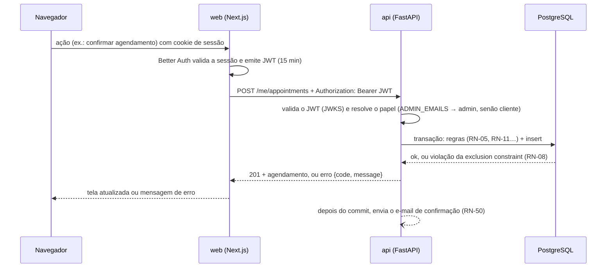

# Arquitetura

Como o sistema é organizado, onde cada coisa mora e como as peças conversam. **As justificativas das escolhas** estão nos ADRs em [decisoes/](decisoes/), e aqui só aparece o link para elas.

## Visão geral



- **web**: renderiza as telas e é o **BFF**. É o único serviço público ([0001](decisoes/0001-arquitetura-web-api.md)).
- **api**: concentra **todas** as regras de negócio (`RN-xx`) e as tabelas de domínio.
- **jobs**: a mesma imagem da API, rodando o comando de lembretes por cron ([0006](decisoes/0006-email-e-jobs.md)).
- **PostgreSQL**: um banco, com dois donos de schema. O Alembic cuida das tabelas de domínio e o Better Auth das tabelas de autenticação ([0002](decisoes/0002-banco-de-dados.md)).

## Fluxo de uma requisição autenticada



Detalhes da autenticação: [0003](decisoes/0003-autenticacao.md).

## API (`/api`)

O esqueleto da S2.02 está implementado em [esqueleto-api.md](specs/esqueleto-api.md): criação da app, settings, handlers de erro e healthcheck tipado. A fundação do banco da S2.05 está em [banco-api.md](specs/banco-api.md): engine SQLAlchemy 2 com Psycopg 3, sessão por requisição, Alembic e testes no Postgres. O contrato com o web está em [contrato-openapi.md](specs/contrato-openapi.md): `app/export_openapi.py` exporta o OpenAPI sem subir o servidor. Autenticação e módulos de domínio entram nas issues seguintes. `app/health.py` verifica a conexão com `SELECT 1` e retorna 503 se indisponível. As pastas abaixo mostram a estrutura alvo.

### Estrutura de pastas

```
api/
├── pyproject.toml / uv.lock
├── Dockerfile
├── alembic.ini
├── alembic/                  # migrações (só tabelas de domínio)
├── app/
│   ├── main.py               # cria o FastAPI e registra os routers
│   ├── config.py             # settings (pydantic-settings, lê env)
│   ├── health.py             # router e schema de GET /health
│   ├── db.py                 # engine, sessão, base declarativa
│   ├── errors.py             # erro de domínio → {code, message} (0008)
│   ├── export_openapi.py     # python -m app.export_openapi: OpenAPI em JSON, sem servidor
│   ├── auth/                 # validação do JWT, dependências current_user / require_admin
│   ├── modules/              # um pacote por área do domínio
│   │   ├── shop/             # Barbearia + horário de funcionamento
│   │   ├── barbers/          # Barbeiro, Barbeiro–Serviço
│   │   ├── catalog/          # Serviço (o nome evita confusão com service.py)
│   │   ├── customers/        # Cliente e vínculo com a conta
│   │   ├── availability/     # cálculo de horários disponíveis (RN-05) e bloqueios
│   │   ├── appointments/     # agendamento e ciclo de vida (RN-10 a RN-33)
│   │   ├── payments/         # conclusão, pagamento e relatório (RN-40 a RN-44)
│   │   └── notifications/    # registro e envio de e-mail, templates (RN-50 a RN-54)
│   └── jobs/
│       └── send_reminders.py # python -m app.jobs.send_reminders
└── tests/                    # espelha app/modules; usa o Postgres do compose
```

Cada módulo segue o mesmo formato:

| Arquivo | Responsabilidade |
|---|---|
| `router.py` | HTTP: rotas, parse e validação de formato (Pydantic), dependências de auth. **Sem regra de negócio** |
| `schemas.py` | Modelos Pydantic de entrada e saída. Geram o OpenAPI ([0008](decisoes/0008-contrato-openapi.md)) |
| `service.py` | **Regras de negócio** e transações. Cita as `RN-xx` em comentários e docstrings |
| `models.py` | Tabelas SQLAlchemy |

### Onde cada tipo de regra mora

| Tipo | Onde | Exemplo |
|---|---|---|
| Formato e obrigatoriedade de campos | `schemas.py` (Pydantic) | Telefone obrigatório, preço ≥ 0 |
| Regra de negócio | `service.py` | Prazo de 2h para cancelar (RN-14), limite de 2 agendamentos (RN-11) |
| Cálculo puro | Função sem I/O em `availability/` | Grade e slots (RN-04, RN-05), testável sem banco |
| Invariante crítica | Constraint no banco | Sem sobreposição (RN-08) |
| Permissão | Dependência de auth no `router.py` | `require_admin` nas rotas `/admin` (RN-70) |

### Grupos de rotas

Os prefixos deixam a permissão explícita (RN-70):

| Prefixo | Quem acessa | Conteúdo |
|---|---|---|
| `/public` | Qualquer um, sem token | Dados da barbearia, serviços e barbeiros ativos, horários disponíveis |
| `/me` | Cliente autenticado | Perfil, os próprios agendamentos (criar, remarcar, cancelar) |
| `/admin` | Administração | Agenda, agendamento manual, bloqueios, conclusão, falta, cadastros, relatório |
| `/health` | Railway | Healthcheck |

## Web (`/web`)

### Estrutura de pastas

```
web/
├── package.json / pnpm-lock.yaml
├── Dockerfile
├── scripts/gen-api.mjs         # `pnpm gen:api`: OpenAPI da API → src/lib/api/schema.d.ts
└── src/
    ├── app/
    │   ├── (publico)/              # vitrine: /, /entrar, /servicos, /barbeiros, /privacidade
    │   ├── (cliente)/              # exige login: /agendar, /meus-agendamentos, /perfil
    │   ├── admin/                  # exige admin: /admin/agenda, /admin/clientes, /admin/cadastros, /admin/relatorio
    │   ├── design-system/          # vitrine dos componentes, fora do menu e dos buscadores
    │   └── api/auth/[...all]/      # handler do Better Auth
    ├── lib/
    │   ├── auth.ts                 # configuração do Better Auth (Google + plugin JWT)
    │   ├── auth-jwt.ts             # o JWT para a API (EdDSA, 15 min, sub/email/name)
    │   ├── auth-actions.ts         # Server Actions de entrar e sair
    │   ├── session.ts              # sessão atual para Server Components
    │   └── api/
    │       ├── token.ts            # getApiToken(): JWT da sessão atual
    │       ├── client.ts           # openapi-fetch com o Bearer JWT
    │       └── schema.d.ts         # GERADO por `pnpm gen:api`, não editar
    └── components/
        ├── api-status.tsx          # status de GET /health na página inicial, só em desenvolvimento
        └── ui/                     # componentes do design system (docs/design/design-system.md)
```

### Regras do front

- O web chama a API só pelo `createApiClient()` de `lib/api/client.ts`, tipado pelo `schema.d.ts` gerado ([contrato-openapi.md](specs/contrato-openapi.md)). Mudou um schema da API, rode `pnpm gen:api` no mesmo PR; o job `contract` do CI confere.
- **Server Components** buscam dados pela API. **Server Actions** fazem as mutações chamando a API. O navegador nunca chama a API diretamente.
- **Nenhuma regra de negócio no front.** Validação no front é só para a experiência do usuário; quem decide é a API, e o front mostra o `message` do erro que a API devolve.
- O acesso às rotas `(cliente)` e `admin` é checado no servidor (middleware ou layout). Mesmo assim, a API valida tudo de novo.
- Mobile first: toda tela precisa funcionar bem em 360px de largura.

## Ambientes

| Ambiente | Como sobe | Banco |
|---|---|---|
| Desenvolvimento | `docker compose up` ([0004](decisoes/0004-docker.md)) | Postgres do compose |
| Demonstração | Deploy no trial da Railway, cerca de uma semana antes da apresentação ([0009](decisoes/0009-demonstracao-no-trial.md)) | Postgres da Railway |
| Produção | Push na `main` → deploy na Railway ([0005](decisoes/0005-hospedagem.md)). É a demonstração depois que a barbearia assina o plano | Postgres da Railway |

Não há ambiente de homologação no MVP. Até a demonstração, o sistema só roda localmente.

### Serviços na Railway

| Serviço | Imagem | Comando | Público? |
|---|---|---|---|
| `web` | `/web/Dockerfile` | `node server.js` (Next standalone) | Sim (domínio) |
| `api` | `/api/Dockerfile` | `alembic upgrade head && uvicorn app.main:app` | Não (rede privada) |
| `jobs` | `/api/Dockerfile` | `python -m app.jobs.send_reminders`, cron `0 * * * *` | Não |
| `postgres` | Gerenciado | — | Não |

## Variáveis de ambiente

Só os **nomes**. Os valores ficam no `.env` local (não versionado) e nas variáveis da Railway. O `.env.example` da raiz lista todas e alimenta o `docker compose`, que entrega a cada serviço só as variáveis dele. `api/.env.example` cobre a configuração opcional para rodar a API fora do compose.

| Variável | Serviço | Para quê |
|---|---|---|
| `POSTGRES_USER` / `POSTGRES_PASSWORD` / `POSTGRES_DB` | db | Só no desenvolvimento: credenciais do Postgres do compose |
| `APP_NAME` | api | Opcional: título do OpenAPI; padrão "Augusto Barbearia API" |
| `DATABASE_URL` | api, jobs, web | Conexão com o PostgreSQL; obrigatória na API. Testes usam o mesmo servidor com o nome do banco acrescido de `_test` |
| `ADMIN_EMAILS` | api | Lista de e-mails da administração (RN-71) |
| `AUTH_JWKS_URL` | api, jobs | Endpoint JWKS do Better Auth |
| `AUTH_ISSUER` / `AUTH_AUDIENCE` | web, api | `iss` e `aud` do JWT: o web emite com eles e a API confere |
| `RESEND_API_KEY` | api, jobs | Envio de e-mail |
| `EMAIL_FROM` | api, jobs | Remetente dos e-mails |
| `WEB_BASE_URL` | api, jobs | Links nos e-mails (ex.: "Meus agendamentos") |
| `BETTER_AUTH_SECRET` | web | Assinatura da sessão |
| `BETTER_AUTH_URL` | web | URL pública do site |
| `GOOGLE_CLIENT_ID` / `GOOGLE_CLIENT_SECRET` | web | Login com Google |
| `API_INTERNAL_URL` | web | Endereço da API na rede privada |

### Sessões, migrações e testes

`app/db.py` mantém o engine com `pool_pre_ping` e timeout de conexão de 5 segundos. Cada requisição recebe uma `Session`, fechada ao final; os services decidem o commit e alterações pendentes são desfeitas no fechamento. O Alembic lê `DATABASE_URL` e ignora as cinco tabelas do Better Auth. Novos modelos devem ser importados no `alembic/env.py` para alimentar `Base.metadata`.

As fixtures criam o banco separado `<banco>_test`, aplicam migrações uma vez e usam transação externa com savepoints por teste, preservando o isolamento mesmo com commits dos services. `client` substitui a dependência de sessão por essa sessão isolada.
