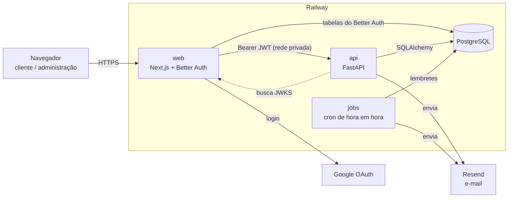
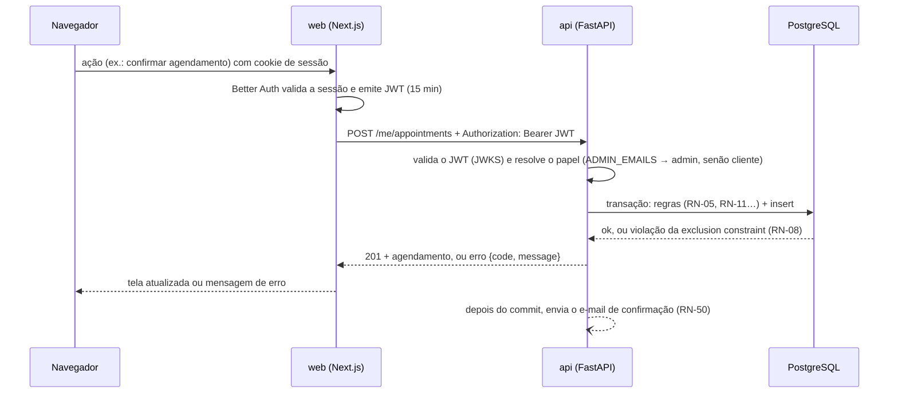

# Arquitetura

Como o sistema é organizado, onde cada coisa mora e como as peças conversam. **As justificativas das escolhas** estão nos ADRs em [decisoes/](decisoes/), e aqui só aparece o link para elas.

## Visão geral



- **web**: renderiza as telas e é o **BFF**. É o único serviço público ([0001](decisoes/0001-arquitetura-web-api.md)).
- **api**: concentra **todas** as regras de negócio (`RN-xx`) e as tabelas de domínio.
- **jobs**: a mesma imagem da API, rodando o comando de lembretes por cron ([0006](decisoes/0006-email-e-jobs.md)).
- **PostgreSQL**: um banco, com dois donos de schema. O Alembic cuida das tabelas de domínio e o Better Auth das tabelas de autenticação ([0002](decisoes/0002-banco-de-dados.md)).

## Fluxo de uma requisição autenticada



Detalhes da autenticação: [0003](decisoes/0003-autenticacao.md).

## API (`/api`)

O esqueleto da S2.02 está implementado em [esqueleto-api.md](specs/esqueleto-api.md): criação da app, settings, handlers de erro e healthcheck tipado. A fundação do banco da S2.05 está em [banco-api.md](specs/banco-api.md): engine SQLAlchemy 2 com Psycopg 3, sessão por requisição, Alembic e testes no Postgres. O contrato com o web está em [contrato-openapi.md](specs/contrato-openapi.md): `app/export_openapi.py` exporta o OpenAPI sem subir o servidor. A autenticação da S2.09 está em [autenticacao-api.md](specs/autenticacao-api.md): validação JWT, dependências de acesso e rotas de prova. O primeiro módulo de domínio é `shop` (S3.02), em [barbearia-horarios.md](specs/barbearia-horarios.md): barbearia e horário de funcionamento. O módulo `customers` (S3.06), em [perfil-cliente.md](specs/perfil-cliente.md), cuida do cliente e do vínculo com a conta Google; o cadastro de clientes pela administração (S5.02), em [cadastro-clientes.md](specs/cadastro-clientes.md), mora no mesmo módulo, no `admin_router`, e `create_customer` (`service.py`) é a função que outros módulos chamam para criar um cliente. O módulo `barbers` (S3.03), em [cadastro-barbeiros.md](specs/cadastro-barbeiros.md), cuida do cadastro de barbeiros. O módulo `catalog` (S3.04), em [cadastro-servicos.md](specs/cadastro-servicos.md), cuida dos serviços e da associação Barbeiro–Serviço; ele depende de `barbers`, e não o contrário. A vitrine (S3.05), em [vitrine.md](specs/vitrine.md), lê os serviços e os barbeiros ativos pelos routers públicos (`public_router`) desses dois módulos, separados dos routers `/admin`. O módulo `appointments` (S3.07), em [disponibilidade.md](specs/disponibilidade.md), tem o agendamento e a exclusion constraint da RN-08; `barbers` depende dele para a trava da RN-60. O módulo `availability` (S3.07) calcula os horários disponíveis numa função pura (`slots.py`) e carrega os dados em `service.py`, que também tem `ensure_slot_available` para a criação de agendamento. O módulo `booking` (S3.08), em [agendamento-cliente.md](specs/agendamento-cliente.md), tem as rotas `/me/appointments` do cliente; ele fica acima de `appointments`, `availability`, `catalog`, `barbers` e `customers`, porque `appointments` não pode importar `availability` (`availability` → `barbers` → `appointments` formaria um ciclo). O módulo `agenda` (S5.01), em [agenda-admin.md](specs/agenda-admin.md), tem as rotas `/admin/appointments` da agenda da administração; ele fica acima de `appointments`, `barbers`, `catalog`, `customers` e `shop`, porque `appointments` não pode importar `barbers` (`barbers` já depende de `appointments` pela RN-60). O módulo `time_blocks` (S5.04), em [bloqueios.md](specs/bloqueios.md), tem o bloqueio e as rotas `/admin/time-blocks`; ele fica acima de `barbers` e `appointments` (trava do barbeiro com `FOR UPDATE` e busca de agendamento ativo, RN-03) e reaproveita o período de `agenda`, e `availability` importa só o modelo dele para pôr os bloqueios entre os ocupados (RN-05, item 3). O módulo `admin_booking` (S5.05), em [agendamento-admin.md](specs/agendamento-admin.md), cria, cancela e remarca agendamentos pela administração e expõe os horários com a política dela (`ADMIN_POLICY`, RN-21); ele fica acima de `agenda`, `appointments`, `availability`, `catalog`, `barbers` e `customers`, nenhum deles o importa, e reaproveita a resposta da agenda e o `create_customer` (com `commit=False`, para o cliente novo e o agendamento irem no mesmo `commit`). Ele também depende de `notifications` (S5.09, #101): cada ação registra o e-mail ao cliente na transação (`notify`) e o envia depois do commit pela `Outbox`, como o `booking`. O módulo `notifications` (S5.03), em [notificacoes-email.md](specs/notificacoes-email.md), registra os e-mails ao cliente na transação da ação (`notify`) e os envia depois do commit pela `Outbox` (`RequestOutbox`, uma background task com a sessão da requisição), com o Resend ou, sem chave, com um remetente que só registra no log; `booking` e `admin_booking` dependem dele. O lembrete (S5.08) é `send_due_reminders` em `notifications/reminders.py`, chamado pelo comando `app/jobs/send_reminders.py`, que roda fora de requisição e pode ser executado à mão com `docker compose exec api uv run python -m app.jobs.send_reminders`. O módulo `payments` (S5.06), em [conclusao-atendimento.md](specs/conclusao-atendimento.md), tem `Payment`, a conclusão com pagamento, a falta e a correção do pagamento; ele fica acima de `agenda` (`payments.router` usa a resposta da agenda, e a agenda lê `payments.models` e `payments.schemas`, sem ciclo). O módulo `reports` (S5.07), em [relatorio-financeiro.md](specs/relatorio-financeiro.md), tem a rota `/admin/reports/financial`, só de leitura; ele fica acima de `payments`, `agenda` e `barbers` (reaproveita `period_bounds` e `get_barber`) e ninguém o importa, então não cria ciclo. `app/clock.py` guarda o fuso de São Paulo (RN-01) e a dependência `utc_now`, que as rotas usam para o relógio e os testes substituem. Os demais módulos entram nas issues seguintes. `app/health.py` verifica a conexão com `SELECT 1` e retorna 503 se indisponível. As pastas abaixo mostram a estrutura alvo.

### Estrutura de pastas

```
api/
├── pyproject.toml / uv.lock
├── Dockerfile
├── alembic.ini
├── alembic/                  # migrações (só tabelas de domínio)
├── app/
│   ├── main.py               # cria o FastAPI e registra os routers
│   ├── config.py             # settings (pydantic-settings, lê env)
│   ├── health.py             # router e schema de GET /health
│   ├── db.py                 # engine, sessão, base declarativa
│   ├── clock.py              # fuso America/Sao_Paulo (RN-01) e utc_now, o relógio das rotas
│   ├── errors.py             # erro de domínio → {code, message} (0008)
│   ├── ids.py                # Id: o id das rotas e dos corpos, de 1 a 2147483647 (o integer do Postgres)
│   ├── export_openapi.py     # python -m app.export_openapi: OpenAPI em JSON, sem servidor
│   ├── auth/                 # validação do JWT, dependências current_user / require_admin
│   ├── modules/              # um pacote por área do domínio
│   │   ├── shop/             # Barbearia + horário de funcionamento
│   │   ├── barbers/          # Barbeiro
│   │   ├── catalog/          # Serviço e Barbeiro–Serviço (o nome evita confusão com service.py)
│   │   ├── customers/        # Cliente, vínculo com a conta, current_customer (dependencies.py) e o cadastro da administração (admin_router)
│   │   ├── availability/     # horários disponíveis (RN-05): slots.py (puro), service.py e a rota pública; os ocupados incluem os bloqueios
│   │   ├── appointments/     # agendamento, exclusion constraint (RN-08) e ciclo de vida (RN-10 a RN-33)
│   │   ├── booking/          # rotas /me/appointments do cliente: criar (RN-10 a RN-13), listar, cancelar e remarcar (RN-14 a RN-16)
│   │   ├── agenda/           # rotas /admin/appointments: a agenda do período e o detalhe (RN-01, RN-02, RN-30, RN-70)
│   │   ├── admin_booking/    # agendamento manual, cancelar e remarcar pela administração e os horários dela (RN-20 a RN-22)
│   │   ├── time_blocks/      # bloqueio (TimeBlock) e as rotas /admin/time-blocks (RN-03)
│   │   ├── payments/         # conclusão, falta e correção do pagamento (S5.06, RN-40 a RN-44)
│   │   ├── reports/          # relatório financeiro /admin/reports/financial, só leitura (S5.07, RN-42, RN-43)
│   │   └── notifications/    # registro (notify), envio pós-commit (Outbox, send_notification), remetentes, templates e o lembrete (`reminders.py`, RN-50 a RN-54)
│   └── jobs/
│       └── send_reminders.py # python -m app.jobs.send_reminders (chama notifications.reminders)
└── tests/                    # espelha app/modules; usa o Postgres do compose
```

Cada módulo segue o mesmo formato:

| Arquivo | Responsabilidade |
|---|---|
| `router.py` | HTTP: rotas, parse e validação de formato (Pydantic), dependências de auth. **Sem regra de negócio** |
| `schemas.py` | Modelos Pydantic de entrada e saída. Geram o OpenAPI ([0008](decisoes/0008-contrato-openapi.md)) |
| `service.py` | **Regras de negócio** e transações. Cita as `RN-xx` em comentários e docstrings |
| `models.py` | Tabelas SQLAlchemy |
| `dependencies.py` | Opcional: dependências FastAPI que outros módulos reutilizam (ex.: `current_customer`, `OutboxDep`) |

### Onde cada tipo de regra mora

| Tipo | Onde | Exemplo |
|---|---|---|
| Formato e obrigatoriedade de campos | `schemas.py` (Pydantic) | Telefone obrigatório, preço ≥ 0 |
| Regra de negócio | `service.py` | Prazo de 2h para cancelar (RN-14), limite de 2 agendamentos (RN-11) |
| Cálculo puro | Função sem I/O em `availability/` | Grade e slots (RN-04, RN-05), testável sem banco |
| Invariante crítica | Constraint no banco | Sem sobreposição (RN-08) |
| Permissão | Dependência de auth no `router.py` | `require_admin` nas rotas `/admin`, `require_customer` no perfil (RN-70) |

### Grupos de rotas

Os prefixos deixam a permissão explícita (RN-70):

| Prefixo | Quem acessa | Conteúdo |
|---|---|---|
| `/public` | Qualquer um, sem token | Dados da barbearia, serviços e barbeiros ativos, horários disponíveis |
| `/me` | Cliente autenticado | Perfil, os próprios agendamentos (criar, remarcar, cancelar) |
| `/admin` | Administração | Agenda, agendamento manual, bloqueios, conclusão, falta, cadastros, relatório |
| `/health` | Railway | Healthcheck |

| Rota | Quem acessa | O que faz |
|---|---|---|
| `GET /me` | Qualquer identidade autenticada | `sub`, `email`, `name`, `role` e `has_phone`. Para o cliente, resolve o cadastro (cria ou vincula, RN-23); para a administração, `has_phone` é `false` e nenhum cliente é criado (RN-71) |
| `GET /me/profile` | Cliente (`require_customer`) | Nome, e-mail e telefone do próprio cadastro (RN-16) |
| `PATCH /me/profile` | Cliente (`require_customer`) | Altera nome e telefone; campo ausente ou `null` fica como está (RN-62) |
| `GET /admin/ping` | Administração (`require_admin`) | `{ "status": "ok" }`, rota de prova da S2.09 |
| `GET /public/shop` | Qualquer um | Dados da barbearia e horário de funcionamento ([barbearia-horarios.md](specs/barbearia-horarios.md)) |
| `PUT /admin/shop`, `PUT /admin/business-hours` | Administração (`require_admin`) | Alteram os dados da barbearia e o horário de funcionamento. Um horário que deixe agendamento futuro fora do expediente, nos dias que mudam, responde `409 BUSINESS_HOURS_CONFLICT` com os agendamentos afetados (`appointments`, até 20, e `total`) (RN-02, #124) |
| `GET /admin/barbers`, `POST /admin/barbers` | Administração (`require_admin`) | Lista todos os barbeiros (ativos primeiro) e cria um barbeiro ativo ([cadastro-barbeiros.md](specs/cadastro-barbeiros.md)) |
| `GET /admin/barbers/{id}`, `PATCH /admin/barbers/{id}` | Administração (`require_admin`) | Lê e altera um barbeiro; o `PATCH` muda só os campos enviados, inclusive `active` para inativar ou reativar. Inativar com agendamento ativo que ainda não terminou responde `409 BARBER_HAS_FUTURE_APPOINTMENTS` (RN-60) |
| `GET /admin/services`, `POST /admin/services` | Administração (`require_admin`) | Lista todos os serviços (ativos primeiro), com os barbeiros que os realizam, e cria um serviço ativo ([cadastro-servicos.md](specs/cadastro-servicos.md)) |
| `GET /admin/services/{id}`, `PATCH /admin/services/{id}` | Administração (`require_admin`) | Lê e altera um serviço; o `PATCH` muda só os campos enviados, `barber_ids` substitui a lista e `active` inativa ou reativa. Não há exclusão (RN-61) |
| `GET /admin/customers?q=&page=&page_size=` | Administração (`require_admin`) | Busca clientes por parte do nome, do e-mail ou do telefone, por nome, paginada: `{ items, total, page, page_size }` ([cadastro-clientes.md](specs/cadastro-clientes.md)) |
| `POST /admin/customers` | Administração (`require_admin`) | Cria um cliente sem conta, com nome e telefone obrigatórios e e-mail opcional (RN-20, RN-62). E-mail repetido responde `409 CUSTOMER_EMAIL_TAKEN` |
| `GET /admin/customers/{id}`, `PATCH /admin/customers/{id}` | Administração (`require_admin`) | Lê e altera um cliente; informa `has_account`. Trocar o e-mail de quem tem conta Google responde `409 CUSTOMER_EMAIL_LOCKED` (RN-23). Não há exclusão (RN-72, fora desta entrega) |
| `GET /public/services` | Qualquer um | Serviços ativos com pelo menos um barbeiro ativo, por nome, cada um com os barbeiros ativos que o realizam (RN-60, RN-61, RN-05 item 5) ([vitrine.md](specs/vitrine.md)) |
| `GET /public/barbers` | Qualquer um | Barbeiros ativos, por nome, com foto e apresentação (RN-60) |
| `GET /public/availability?barber_id=&service_id=&date=` | Qualquer um | Horários de início disponíveis do barbeiro para o serviço na data local, com o fim de cada atendimento, no fuso de São Paulo (RN-05 a RN-07). Barbeiro ou serviço inexistente responde 404 ([disponibilidade.md](specs/disponibilidade.md)) |
| `GET /public/availability/days?barber_id=&service_id=` | Qualquer um | Datas da janela do cliente (hoje até hoje + 30 dias, RN-07) com pelo menos um horário disponível, com a mesma conta da rota acima ([agendamento-cliente.md](specs/agendamento-cliente.md)) |
| `POST /me/appointments` | Cliente (`current_customer`) | Cria o agendamento `SCHEDULED`/`ONLINE` com o preço e a duração do serviço (RN-12, RN-13). Exige telefone (`409 PHONE_REQUIRED`, RN-10), no máximo 2 ativos no futuro (`409 APPOINTMENT_LIMIT_REACHED`, RN-11) e um horário disponível (`409 SLOT_UNAVAILABLE`, RN-05 a RN-08) |
| `GET /me/appointments` | Cliente (`current_customer`) | Os agendamentos do próprio cliente em `upcoming` (`SCHEDULED` que não terminaram, do mais próximo) e `history` (o resto, do mais recente), cada um com `can_cancel`, `can_reschedule` e `change_deadline` calculados pela API (RN-14, RN-16) ([meus-agendamentos.md](specs/meus-agendamentos.md)) |
| `GET /me/appointments/{id}` | Cliente (`current_customer`) | Um agendamento do próprio cliente; o de outro cliente responde `404 APPOINTMENT_NOT_FOUND`, igual ao inexistente (RN-16) |
| `POST /me/appointments/{id}/cancel` | Cliente (`current_customer`) | Cancela até 2 horas antes (`409 CHANGE_DEADLINE_PASSED`, RN-14), só se ativo (`409 APPOINTMENT_NOT_ACTIVE`, RN-31), registrando `canceled_at` e `canceled_by = CUSTOMER` (RN-33) |
| `POST /me/appointments/{id}/reschedule` | Cliente (`current_customer`) | Muda `starts_at` e, opcionalmente, `barber_id`, nunca o serviço (RN-15), com o mesmo prazo e status do cancelamento. O novo horário segue RN-05 a RN-08 com a duração congelada (RN-13); o mesmo horário responde `409 SAME_SLOT` |
| `GET /me/appointments/{id}/availability/days?barber_id=`, `GET /me/appointments/{id}/availability?barber_id=&date=` | Cliente (`current_customer`) | Dias e horários para remarcar, nos formatos das rotas públicas: ignoram o próprio agendamento, usam a duração congelada e não oferecem o horário atual |
| `GET /admin/appointments?start=&end=&barber_id=` | Administração (`require_admin`) | A agenda do período: datas locais de São Paulo, inclusivas, até 7 dias (`422 INVALID_PERIOD`). Devolve `days` (cada data com o horário de funcionamento, RN-02), `barbers` (os ativos e os inativos com agendamento no período; com `barber_id`, só ele, ou `404 BARBER_NOT_FOUND`) e `appointments`: os que começam no período em São Paulo, em todos os status, com cliente (nome, telefone, e-mail), barbeiro, serviço, início e fim em `-03:00`, preço, status e origem (RN-01, RN-30) ([agenda-admin.md](specs/agenda-admin.md)) |
| `GET /admin/appointments/{id}` | Administração (`require_admin`) | Um agendamento de qualquer cliente, no formato do item da agenda; inexistente responde `404 APPOINTMENT_NOT_FOUND` |
| `POST /admin/appointments/{id}/complete` | Administração (`require_admin`) | Conclui com `method` (`CASH`/`PIX`/`DEBIT`/`CREDIT`, obrigatório) e `amount` (string decimal, opcional; padrão = preço congelado; zero = cortesia). Só de `SCHEDULED` e com o início alcançado: `409 APPOINTMENT_NOT_STARTED` ou `409 APPOINTMENT_NOT_ACTIVE`; valor negativo `422 INVALID_PAYMENT_AMOUNT`. Registra `closed_at`/`closed_by` (RN-31, RN-33, RN-40) ([conclusao-atendimento.md](specs/conclusao-atendimento.md)) |
| `POST /admin/appointments/{id}/no-show` | Administração (`require_admin`) | Marca a falta, com as mesmas condições da conclusão (RN-31) |
| `PATCH /admin/appointments/{id}/payment` | Administração (`require_admin`) | Corrige `amount` e/ou `method` de um atendimento concluído, sem mudar o status (RN-41). Não concluído: `409 APPOINTMENT_NOT_COMPLETED`; corpo vazio: `422 EMPTY_PAYMENT_UPDATE`. As três rotas devolvem o agendamento com `payment`, `closed_at` e `closed_by` |
| `GET /admin/time-blocks?start=&end=&barber_id=` | Administração (`require_admin`) | Os bloqueios que cruzam o período (mesmas regras de período da agenda), por início, com barbeiro, início e fim em `-03:00`, `all_day` e motivo ([bloqueios.md](specs/bloqueios.md)) |
| `POST /admin/time-blocks` | Administração (`require_admin`) | Cria um bloqueio num dia local (`date` + `start_time`/`end_time`, ou `all_day` para a folga da meia-noite à meia-noite, RN-03). Agendamento ativo no intervalo responde `409 TIME_BLOCK_CONFLICT`; outro bloqueio cruzado, `409 TIME_BLOCK_OVERLAP`; horários inválidos, `422 INVALID_TIME_BLOCK` |
| `GET /admin/time-blocks/{id}`, `DELETE /admin/time-blocks/{id}` | Administração (`require_admin`) | Lê e remove um bloqueio (`204`); os horários voltam na hora. Inexistente responde `404 TIME_BLOCK_NOT_FOUND` |
| `GET /admin/availability?barber_id=&service_id=&date=`, `GET /admin/availability/days?barber_id=&service_id=` | Administração (`require_admin`) | Horários e dias (hoje até hoje + 30) com a política da administração: RN-05, itens 1 a 5, sem antecedência nem janela (RN-21). O encaixe é um horário da grade de hoje, mesmo que já tenha começado ([agendamento-admin.md](specs/agendamento-admin.md)) |
| `POST /admin/appointments` | Administração (`require_admin`) | Agenda para `customer_id` ou um cliente novo (`customer`: nome, telefone, e-mail opcional), gravados juntos (RN-20). Nasce `SCHEDULED`/`ADMIN` com preço e duração congelados (RN-13), sem limite por cliente (RN-21). Horário indisponível ou disputado responde `409 SLOT_UNAVAILABLE` (RN-08). A resposta traz `notified` (e-mail ao cliente registrado, RN-50) |
| `POST /admin/appointments/{id}/cancel`, `POST /admin/appointments/{id}/reschedule` | Administração (`require_admin`) | Cancela (`canceled_by = ADMIN`, RN-33) ou remarca (`starts_at`, `barber_id` opcional) qualquer agendamento `SCHEDULED`, sem prazo (RN-22). Status final responde `409 APPOINTMENT_NOT_ACTIVE`. A resposta traz `notified` (e-mail ao cliente registrado, RN-52; não há e-mail para cliente sem e-mail nem para horário que já começou) |
| `GET /admin/appointments/{id}/availability/days?barber_id=`, `GET /admin/appointments/{id}/availability?barber_id=&date=` | Administração (`require_admin`) | Dias e horários para remarcar, com a política da administração; ignoram o próprio agendamento e não oferecem o horário atual |
| `GET /admin/reports/financial?start=&end=&barber_id=` | Administração (`require_admin`) | O relatório financeiro (RN-43): período obrigatório em datas locais de São Paulo, inclusivas, até 366 dias (`422 INVALID_PERIOD`), e filtro opcional por barbeiro (`404 BARBER_NOT_FOUND`). Conta o atendimento que **começa** no período. Devolve `total` e `completed_count`, `no_show_count`, `by_barber` (RN-42; os ativos e os inativos com atendimento), `by_method` (as quatro formas, mesmo com zero) e `completed` (a lista). Dinheiro em string decimal ([relatorio-financeiro.md](specs/relatorio-financeiro.md)) |

As rotas `/me` do cliente recebem o `Customer` pela dependência `current_customer` (`app/modules/customers/dependencies.py`), que sempre parte do `sub` do token, nunca de um id na requisição. A tabela `customers` guarda o `sub` em `auth_user_id`, sem FK para a tabela `user` do Better Auth ([perfil-cliente.md](specs/perfil-cliente.md)).

`app/auth/` valida apenas JWT EdDSA com chave Ed25519 do `AUTH_JWKS_URL`, exigindo identidade, emissor, audiência e expiração. As chaves são cacheadas por até 5 minutos e um `kid` desconhecido provoca nova busca, com timeout de 5 segundos. `current_user` responde 401 com `WWW-Authenticate: Bearer` quando não há credencial válida; `require_admin` responde 403 para clientes e `require_customer` responde 403 para a administração, sempre no contrato `{code, message}`. O papel vem exclusivamente de `ADMIN_EMAILS`: a lista separada por vírgulas ignora espaços nas extremidades e diferenças de caixa. Um papel enviado no token não concede permissão. Falhas de JWKS negam o acesso.

## Web (`/web`)

### Estrutura de pastas

```
web/
├── package.json / pnpm-lock.yaml
├── Dockerfile
├── scripts/gen-api.mjs         # `pnpm gen:api`: OpenAPI da API → src/lib/api/schema.d.ts
└── src/
    ├── app/
    │   ├── (publico)/              # vitrine: / (em (inicio)/), /entrar, /servicos, /barbeiros, /privacidade
    │   ├── (cliente)/              # exige login: /agendar, /meus-agendamentos, /perfil
    │   ├── admin/                  # exige admin; layout.tsx checa o acesso e mostra a navegação: /admin, /admin/agenda (dia e semana, ?data=&visao=&barbeiro=), /admin/agenda/novo (agendamento manual), /admin/agenda/[id] (com /cancelar e /remarcar), /admin/clientes(/novo, /[id]), /admin/relatorio (?inicio=&fim=&barbeiro=), /admin/cadastros(/barbearia, /barbeiros, /servicos)
    │   ├── design-system/          # vitrine dos componentes, fora do menu e dos buscadores
    │   └── api/auth/[...all]/      # handler do Better Auth
    ├── lib/
    │   ├── auth.ts                 # configuração do Better Auth (Google + plugin JWT)
    │   ├── auth-jwt.ts             # o JWT para a API (EdDSA, 15 min, sub/email/name)
    │   ├── auth-actions.ts         # Server Actions de entrar e sair
    │   ├── session.ts              # sessão atual para Server Components
    │   └── api/
    │       ├── token.ts            # getApiToken(): JWT da sessão atual
    │       ├── client.ts           # openapi-fetch com o Bearer JWT; createPublicApiClient() sem token
    │       ├── public.ts           # leituras das rotas /public para a vitrine e o rodapé, com cache por tag
    │       ├── public-tags.ts      # tags desse cache, invalidadas pelas Server Actions da administração
    │       └── schema.d.ts         # GERADO por `pnpm gen:api`, não editar
    └── components/
        ├── api-status.tsx          # status de GET /health na página inicial, só em desenvolvimento
        ├── site-header.tsx / site-nav.tsx / site-footer.tsx  # cabeçalho com navegação e "Agendar"; rodapé com dados da API
        ├── header-frame.tsx        # modo do cabeçalho: transparente sobre o hero da página inicial, faixa escura nas outras; nunca fixo
        ├── header-account.tsx      # login ou "Olá, <nome>" do cabeçalho: a única parte que lê a sessão, num Suspense
        ├── vitrine/                # seções da vitrine: listas de serviços e barbeiros, horário e contato e topo
        ├── booking/                # agendamento e remarcação: DayPicker, TimePicker, BarberStep/ServiceStep, a moldura das etapas e o ContactNotice (contato quando o prazo passou)
        └── ui/                     # componentes do design system (docs/design/design-system.md)
```

### Regras do front

- O web chama a API só pelo `createApiClient()` de `lib/api/client.ts`, tipado pelo `schema.d.ts` gerado ([contrato-openapi.md](specs/contrato-openapi.md)). Mudou um schema da API, rode `pnpm gen:api` no mesmo PR; o job `contract` do CI confere.
- O cliente é exclusivo do servidor e obtém `getApiToken()` por requisição, enviando Bearer quando existe sessão. As rotas `/public` da vitrine usam `createPublicApiClient()`, que nunca envia token nem consulta a sessão; `lib/api/public.ts` junta essas leituras com o `cache` do React, para o rodapé e a página dividirem a mesma chamada. O layout de `/admin` consulta `/admin/ping` sem cache antes de qualquer página da área: 200 mostra a navegação e a página, 401 sem sessão leva ao login com destino de volta, 403 leva à página inicial. Falhas de infraestrutura ou JWT rejeitado apesar de sessão existente mostram um aviso de indisponibilidade, evitando um ciclo de redirecionamentos. A lista de administradores fica somente na API.
- **Cache da vitrine (S4.02).** As leituras de `/public/shop`, `/public/services` e `/public/barbers` ficam no cache de dados do Next (`unstable_cache`), no servidor do web, com uma tag cada (`lib/api/public-tags.ts`) e validade de 5 minutos como rede de segurança. As Server Actions da administração que mudam barbeiros, serviços e dados da barbearia chamam `updateTag` com as tags afetadas depois do sucesso na API, para a RN-60 e a RN-61 valerem na próxima visita. Uma falha da API não entra no cache. A disponibilidade e tudo o que depende do usuário continuam sem cache. Como a API não existe no `next build`, as leituras chamam `connection()` e as páginas renderizam na requisição, a partir do cache, sem pré-renderização no build. O cache é local ao processo do web: com mais de uma instância, cada uma teria o seu, e a invalidação precisaria de um `cacheHandler` compartilhado. Se o projeto adotar `cacheComponents`, `unstable_cache` dá lugar a `'use cache'` com `cacheTag`. Detalhes na [spec da vitrine](specs/vitrine.md#carregamento-e-cache).
- **Sessão no layout.** O layout raiz não lê a sessão. No cabeçalho, só `HeaderAccount` a lê, dentro de um `Suspense` cujo fallback é o link "Entrar" (`AccountPlaceholder`), do mesmo tamanho, para o login funcionar sem JavaScript: o servidor envia a página sem esperar a sessão, que chega na mesma resposta. Sem `cacheComponents`, a leitura ainda torna a rota dinâmica; o `Suspense` tira a sessão do caminho crítico, não da requisição. `getCurrentSession()` usa o `cache` do React, então o cabeçalho e a página dividem a mesma leitura.
- **Server Components** buscam dados pela API. **Server Actions** fazem as mutações chamando a API. O navegador nunca chama a API diretamente.
- **Ids na entrada usam `Id`** (`app/ids.py`, #147): todo id de entidade no caminho, na busca ou no corpo (inclusive listas, como `barber_ids`) vai de 1 a 2147483647. Fora disso, a API responde `422 VALIDATION_ERROR` antes de chegar ao banco, que derrubaria a requisição com `500`.
- **Nenhuma regra de negócio no front.** Validação no front é só para a experiência do usuário; quem decide é a API, e o front mostra o `message` do erro que a API devolve.
- **O `422 VALIDATION_ERROR` diz o que corrigir** (#148). `validation_message` (`app/errors.py`) monta o `message` a partir do primeiro erro: o texto de um `InvalidInput` (o `ValueError` dos validadores com mensagem para a pessoa, como "Informe o telefone com DDD.") vai como está; nos outros erros, o campo do fim do `loc` vira "Informe o nome.", "O motivo pode ter no máximo 120 caracteres." ou "Confira o preço.", pelos rótulos de `FIELD_LABELS`. Campo fora dessa lista, campo que o formulário não envia ou erro do corpo inteiro ficam com "Confira os dados informados e tente novamente.".
- O acesso às rotas `(cliente)` e `admin` é checado no servidor (middleware, layout ou na própria página). `/perfil` confere a sessão antes de chamar a API e leva ao login com `voltar=/perfil`; a administração (403) vai para `/admin`. Em `/agendar`, as etapas de escolha só leem rotas `/public` e não exigem login; a confirmação (com `hora` na URL) confere a sessão e leva ao login com `voltar=` a URL completa da confirmação. `/meus-agendamentos` e as telas de cancelar e remarcar conferem a sessão antes de chamar a API e levam ao login com `voltar=` a própria URL; a administração (403) vai para `/admin`. As páginas de `/admin` passam pelo layout dela, que sem sessão leva ao login com `voltar=` a página e a busca pedidas (#154): como layouts não recebem a URL, o `web/src/proxy.ts` (o antigo middleware do Next), que só roda em `/admin/:path*`, grava o caminho no cabeçalho `x-requested-path`; o layout o valida com `safeRedirectPath` e, fora de `/admin`, volta ao início da administração. Mesmo assim, a API valida tudo de novo.
- Mobile first: toda tela precisa funcionar bem em 360px de largura.

## Ambientes

| Ambiente | Como sobe | Banco |
|---|---|---|
| Desenvolvimento | `docker compose up` ([0004](decisoes/0004-docker.md)) | Postgres do compose |
| Demonstração | `scripts/demo.sh up` no notebook do Vitor: `docker-compose.demo.yml`, com as imagens de produção e um link público por túnel ([0010](decisoes/0010-demonstracao-local-com-tunel.md), [spec](specs/demonstracao-local.md)) | Postgres próprio (`augusto_demo`), com dados fictícios |
| Produção | Push na `main` → deploy na Railway ([0005](decisoes/0005-hospedagem.md)), montado depois do aceite, no plano pago pela barbearia | Postgres da Railway |

Não há ambiente de homologação no MVP. Até o aceite dos proprietários, o sistema só roda localmente.

### Serviços na Railway

| Serviço | Imagem (Root Directory) | Comando | Antes do deploy | Watch Paths | Público? |
|---|---|---|---|---|---|
| `web` | `web/Dockerfile` (`/web`) | `node server.js` (Next standalone), porta 3000 | — | `/web/**` | Sim (domínio gerado, porta 3000) |
| `api` | `api/Dockerfile` (`/api`) | `uvicorn app.main:app`, porta 8000, healthcheck `/health` | `alembic upgrade head` | `/api/**` | Não (rede privada) |
| `jobs` | `api/Dockerfile` (`/api`) | `python -m app.jobs.send_reminders`, cron `0 * * * *` (UTC), sem reinício | — | `/api/**` | Não |
| `Postgres` | Gerenciado | — | — | — | Não |

A configuração fica no painel da Railway, porque o arquivo de configuração no repositório foi descontinuado por ela e o substituto ainda não cobre cron, Dockerfile e *watch paths*. O passo a passo completo, com os valores de cada campo e de cada variável, está em [specs/deploy-railway.md](specs/deploy-railway.md). As tabelas do Better Auth são criadas uma vez por `pnpm auth:migrate`, rodado da máquina contra o banco da Railway.

## Variáveis de ambiente

Só os **nomes**. Os valores ficam no `.env` local (não versionado) e nas variáveis da Railway. O `.env.example` da raiz lista todas e alimenta o `docker compose`, que entrega a cada serviço só as variáveis dele. `api/.env.example` cobre a configuração opcional para rodar a API fora do compose.

| Variável | Serviço | Para quê |
|---|---|---|
| `POSTGRES_USER` / `POSTGRES_PASSWORD` / `POSTGRES_DB` | db | Só no desenvolvimento: credenciais do Postgres do compose |
| `APP_NAME` | api | Opcional: título do OpenAPI; padrão "Augusto Barbearia API" |
| `DATABASE_URL` | api, jobs, web | Conexão com o PostgreSQL; obrigatória na API. Testes usam o mesmo servidor com o nome do banco acrescido de `_test` |
| `ADMIN_EMAILS` | api | E-mails da administração separados por vírgula, ignorando espaços nas extremidades e diferenças de caixa (RN-71); vazia não autoriza nenhum administrador |
| `AUTH_JWKS_URL` | api, jobs | Endpoint JWKS do Better Auth |
| `AUTH_ISSUER` / `AUTH_AUDIENCE` | web, api | `iss` e `aud` do JWT: o web emite com eles e a API confere |
| `RESEND_API_KEY` | api, jobs | Chave do Resend para enviar e-mail. Vazia (desenvolvimento e testes): os e-mails vão para o log da API |
| `EMAIL_FROM` | api, jobs | Remetente dos e-mails (ex.: `Augusto Barbearia <agenda@dominio>`); obrigatória quando há `RESEND_API_KEY` |
| `WEB_BASE_URL` | api, jobs | Base dos links nos e-mails (ex.: "Meus agendamentos"); vazia ou ausente, `http://localhost:3000` |
| `BETTER_AUTH_SECRET` | web | Assinatura da sessão |
| `BETTER_AUTH_URL` | web | URL pública do site, com protocolo (`https://...`); também é a base absoluta do `og:image` |
| `GOOGLE_CLIENT_ID` / `GOOGLE_CLIENT_SECRET` | web | Login com Google |
| `API_INTERNAL_URL` | web | Endereço da API na rede privada |
| `PORT` | web, api | Só na Railway: a porta em que o serviço escuta (`3000` no web, `8000` na API), para o healthcheck e o domínio acertarem a porta |
| `DEMO_URL` | web, api | Só na demonstração (`.env.demo`): o link do túnel, gravado pelo `scripts/demo.sh`. Vira `BETTER_AUTH_URL`, `AUTH_ISSUER`, `AUTH_AUDIENCE` e `WEB_BASE_URL` |

### Sessões, migrações e testes

`app/db.py` mantém o engine com `pool_pre_ping` e timeout de conexão de 5 segundos. Cada requisição recebe uma `Session`, fechada ao final; os services decidem o commit e alterações pendentes são desfeitas no fechamento. O Alembic lê `DATABASE_URL` e ignora as cinco tabelas do Better Auth. Novos modelos devem ser importados no `alembic/env.py` para alimentar `Base.metadata`.

As fixtures criam o banco separado `<banco>_test`, aplicam migrações uma vez e usam transação externa com savepoints por teste, preservando o isolamento mesmo com commits dos services. `client` substitui a dependência de sessão por essa sessão isolada.
