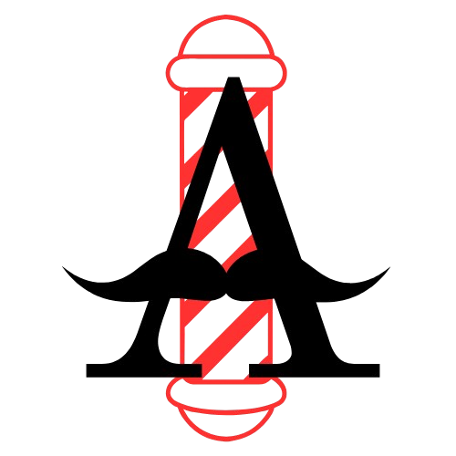

# Identidade visual

> Este documento cuida da **marca**: logo, cores, fontes, tom, linguagem e movimento. Os componentes e os padrões de tela estão no [design system](design-system.md).

> **Decisão de 2026-10-31 (Sprint 4):** a vitrine se aproxima do [Beard X](referencia-beard-x.md) medido ao vivo. Os títulos passam a ser **Barlow 900 em caixa alta** (no lugar da Playfair Display), o acento continua o **vermelho `brand`** (não o champanhe do Beard X) e o **fundo fixo do hero vale só no desktop**. A fonte, a escala dos títulos, o corpo, o respiro e o botão entraram na S4.03 (#76). O cabeçalho e o hero entraram na S4.04 (#77), e a entrada ao rolar, na S4.05 (#78). Serviços, equipe e ornamentos vieram na S4.06 (#79), e as páginas internas e as telas do cliente fecharam a sprint na S4.07 (#80).

> **Status:** proposta para o MVP. As cores e o logo vieram do projeto acadêmico, que usou o material entregue pela barbearia ("cores baseadas no cartão"). O logo em vetor e a confirmação da paleta são as pendências P1 e P2 em [registro.md](../cliente/registro.md). O protótipo aprovado no Figma ainda não está acessível (P6).

## Logo



- Arquivo: [`assets/logo.png`](assets/logo.png), PNG 500×500 com fundo transparente, tirado do repositório antigo.
- Elementos: um "A" serifado com bigode, sobre um poste de barbeiro listrado em vermelho e branco.
- **Uso:** sempre sobre fundo claro. Os traços pretos somem em fundo escuro. Até existir uma versão negativa, nas áreas escuras o logo vai dentro de um círculo ou cartão claro.
- **Pendente (P1):** a versão em vetor (SVG). Quando chegar, substitui o PNG e ganha uma versão negativa.

## Cores

A paleta tem preto, branco e vermelho. O vermelho vivo do logo (`#FF3131`) **não** é usado em texto ou botão, porque tem contraste baixo. A interface usa um vermelho mais fechado, que passa no WCAG AA.

| Token | Hex | Uso | Contraste |
|---|---|---|---|
| `brand` | `#C41E3A` | Botões primários, links, destaques | 5,8:1 com branco ✅ |
| `brand-strong` | `#8B1528` | Hover e pressionado do primário | 9,4:1 com branco ✅ |
| `brand-on-dark` | `#E63946` | Destaque sobre fundo escuro | 4,5:1 sobre `#111111` ✅ |
| `logo-red` | `#FF3131` | **Só** no logo e em ilustrações | — |
| `ink` | `#111111` | Texto principal; fundos escuros (hero, rodapé) | 17,7:1 sobre `paper` ✅ |
| `ink-muted` | `#5C5C5C` | Texto secundário | 6,3:1 sobre `paper` ✅ |
| `paper` | `#FAF7F2` | Fundo das páginas (off-white quente) | — |
| `surface` | `#FFFFFF` | Cartões, modais, campos | — |
| `line` | `#E5E1DA` | Bordas e divisores | — |
| `on-ink-muted` | `#BDB8B0` | Texto secundário sobre fundo escuro (`ink`) | 9,6:1 sobre `#111111` ✅ |
| `line-on-ink` | `#333333` | Divisores sobre fundo escuro | — |
| `success` | `#1E7F4F` | Concluído, confirmações | 5,0:1 com branco ✅ |
| `warning` | `#9A5B00` | Avisos (ex.: "faltam menos de 2h") | 5,4:1 com branco ✅ |
| `danger` | `#B42318` | Cancelado, erro, falta | 6,6:1 com branco ✅ |

**Status do agendamento** (badges): `AGENDADO` em `ink` sobre `line`, `CONCLUIDO` em `success`, `CANCELADO` em `ink-muted` riscado, `FALTOU` em `danger`.

## Tipografia

| Papel | Fonte | Uso |
|---|---|---|
| Títulos da vitrine | **Barlow** (Google Fonts), 900 em **caixa alta** (600 para títulos menores) | Títulos do hero e das seções, nomes em cards e números. Substitui a Playfair Display, que ficava com 700 e sem caixa alta |
| Texto e interface | **Inter** (Google Fonts), 400/500/600 | Todo o resto: formulários, tabelas, botões de apoio, administração |

- O corpo da vitrine (`text-body`) tem **18px com entrelinha de 1,667** a partir do `md` e 16px com entrelinha de 1,5 no celular. Na administração, o texto segue a escala padrão do Tailwind, com base de 16px.
- Os títulos da vitrine usam uma escala própria, que cresce com a tela (`clamp`) de 360 a 1280px. Os extremos e as entrelinhas vêm do CSS do Beard X, que salta de tamanho nos breakpoints dele (479, 767 e 991px); nós crescemos de forma contínua entre os mesmos extremos:

| Token | Em uso: celular → desktop | Entrelinha | Beard X (do celular ao desktop) | Uso |
|---|---|---|---|---|
| `text-display-1` | 32 → 92px (≈ 59px em 768px) | 1,065 | 32 / 40 / 64 / 92px | Título do hero e das páginas internas |
| `text-display-2` | 28 → 56px (≈ 40px em 768px) | 1,196 | 28 / 34 / 56px | Título de seção |
| `text-display-3` | 24 → 38px (≈ 30px em 768px) | 1,368 | 24 / 26 / 32 / 38px | Nomes nos cards da vitrine e preço do serviço; título das telas do cliente |
| `text-display-4` | 20 → 24px | 1,583 | 20 / 22 / 24px | Títulos pequenos de bloco, estado vazio e cards da área do cliente |

- Os títulos são sempre em **caixa alta** (`uppercase`), em Barlow 900 (`font-black`). Barlow 600 (`font-semibold`) fica para números menores, como o dia no `DayPicker`. Em 360px, confira a quebra de linha: palavra longa não pode estourar a tela.
- Botões em Barlow 900 em caixa alta, com o espaçamento normal da fonte. Rótulos e textos pequenos em destaque usam Inter 600 em caixa alta com espaçamento de 0,08em.
- Na administração, os títulos continuam em Inter: lá a prioridade é densidade e leitura rápida.

## Tom

- **Visual:** clássico e sóbrio, com cara de barbearia tradicional e sem exagero. A vitrine tem mais respiro e fotos; a administração é limpa e direta.
- **Texto:** próximo e simples, tratando o cliente por "você". Frases curtas. Nada de jargão técnico em mensagens de erro: a mensagem diz o que aconteceu e o que fazer.
  - ✅ "Esse horário acabou de ser reservado. Escolha outro."
  - ❌ "Erro 409: conflito de agendamento."

## Linguagem visual

A estrutura e o ritmo vêm da referência [Beard X](referencia-beard-x.md), medida ao vivo, adaptados às cores e às fontes acima. O acento é o vermelho `brand`, e não o champanhe do Beard X. Só reproduzimos estrutura, proporções e padrões de interação; textos, imagens, ícones e código do template ficam de fora.

- **Formas quadradas:** botões, cards e campos não têm arredondamento. A exceção é o círculo claro que segura o logo em fundo escuro.
- **Faixas escuras e claras:** o hero e o rodapé ficam em `ink`; as seções, em `paper`, com cards em `surface`. Nas páginas internas (`/servicos` e `/barbeiros`), a faixa escura do título continua numa faixa parcial que o card de serviços e as fotos da equipe atravessam, como no Beard X (S4.07, #80). As telas do cliente e da administração não têm essa faixa: o conteúdo claro começa logo abaixo do cabeçalho escuro.
- **Ornamento:** um bigode entre duas linhas, em `brand` (`brand-on-dark` sobre o escuro), fica 24px acima dos títulos de seção, no lugar de um texto pequeno. Ornamentos SVG maiores flutuam nas bordas das seções da página inicial, atrás do conteúdo (S4.06, #79): navalha, tesoura e pente, só em traço, em `ink` a 10% e a partir de 1024px. São desenhos próprios, sem nada do template.
- **Hero:** ocupa a tela inteira (`min-h-svh`), com overlay preto de 70%. No desktop, a foto fica fixa enquanto a página rola; no celular, ela rola junto (S4.04, #77). A foto fixa é uma camada `fixed` recortada pelo `clip-path` do hero, e não `background-attachment: fixed`, que o Safari ignora.
- **Elevação mínima:** uma única sombra, `shadow-card` (`0 2px 12px` a 8%), nos cards claros.
- **Botões:** primário em `brand` com texto branco, contorno em `ink` e contorno claro sobre o escuro. Caixa alta e anel de foco visível. A altura é de **84px a partir do `md`** e 60px abaixo dele, com largura total no celular; o tamanho `sm` (44px) fica para a administração, o cabeçalho e os cards.
- **Cabeçalho** (S4.04, #77): sempre escuro, com o logo no círculo claro, o nome em Barlow 900 em caixa alta e 80px de altura.
  - Na página inicial, fica transparente sobre o hero. Quando a página rola, vira uma faixa `ink` fixa (a cor troca em 300ms `ease`), para o "Agendar" continuar à mão. Ele escurece logo no começo da rolagem, e não só depois do hero: transparente e fixo, ele cobriria o título e os botões do hero que passam por baixo dele.
  - Sem JS, o cabeçalho da página inicial fica no topo do hero e rola com a página, como no Beard X. Ele nunca fica transparente sobre fundo claro.
  - Nas outras páginas, é uma faixa `ink` presa no topo (`sticky`), contínua com a faixa escura do `PageHero`. As telas do cliente e da administração usam a mesma faixa: ela combina com o rodapé escuro e não disputa com o conteúdo claro.
- **Respiro:** as seções da vitrine (`py-section`) têm 88px de padding vertical no celular, 100px a partir do `sm`, 160px a partir do `md` e 240px a partir do `lg`, com conteúdo em até 1340px (`max-w-site`). O cabeçalho e o rodapé seguem o mesmo container desde a S4.04 (#77); a administração continua com 1280px.

## Movimento

Hoje o código faz o que está em "Em uso". A coluna "Alvo" é a decisão medida no Beard X. O hover de botão (#76), o menu do celular (#77), a entrada ao rolar (#78), o zoom de foto (#79) e o hover de links, chips e campos (#80) já estão alinhados.

| | Em uso | Alvo (Beard X) |
|---|---|---|
| Hover de botão | Troca de cor e sobe 3px, 300ms `ease` (`ease-standard`) | Troca de cor e sobe 3px, 300ms `ease` |
| Hover de links, chips, campos e cards | Troca de cor em 300ms `ease` (`ease-standard`), na vitrine, nas telas do cliente e na administração (S4.07) | 300ms `ease` em todas as transições |
| Cascata das páginas internas | Ornamento, título e texto do `PageHero` em 0, 200 e 400ms, como o hero da página inicial (S4.07) | Degraus de 200ms |
| Zoom de foto em card | 1,1, dentro da moldura com `overflow: hidden`, 300ms `ease` (S4.06) | 1,1, dentro de uma moldura com `overflow: hidden` |
| Entrada ao rolar | Três presets (`rise`, `fade`, `zoom`), 500ms `ease`, atraso padrão de 200ms, cascata de 200ms nas grades | Igual |
| Menu do celular | Painel escuro que desce em 400ms `ease` (S4.04) | Igual |

- **Presets de entrada** (componente `RevealObserver`, uma única vez por elemento). O preset é o valor de `data-reveal`:
  - `data-reveal="rise"`: sobe **10% da altura do elemento** (`translateY(10%)`) e aparece. Também vale para `data-reveal` sem valor;
  - `data-reveal="fade"`: só aparece;
  - `data-reveal="zoom"`: vai de 0,92 a 1 de escala enquanto aparece;
  - todos duram 500ms com `ease`. O atraso padrão é de 200ms; `data-reveal-delay="400"` (em ms) troca o atraso daquele elemento (o observer grava `--reveal-delay`);
  - o estado vai em outro atributo, `data-reveal-state` (`pending` ou `done`), que só o observer escreve. O servidor nunca o renderiza;
  - a transição só existe no `done`: esconder é instantâneo e fica abaixo da dobra, e o elemento entra com o ritmo do preset;
  - o bloco de título (`SectionHeading`: ornamento, título e texto) anima como uma unidade, com um `data-reveal="rise"` em volta;
  - nas grades (`catalog.tsx`), cada card recebe `--reveal-index` e a `ul` define `--reveal-cols` por breakpoint; o CSS soma 200ms por coluna ao atraso, e a cascata fica de 200, 400 e 600ms numa grade de 3 colunas. No celular, com 1 coluna, não há degrau.
- **Hero:** o conteúdo sobe e aparece em cascata ao carregar (`animate-rise`), com o mesmo ritmo do preset `rise`: 10% da altura do elemento, 500ms `ease`. Os delays ficam na marcação, em degraus de 200ms como no Beard X: ornamento em 0, título em 200ms, texto em 400ms e botões em 600ms. É só CSS, e a cascata não esconde nada antes do JS. O cabeçalho nunca se move: ao rolar, só troca de cor.
- **Escondido só abaixo da dobra:** só o que está abaixo da dobra começa escondido. A página que usa `data-reveal` monta o próprio `RevealObserver`; no layout, ele mexeria nos elementos antes de a página hidratar.
- **Rolagem:** a nativa do navegador. No desktop, a foto do hero fica fixa com CSS, sem parallax por script.
- **Regras:**
  - Todo movimento respeita `prefers-reduced-motion`.
  - Nenhum conteúdo depende de JavaScript para aparecer.
  - Nada de parallax por script, loader ou autoplay. O Beard X deixa 34 elementos com `opacity: 0` no HTML; nós não fazemos isso.

## Tokens para o código

No Next.js, as cores viram variáveis CSS mapeadas no tema do Tailwind:

```css
:root {
  --brand: #C41E3A;
  --brand-strong: #8B1528;
  --brand-on-dark: #E63946;
  --logo-red: #FF3131;
  --ink: #111111;
  --ink-muted: #5C5C5C;
  --paper: #FAF7F2;
  --surface: #FFFFFF;
  --line: #E5E1DA;
  --on-ink-muted: #BDB8B0;
  --line-on-ink: #333333;
  --success: #1E7F4F;
  --warning: #9A5B00;
  --danger: #B42318;
}
```

Além das cores, `globals.css` define os tokens de ritmo e tipografia da vitrine:

| Classe | Token | Valor |
|---|---|---|
| `font-heading` | `--font-heading` | Barlow (600 e 900), pela variável `--font-barlow` do `next/font` |
| `text-display-1` a `text-display-4` | `--text-display-*` | `clamp` de 360 a 1280px, com a entrelinha medida |
| `text-body` | `--body-size`, `--body-leading` | 16px/1,5; 18px/1,667 a partir do `md` |
| `py-section` | `--section-y` | 88, 100, 160 e 240px (base, `sm`, `md`, `lg`) |
| `max-w-site` | `--container-site` | 1340px |
| `ease-standard` | `--ease-standard` | `ease` |

O componente usa sempre o token (`bg-brand`, `text-ink`, `text-display-2`, `py-section`, `shadow-card`), nunca o hex direto. Os tokens estão em `web/src/app/globals.css`.

## Telas

O protótipo aprovado no Figma (2025) ainda não está acessível (P6). Até lá, as telas seguem os fluxos descritos nas specs (`docs/specs/`) e o mapa de páginas em [arquitetura.md](../arquitetura.md#web-web). Quando o acesso ao Figma for recuperado, o link entra aqui.
