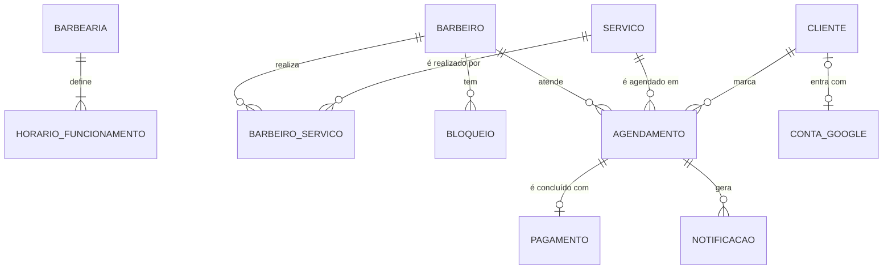
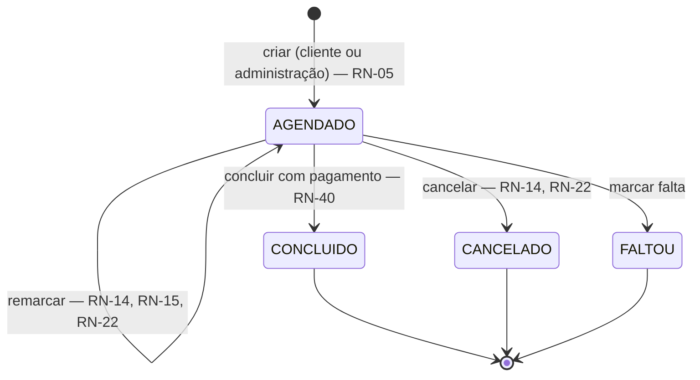

# Modelo de domínio

O domínio aqui é descrito no **nível conceitual**: entidades, relacionamentos, ciclo de vida e vocabulário. **Os campos não estão listados.** A fonte de verdade deles é o schema do banco no código. Este documento só muda quando surge, some ou muda de significado uma entidade ou um relacionamento.

Regras citadas como `RN-xx` estão em [regras.md](regras.md).

## Entidades e relacionamentos

| Entidade | O que é |
|---|---|
| **Barbearia** | O registro único com os dados do negócio: nome, endereço, contato e textos da vitrine |
| **Horário de funcionamento** | Abertura e fechamento (ou "fechado") para cada dia da semana. Vale para todos os barbeiros (RN-02) |
| **Barbeiro** | Profissional cadastrado, com foto e apresentação. **Não faz login** (D2). Pode estar ativo ou inativo (RN-60). Não é excluído: quem sai é inativado e o cadastro continua para o histórico. A foto é o caminho de um arquivo estático do web, sem upload no MVP (D10) |
| **Serviço** | O que é oferecido, com preço e duração. Pode estar ativo ou inativo (RN-61). Não é excluído: o que sai é inativado e o cadastro continua para o histórico |
| **Barbeiro–Serviço** | Quais barbeiros realizam quais serviços (N:N). Todo serviço tem pelo menos um barbeiro; um barbeiro inativo pode continuar ligado, mas não é oferecido (RN-05, RN-61) |
| **Bloqueio** | Intervalo em que um barbeiro não atende: almoço, folga, compromisso (RN-03) |
| **Cliente** | Pessoa atendida. Pode ter conta Google (agenda online) ou não (cadastrada pela administração) (RN-62, RN-20). O e-mail, quando existe, é único entre os clientes |
| **Conta Google** | A identidade de login. Ou está vinculada a um cliente, ou pertence a um e-mail da lista de administração (RN-71) |

### Vínculo entre Cliente e Conta Google

- O cliente guarda o identificador da conta (o `sub` do JWT, que é o id do usuário do Better Auth). Cada conta se vincula a no máximo um cliente, e cada cliente a no máximo uma conta.
- No primeiro acesso de uma conta que não é da administração, o cadastro é procurado pelo vínculo; sem ele, pelo e-mail, vinculando um cadastro feito pela administração (RN-23); sem os dois, é criado com o nome e o e-mail do Google, ainda sem telefone.
- Um cadastro já vinculado nunca passa sozinho para outra conta com o mesmo e-mail: a barbearia resolve o caso.
- A conta da administração não ganha cadastro de cliente (RN-71).
- O cliente sem conta tem telefone desde o cadastro; o cliente com conta informa o telefone no perfil, e só agenda depois disso (RN-10).
- A conta fica nas tabelas do Better Auth, e o cliente nas tabelas de domínio. Por isso o vínculo não tem chave estrangeira entre os dois donos de schema (ADR 0002).
| **Agendamento** | Um horário reservado de um cliente com um barbeiro para um serviço. Guarda o preço e a duração "congelados" (RN-13) e a origem (online ou administração) |
| **Pagamento** | O registro da conclusão: o valor cobrado e a forma de pagamento (RN-40). Existe só para agendamentos concluídos |
| **Notificação** | Registro de cada e-mail enviado ou que falhou: confirmação, lembrete, remarcação, cancelamento (RN-50 a RN-54) |

### Conceitos que não são armazenados

- **Horário disponível (slot):** é **calculado** a cada consulta, a partir do horário de funcionamento, da grade de 30 minutos, dos bloqueios e dos agendamentos ativos (RN-05). O cálculo é uma função pura, que recebe os intervalos ocupados do barbeiro (agendamentos ativos e bloqueios) sem saber de onde eles vêm. Não existe uma tabela de horários. O projeto acadêmico tinha uma (`Schedule`) e ela foi abandonada de propósito, porque duplicava estado e permitia inconsistência.
- **Faturamento:** é a soma dos pagamentos do período, calculada pelo relatório (RN-43).

### Entidades futuras (Fase 3, fidelidade)

Ainda não existem e não devem ser criadas antes da Fase 3: **Regra de pontos**, **Benefício** e **Resgate**. O schema do projeto acadêmico (`PointRule`, `Benefit`, `BenefitRedemption`) serve de ponto de partida.

## Ciclo de vida do agendamento

As condições de cada transição (quem pode e quando) estão em RN-31. Só `AGENDADO` ocupa a agenda (RN-08).

## Glossário

Os documentos usam os termos em português. **No código, os identificadores são em inglês**, conforme a tabela. A interface com o usuário é em português.

| Termo (PT) | No código | Definição |
|---|---|---|
| Barbearia | `Shop` | O negócio. Existe um único registro |
| Horário de funcionamento | `BusinessHours` | Abertura e fechamento por dia da semana |
| Barbeiro | `Barber` | Profissional cadastrado, sem login |
| Serviço | `Service` | Item oferecido, com preço e duração |
| Barbeiro–Serviço | `BarberService` | Associação N:N |
| Bloqueio | `TimeBlock` | Intervalo indisponível na agenda de um barbeiro |
| Cliente | `Customer` | Pessoa atendida, com ou sem conta |
| Conta Google | `User` / `Account` | Identidade de login. As tabelas seguem a biblioteca de autenticação |
| Administração | `admin` | Perfil de quem está na lista de e-mails autorizados (RN-71) |
| Agendamento | `Appointment` | Reserva de horário |
| Status `AGENDADO` | `SCHEDULED` | Ativo, ocupa a agenda |
| Status `CONCLUIDO` | `COMPLETED` | Atendido e pago |
| Status `CANCELADO` | `CANCELED` | Cancelado |
| Status `FALTOU` | `NO_SHOW` | O cliente não compareceu |
| Origem do agendamento | `source`: `ONLINE` / `ADMIN` | Quem criou o agendamento |
| Quem cancelou | `canceled_by`: `CUSTOMER` / `ADMIN` | Registrado junto com `canceled_at` no cancelamento (RN-33) |
| Pagamento | `Payment` | Valor cobrado e forma de pagamento na conclusão |
| Forma de pagamento | `PaymentMethod`: `CASH`, `PIX`, `DEBIT`, `CREDIT` | Dinheiro, Pix, débito, crédito |
| Notificação | `Notification` | Registro de envio de e-mail |
| Tipo da notificação | `kind`: `CONFIRMATION` / `REMINDER` / `RESCHEDULED` / `CANCELED` | Confirmação, lembrete, remarcação, cancelamento (RN-50 a RN-52) |
| Situação da notificação | `status`: `PENDING` / `SENT` / `FAILED` | Registrada, enviada ou com falha (RN-54) |
| Horário disponível | `slot` | Horário de início calculado (RN-05), não armazenado |
| Encaixe | — | Agendamento feito pela administração começando agora (RN-21, RN-44) |
| Remarcar | `reschedule` | Mudar a data, o horário ou o barbeiro de um agendamento ativo |
