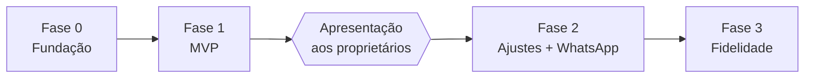

# Roadmap

O roadmap diz **o que entra em cada fase e por quê**. O andamento das tarefas (a fazer, fazendo, feito) fica no kanban do GitHub Projects, não aqui.

Decisões que embasam este documento: D0–D8 em [registro.md](../cliente/registro.md). Visão geral do produto: [visao.md](visao.md).

## Fases

### Fase 0 — Fundação

**Objetivo:** ter um sistema vazio, mas no ar, com a base que todas as funcionalidades usam.

- Repositório, stack e convenções (ADRs em `docs/decisoes/`).
- Deploy automático da `main` num ambiente acessível pela internet.
- Banco de dados com migrações.
- Login com Google, separando o acesso do cliente e o da administração.
- Layout base e identidade visual (cores, logo, tipografia).

**Por que primeiro:** tudo depende disso, e colocar o sistema no ar desde o início evita surpresa de deploy na véspera da apresentação.

### Fase 1 — MVP

**Objetivo:** a barbearia consegue operar um dia inteiro **sem a agenda de papel**. É a versão que será apresentada aos proprietários.

**Lado do cliente**
- **Vitrine:** a barbearia, os serviços e preços, os barbeiros (foto e apresentação), o endereço, o horário de funcionamento e o contato.
- **Agendamento:** escolher serviço → barbeiro → dia → horário livre → confirmar.
- **Meus agendamentos:** ver, remarcar e cancelar (até 2h antes, D6).
- **Perfil:** nome (vem do Google) e telefone.
- **E-mails:** confirmação, lembrete, remarcação e cancelamento (D4).
- **Política de privacidade** (LGPD).

**Lado da administração**
- **Agenda:** visão do dia e da semana, por barbeiro.
- **Agendamento manual** para quem liga ou chega no balcão, inclusive clientes sem conta (D3).
- **Bloqueios e folgas** na agenda de cada barbeiro.
- **Concluir atendimento** registrando o valor e a forma de pagamento (D8), e **marcar falta**.
- **Cadastros:** barbeiros, serviços, horário de funcionamento e clientes.
- **Relatório financeiro:** faturamento por período, por barbeiro e por forma de pagamento.

**Ordem sugerida das entregas dentro do MVP:**
1. Cadastros (barbeiros, serviços, horário de funcionamento), porque o resto depende deles.
2. Vitrine.
3. Motor de disponibilidade e agendamento pelo cliente.
4. Agenda da administração e agendamento manual.
5. E-mails.
6. Conclusão de atendimento e relatório financeiro.

**Por que este recorte:** ele ataca os três problemas centrais (sobreposição, faltas e falta de registro) com o mínimo de funcionalidades. O financeiro entra no MVP porque concluir o atendimento é o que fecha o ciclo da agenda, e o registro sai quase de graça junto.

### Fase 2 — Ajustes pós-apresentação e WhatsApp

**Objetivo:** incorporar o feedback dos proprietários e levar as notificações para o canal que o cliente mais lê.

- Ajustes vindos da apresentação. As decisões D0–D8 podem ser revistas aqui.
- Notificações por **WhatsApp** (D4). Exige uma conta Business verificada da barbearia, com CNPJ (P3), então só é viável depois da apresentação.
- Passagem da infraestrutura para o nome da barbearia (domínio próprio, contas e custos).

### Fase 3 — Programa de fidelidade

**Objetivo:** incentivar a volta do cliente (D5).

- Regras de acúmulo de pontos por serviço.
- Benefícios disponíveis para resgate.
- Saldo e histórico de pontos do cliente.
- Resgate de benefícios, com registro de quem aprovou.
- Log de alterações nas regras e nos benefícios.

**Por que por último:** não resolve nenhum dos problemas centrais, e as regras de pontos dependem de ouvir os proprietários.

### Ideias sem fase definida

Ficam registradas para não se perderem, mas não há compromisso de entrega:

- Opção "qualquer barbeiro" no agendamento.
- Lista de espera para horários lotados.
- Área própria do barbeiro, se os proprietários pedirem.
- Estatísticas de faltas e de horários mais procurados.

## De onde veio cada requisito do projeto acadêmico

| RF antigo | Descrição resumida | Destino |
|---|---|---|
| RF01 | Cliente cadastra e edita seus dados | MVP: perfil, com cadastro via Google (D3) |
| RF02 | Cliente gerencia agendamentos | MVP |
| RF03 | Notificação de confirmação e lembrete | MVP por e-mail; WhatsApp na Fase 2 (D4) |
| RF04 | Barbeiro visualiza a agenda | MVP, pela administração (D2) |
| RF05 | Administrador cadastra barbeiros | MVP |
| RF06 | Administrador gerencia serviços e valores | MVP |
| RF07 | Cliente vê os pontos de fidelidade | Fase 3 (D5) |
| RF08 | Cliente resgata benefícios | Fase 3 (D5) |
| RF09 | Administrador configura regras de pontos | Fase 3 (D5) |
| RF10 | Administrador cadastra benefícios | Fase 3 (D5) |
| RF11 | Barbeiro gerencia a disponibilidade | MVP, pela administração (D2) |
| RF12 | Barbeiro cadastra e gerencia clientes | MVP, pela administração (D2) |
| RF13 | Barbeiro agenda clientes (telefone ou balcão) | MVP, pela administração (D2, D3) |
| RF14 | Administrador cadastra detalhes dos barbeiros | MVP |
| RF15 | Cliente vê informações dos barbeiros | MVP (vitrine) |
| RF16 | Administrador vê relatório de entradas | MVP, com forma de pagamento (D8) |
| RF17 | Cliente consulta os serviços | MVP (vitrine) |
| RF18 | Login | MVP, com Google (D3) |
| RNF05 | Log de alterações na fidelidade | Fase 3 |
