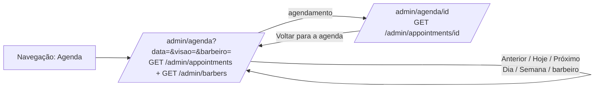

# Spec — Agenda da administração por dia e semana

- **Issue:** #93 (S5.01)
- **Fase:** 1 (MVP) (ver `docs/produto/roadmap.md`)
- **Status:** implementada

## Contexto
A barbearia ainda olha a agenda de papel para saber quem atende quem e quando. Esta funcionalidade mostra à administração, de relance, os agendamentos do dia ou da semana, de todos os barbeiros ou de um só, dentro do horário de funcionamento. Ela substitui a consulta ao papel (objetivo do MVP: operar um dia inteiro sem ele) e é o ponto de partida dos bloqueios (S5.04, #96), do agendamento manual (S5.05, #97) e da conclusão com pagamento (S5.06, #98), que entram na mesma tela.

## Quem usa
Administração. O cliente e o visitante não acessam (RN-70).

## Histórias
- Como **administração**, quero **ver os agendamentos de hoje, por barbeiro** para **saber quem chega e com quem**.
- Como **administração**, quero **ver a semana de um barbeiro ou de todos** para **planejar o movimento e responder quem liga perguntando**.
- Como **administração**, quero **ir para qualquer dia e voltar para hoje** para **encontrar um horário marcado sem folhear papel**.
- Como **administração**, quero **abrir um agendamento e ver o cliente com telefone** para **ligar quando for preciso**.

## Regras envolvidas
- RN-01 — Fuso horário (datas recebidas e devolvidas no fuso de São Paulo)
- RN-02 — Horário de funcionamento (a moldura de cada dia)
- RN-30 — Status (todos aparecem, com texto)
- RN-13 — Preço e duração congelados (a agenda mostra os valores do agendamento)
- RN-33 — Rastreabilidade (quem cancelou e quando, no detalhe)
- RN-70 — Perfis e permissões
- RN-71 — Acesso à administração

## Definições desta funcionalidade
- **Período:** duas datas locais de São Paulo, `start` e `end`, as duas inclusivas. O período tem **no máximo 7 dias** (`end − start ≤ 6`), o tamanho da visão da semana. `end` antes de `start` é recusado.
- **Agendamento do dia:** o que **começa** naquele dia em São Paulo, ou seja, `starts_at` em `[00:00 do dia, 00:00 do dia seguinte)` no fuso de São Paulo, convertido para UTC só na consulta (RN-01). Um atendimento às 22h30 de São Paulo (01h30 UTC do dia seguinte) é do dia em que começa.
- **Todos os status:** a agenda mostra `SCHEDULED`, `COMPLETED`, `CANCELED` e `NO_SHOW` (RN-30). O cancelado continua visível, com o status por extenso, para a administração saber que aquele horário foi liberado.
- **Barbeiros da agenda:** sem filtro, os barbeiros **ativos** e também os inativos que tenham agendamento no período (por nome). Com filtro, só o barbeiro pedido, ativo ou não. Um barbeiro sem agendamentos no período aparece com a lista vazia.
- **Semana:** de segunda a domingo, a que contém a data escolhida. A visão do dia é o período de um dia só.
- **Moldura do dia (RN-02):** cada dia vem com o horário de funcionamento daquele dia da semana (`opens_at`/`closes_at`, ou fechado). A tela mostra "10:00 às 19:00" ou "Fechado" no topo do dia.

## Critérios de aceite

**CA-1 — Agendamentos do período (RN-01, RN-30)**
- **Dado** agendamentos dos três barbeiros em vários dias e status
- **Quando** a administração chama `GET /admin/appointments?start=2026-11-02&end=2026-11-08`
- **Então** a API responde `200` com `start`, `end`, `days` (um por data do período, com `date`, `opens_at` e `closes_at`), `barbers` (como em "Definições") e `appointments`: todos os agendamentos que começam no período, em todos os status, por início, nome do barbeiro e id. Cada um traz `id`, `status`, `source`, `starts_at` e `ends_at` (`-03:00`), `price`, `duration_minutes`, `customer` (`id`, `name`, `phone`, `email`), `barber` (`id`, `name`), `service` (`id`, `name`), `canceled_at` e `canceled_by`.

**CA-2 — Filtro por barbeiro**
- **Dado** o mesmo cenário
- **Quando** a chamada inclui `barber_id`
- **Então** só vêm os agendamentos daquele barbeiro, e `barbers` tem só ele. Um `barber_id` que não existe responde `404` com `code` = `BARBER_NOT_FOUND` e "Barbeiro não encontrado.".

**CA-3 — Borda do fuso (RN-01)**
- **Dado** um agendamento às 23h30 de São Paulo de segunda (02h30 UTC de terça) e outro à 00h00 de terça
- **Quando** a administração pede só a segunda, e depois só a terça
- **Então** o das 23h30 vem só na segunda, e o da meia-noite só na terça.

**CA-4 — Período inválido**
- `end` antes de `start` responde `422` com `code` = `INVALID_PERIOD` e "A data final precisa ser igual ou posterior à inicial.".
- Mais de 7 dias responde `422` com `code` = `INVALID_PERIOD` e "Escolha um período de até 7 dias.".
- O último dia do calendário (`9999-12-31`) como `end` responde `422` com `code` = `INVALID_PERIOD` e "Escolha uma data válida.", porque o período não teria como terminar.
- Data em outro formato ou ausente responde `422 VALIDATION_ERROR`.

**CA-5 — Detalhe**
- `GET /admin/appointments/{id}` devolve o agendamento no mesmo formato do item da lista, de qualquer cliente. Um id que não existe responde `404` com `code` = `APPOINTMENT_NOT_FOUND` e "Agendamento não encontrado.".

**CA-6 — Só a administração (RN-70, RN-71)**
- Sem token, `401`. Um cliente recebe `403` nas duas rotas.

**CA-7 — Tela `/admin/agenda`, visão do dia**
- **Dado** a administração em `/admin/agenda`, sem parâmetros
- **Então** vê o dia de hoje (São Paulo), com o título da data por extenso e o horário de funcionamento do dia ("Fechado" se for o caso), e uma seção por barbeiro (`h2` com o nome) com os agendamentos em ordem de início. Cada agendamento mostra o horário de início e fim, o cliente, o serviço e o `StatusBadge` (texto, não só cor) e é um link para o detalhe. Barbeiro sem agendamentos mostra "Nenhum agendamento".
- Em 360px, as seções ficam uma embaixo da outra (uma lista por barbeiro); a partir de `lg`, os barbeiros ficam lado a lado.

**CA-8 — Visão da semana**
- `?visao=semana` mostra os 7 dias da semana da data (segunda a domingo), cada um com a data curta ("Seg, 2 de nov"), o horário de funcionamento e os agendamentos do dia, cada um também com o barbeiro. Em 360px, os dias ficam um embaixo do outro; no desktop, em grade.

**CA-9 — Navegação e filtro, sem JS**
- O estado fica na URL: `?data=AAAA-MM-DD&visao=dia|semana&barbeiro=<id>`. Valores inválidos são ignorados (data → hoje, visão → dia, barbeiro → todos).
- Links "Anterior", "Hoje" e "Próximo" andam um dia na visão do dia e uma semana na visão da semana, mantendo a visão e o barbeiro.
- Links "Dia" e "Semana" trocam a visão; links "Todos" e um por barbeiro (os ativos, mais o escolhido se estiver inativo) trocam o filtro. O escolhido tem `aria-current`.
- Um formulário `GET` com um campo de data ("Ir para a data") leva a qualquer dia, mantendo a visão e o barbeiro. O campo sempre mostra o dia da agenda: depois de "Anterior", "Hoje" ou "Próximo", uma data digitada e não enviada é descartada (#153).
- Tudo é link ou formulário `GET`: funciona sem JS.

**CA-10 — Detalhe na tela**
- O link de um agendamento leva a `/admin/agenda/{id}`, com o estado da agenda na URL. A página mostra serviço, status, dia, horário e duração, barbeiro, valor, origem ("Online" ou "Administração"), o cliente com nome, telefone (link `tel:`) e e-mail, e, se cancelado, quando e por quem (RN-33). "Voltar para a agenda" volta para a mesma visão.
- Agendamento inexistente mostra "Agendamento não encontrado." e o link de volta.

**CA-11 — Estados**
- `loading.tsx` com esqueleto da agenda. Falha de leitura da API mostra um `Alert` `danger` com o `message` da API ou "Não foi possível carregar a agenda. Tente novamente em instantes.".
- A navegação da administração ganha "Agenda", e a página inicial de `/admin` ganha o atalho para ela.

## Fluxo e telas

- **Topo:** título da data ("segunda-feira, 2 de novembro de 2026" ou "Semana de 2 a 8 de nov"), a barra com "Anterior", "Hoje" e "Próximo", "Dia"/"Semana", o filtro de barbeiro e "Ir para a data".
- **Dia (`AgendaDay`):** a moldura do dia e uma coluna por barbeiro (`AgendaBarberColumn`), cada uma com a lista de `AgendaItem`.
- **Semana (`AgendaWeek`):** um bloco por dia, com a moldura e a lista de `AgendaItem` mostrando o barbeiro.
- **Detalhe (`AppointmentDetail`):** os dados em `dl` e uma área de ações vazia.
- **Pontos de extensão para as próximas issues:** os componentes ficam em `web/src/app/admin/agenda/`. `AppointmentDetail` recebe `actions` (concluir, marcar falta, remarcar e cancelar entram ali, S5.05 e S5.06). `AgendaBarberColumn` recebe `children` depois da lista, e `AgendaDayView` e `AgendaWeekView` recebem `barberExtra` e `dayExtra` para preenchê-lo por barbeiro e por dia (bloqueios, S5.04), e a barra do topo recebe `actions` ("Novo agendamento", "Bloquear horário", S5.04 e S5.05). A resposta da API é um objeto, para os bloqueios entrarem ao lado de `appointments` sem quebrar o contrato.

## API
| Método | Caminho | Quem | O que faz |
|---|---|---|---|
| `GET` | `/admin/appointments?start=&end=&barber_id=` | Administração (`require_admin`) | O período (até 7 dias) com a moldura de cada dia, os barbeiros e os agendamentos em todos os status |
| `GET` | `/admin/appointments/{id}` | Administração (`require_admin`) | Um agendamento, de qualquer cliente |

- Módulo novo `app/modules/agenda/` (`router.py`, `schemas.py`, `service.py`). Ele fica acima de `appointments`, `barbers`, `catalog`, `customers` e `shop`, pelo mesmo motivo do `booking`: `appointments` não pode importar `barbers` (`barbers` já depende de `appointments` pela RN-60).
- As datas entram como datas locais (`AAAA-MM-DD`) e viram instantes de São Paulo no `service.py`; as respostas saem em `-03:00` (RN-01).
- Leitura só: nenhuma rota desta issue altera o banco.

## Fora do escopo desta spec
- Bloqueios e folgas (S5.04, #96): entraram pelos pontos de extensão acima, com rota própria (`GET /admin/time-blocks`), em [bloqueios.md](bloqueios.md).
- Criar, remarcar e cancelar pela administração: S5.05, em [agendamento-admin.md](agendamento-admin.md).
- Concluir com pagamento e marcar falta, e o rótulo "Aguardando registro" para o `SCHEDULED` que já terminou (S5.06, #98).
- Grade de horários com posição proporcional à duração (linha do tempo). A agenda é uma lista por barbeiro e por dia.
- Busca por nome ou telefone do cliente.
- Tornar a agenda a página inicial de `/admin`.

## Dúvidas em aberto
Escolhas desta implementação que nenhuma RN decide, a confirmar:
- **Cancelados na agenda:** aparecem, com o status por extenso, em vez de sumirem. A alternativa seria escondê-los ou pôr um filtro.
- **Semana de segunda a domingo,** e não os 7 dias a partir da data.
- **Período máximo de 7 dias** na API, o tamanho da semana.
- **Barbeiro inativo** só aparece na agenda se tiver agendamento no período, ou se for escolhido no filtro.
