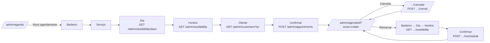

# Spec — Agendamento manual e alterações pela administração

- **Issue:** #97 (S5.05)
- **Fase:** 1 (MVP) (ver `docs/produto/roadmap.md`)
- **Status:** implementada

## Contexto
Muita gente marca horário por telefone ou chega no balcão, e o cliente que é atendido na hora também precisa entrar no sistema, porque todo valor do financeiro vem de um atendimento concluído (RN-44). Esta funcionalidade deixa a administração agendar para qualquer cliente, já cadastrado ou cadastrado na hora (RN-20), inclusive um "encaixe" que começa agora (RN-21), e cancelar ou remarcar qualquer agendamento ativo, sem o prazo de 2 horas do cliente (RN-22). A agenda (S5.01, [agenda-admin.md](agenda-admin.md)) passa a ser também o lugar de mudar a agenda, e não só de consultá-la (objetivo do MVP: operar um dia inteiro sem o papel).

## Quem usa
Administração. O cliente e o visitante não acessam estas rotas nem estas telas (RN-70).

## Histórias
- Como **administração**, quero **agendar quem liga, escolhendo barbeiro, serviço, dia e horário** para **a agenda ficar completa sem papel**.
- Como **administração**, quero **cadastrar um cliente novo no meio do agendamento** para **não sair do fluxo enquanto a pessoa espera no telefone ou no balcão**.
- Como **administração**, quero **registrar um encaixe que começa agora** para **o atendimento sem agendamento prévio entrar no financeiro (RN-44)**.
- Como **administração**, quero **cancelar ou remarcar qualquer agendamento ativo, a qualquer momento** para **resolver o que o cliente pede por telefone depois do prazo dele**.

## Regras envolvidas
- RN-03 — Bloqueios (ocupam a agenda também para a administração)
- RN-04 — Grade de horários (vale também para a administração)
- RN-05 — Horário disponível (itens 1 a 5)
- RN-08 — Sem sobreposição (mesma trava e mesma constraint do cliente)
- RN-13 — Preço e duração congelados
- RN-15 — Remarcação (o serviço não muda)
- RN-20 — Cliente sem conta
- RN-21 — Regras que valem para a administração
- RN-22 — Alterações pela administração
- RN-31 — Transições permitidas
- RN-32 — Liberação da vaga
- RN-33 — Rastreabilidade
- RN-44 — Atendimento sem agendamento prévio
- RN-62 — Cliente (nome e telefone obrigatórios)
- RN-70 — Perfis e permissões
- RN-50 e RN-52 — E-mails de confirmação e de alteração (fora do escopo; ver abaixo)

## Definições desta funcionalidade
- **Política da administração (`ADMIN_POLICY`, RN-21):** o mesmo cálculo da RN-05 (`available_slots`), sem a antecedência mínima (RN-06) e sem a janela de 30 dias (RN-07). Continuam valendo a grade de 30 minutos (RN-04), o expediente (RN-02), os ocupados (RN-08) e a oferta (barbeiro e serviço ativos, e o barbeiro realiza o serviço). Nenhuma política oferece horário num dia que já passou (data de São Paulo).
- **Encaixe (RN-21, RN-44, RN-04) — decisão confirmada na S5.05 e registrada na RN-21:** o encaixe usa um horário da grade, que pode já ter começado; nunca um horário fora da grade. Às 14h10, o horário das 14h00 é oferecido se o barbeiro estiver livre e o serviço couber no expediente, e um encaixe às 14h10 fica registrado às 14h00. Como a RN-21 não tem antecedência, os horários livres da manhã de hoje também são oferecidos, para registrar depois um atendimento que já aconteceu.
- **Dias oferecidos na tela:** a lista de dias da administração vai de hoje até hoje + 30 dias, só os que têm horário. Os 30 dias são só o tamanho da lista, não uma regra: o campo "Outra data" leva a qualquer dia, sem limite à frente.
- **Cliente do agendamento (RN-20):** um cliente já cadastrado (`customer_id`), de qualquer origem, ou um cliente novo (`customer`: nome e telefone obrigatórios, e-mail opcional, as mesmas validações e o mesmo `create_customer` do cadastro de clientes). Um cliente que veio do Google e ainda não informou telefone também pode ser agendado pela administração: a RN-10 vale só para o agendamento online.
- **Tudo ou nada:** o cliente novo e o agendamento são gravados na mesma transação. Se o horário não estiver disponível, se o e-mail já existir ou se outra reserva ganhar a disputa, nada é gravado, nem o cliente.
- **Sem limite por cliente (RN-21):** a RN-11 (2 ativos) não vale para a administração.
- **Origem:** o agendamento nasce `SCHEDULED` com `source = ADMIN`, com o preço e a duração do serviço naquele momento (RN-13).
- **Cancelar (RN-22, RN-31 a RN-33):** qualquer agendamento `SCHEDULED`, a qualquer momento, inclusive um que já começou ou já passou e ainda espera a conclusão. Registra `canceled_at` = agora e `canceled_by = ADMIN`. A vaga volta na hora (RN-32).
- **Remarcar (RN-22, RN-15):** qualquer agendamento `SCHEDULED`, a qualquer momento, para outro horário e, se quiser, outro barbeiro. O serviço, o preço e a duração continuam os da criação (RN-13). O novo horário segue a política da administração, calculado com a duração congelada; o próprio agendamento sai dos ocupados, e o horário atual com o mesmo barbeiro não é oferecido de novo (o mesmo `Rescheduling` da remarcação do cliente).

## Critérios de aceite

**CA-1 — Agendar um cliente já cadastrado (RN-20, RN-13)**
- **Dado** um cliente cadastrado e um horário livre do Edvaldo para o Corte + Barba
- **Quando** a administração chama `POST /admin/appointments` com `customer_id`, `barber_id`, `service_id` e `starts_at` (com fuso)
- **Então** a API responde `201` com o agendamento no formato da agenda (`AdminAppointmentResponse`): `SCHEDULED`, `source` = `ADMIN`, o preço e a duração do serviço naquele momento. Mudar o serviço depois não muda o agendamento.

**CA-2 — Cliente novo na hora (RN-20, RN-62)**
- **Dado** uma pessoa sem cadastro
- **Quando** a administração envia `customer` (`name`, `phone`, `email` opcional) no lugar de `customer_id`
- **Então** a API cria o cliente (sem conta Google) e o agendamento, e responde `201` com os dois. O telefone é normalizado como no cadastro de clientes.
- Telefone inválido, nome vazio, os dois campos (`customer_id` e `customer`) ou nenhum deles respondem `422 VALIDATION_ERROR`. Um e-mail que já existe responde `409 CUSTOMER_EMAIL_TAKEN`. Um `customer_id` que não existe responde `404 CUSTOMER_NOT_FOUND`.
- Se o agendamento for recusado (horário, e-mail, disputa), o cliente novo **não** fica gravado.

**CA-3 — Encaixe: sem antecedência mínima (RN-21, RN-44)**
- **Dado** agora são 13h50 de uma segunda
- **Quando** a administração agenda às 14h00, e o cliente tenta o mesmo horário
- **Então** a administração consegue (`201`) e o cliente recebe `409 SLOT_UNAVAILABLE` (RN-06).
- Às 14h10, o horário das 14h00 continua sendo oferecido e aceito pela administração se o barbeiro estiver livre. 14h10 (fora da grade, RN-04) é recusado com `409 SLOT_UNAVAILABLE`.

**CA-4 — Sem janela nem limite por cliente (RN-21)**
- Um horário daqui a 60 dias é aceito pela administração. Um cliente com 2 agendamentos ativos recebe um terceiro (e um quarto) pela administração.
- Um dia que já passou não tem horário: `409 SLOT_UNAVAILABLE`.

**CA-5 — Continuam valendo os itens 1 a 5 da RN-05 e a RN-08**
- Horário ocupado por agendamento ou por bloqueio (RN-03, [bloqueios.md](bloqueios.md)), fora do expediente, em dia fechado, com barbeiro ou serviço inativo ou com barbeiro que não realiza o serviço responde `409 SLOT_UNAVAILABLE` com "Este horário não está mais disponível. Escolha outro.". Barbeiro ou serviço inexistente responde `404` (`BARBER_NOT_FOUND`, `SERVICE_NOT_FOUND`).
- Duas reservas simultâneas do mesmo horário (administração e cliente, ou duas da administração): só uma consegue; a outra recebe `409 SLOT_UNAVAILABLE`, pela trava `FOR SHARE` de `ensure_slot_available` e pela exclusion constraint, traduzida por `is_slot_conflict`.

**CA-6 — Horários da administração (RN-21)**
- `GET /admin/availability?barber_id=&service_id=&date=` devolve os horários do dia com a política da administração, no formato de `GET /public/availability`. `GET /admin/availability/days?barber_id=&service_id=` devolve os dias de hoje até hoje + 30 com horário, no formato de `GET /public/availability/days`.
- Às 13h50, os horários de hoje incluem 14h00 (e os da manhã que estiverem livres); a rota pública começa às 15h00.

**CA-7 — Cancelar sem prazo (RN-22, RN-31 a RN-33)**
- **Dado** um agendamento `SCHEDULED` que começa daqui a 30 minutos
- **Quando** a administração chama `POST /admin/appointments/{id}/cancel`
- **Então** a API responde `200` com o agendamento `CANCELED`, `canceled_by` = `ADMIN` e `canceled_at` = agora, e o horário volta na hora para a administração e, se estiver na janela do cliente, para o cliente (RN-32). Vale também para o agendamento que já começou ou já terminou e continua `SCHEDULED`.
- Um agendamento `CANCELED`, `COMPLETED` ou `NO_SHOW` responde `409 APPOINTMENT_NOT_ACTIVE` ("Este agendamento não está mais ativo."). Um id que não existe responde `404 APPOINTMENT_NOT_FOUND`.

**CA-8 — Remarcar sem prazo (RN-22, RN-15, RN-13)**
- **Dado** um agendamento `SCHEDULED` de qualquer cliente, mesmo a menos de 2 horas do início
- **Quando** a administração chama `POST /admin/appointments/{id}/reschedule` com `starts_at` e, opcionalmente, `barber_id`
- **Então** a API responde `200` com o mesmo `id`, ainda `SCHEDULED`, o novo início e fim, o mesmo serviço, preço, duração e origem. O horário antigo fica livre (RN-32).
- O novo horário segue a política da administração (CA-3 a CA-5), com a duração congelada; pode cruzar o horário atual. O mesmo barbeiro e o mesmo início respondem `409 SAME_SLOT` ("Este já é o horário do agendamento. Escolha outro."). O corpo não aceita `service_id` (`422`). Status final responde `409 APPOINTMENT_NOT_ACTIVE`.
- `GET /admin/appointments/{id}/availability/days?barber_id=` e `GET /admin/appointments/{id}/availability?barber_id=&date=` devolvem os dias e horários da remarcação, como as rotas do cliente, mas com a política da administração.

**CA-9 — Só a administração (RN-70, RN-71)**
- Sem token, `401`. Um cliente recebe `403` em todas as rotas desta spec.

**CA-10 — Tela "Novo agendamento", sem JS e em 360px**
- A barra da agenda ganha o botão "Novo agendamento", que leva a `/admin/agenda/novo`.
- Uma escolha por tela, com o estado na URL (`?barbeiro=&servico=&data=&hora=&cliente=`): barbeiro → serviço → dia → horário → cliente → confirmação ("Etapa N de 6"). As escolhas feitas aparecem no topo, cada uma com "Trocar".
- Barbeiro e serviço: os mesmos cards do agendamento do cliente (`BarberStep`, `ServiceStep`), com os barbeiros e serviços ativos. Dia: `DayPicker` com os dias da CA-6 e o formulário `GET` "Outra data". Horário: `TimePicker` com os horários da CA-6.
- Cliente: um formulário `GET` "Buscar cliente" (nome, telefone ou e-mail, a busca de `GET /admin/customers`), os resultados como links (nome e telefone) e o link "Cadastrar cliente novo".
- Confirmação: o resumo (barbeiro, serviço, dia, horário, valor) e o cliente. Com um cliente novo, o formulário tem os campos do `CustomerFields`; o botão "Confirmar agendamento" envia tudo de uma vez pela Server Action. Qualquer recusa mostra o `message` da API num `Alert` `danger`, com o que foi digitado de volta e, se for o horário, o link "Escolher outro horário". Se o horário deixou de existir, a confirmação pede outro horário no lugar do formulário, e os dados do cliente novo precisam ser digitados de novo: eles não vão para a URL (dado pessoal).
- Depois de confirmar, a tela vai para o detalhe do agendamento novo, com o `Alert` `success` "Agendamento criado.".

**CA-11 — Remarcar e cancelar no detalhe, sem JS e em 360px**
- O detalhe de um agendamento `SCHEDULED` mostra "Remarcar" (`outline`, `sm`) e "Cancelar" (`danger`, `sm`).
- "Cancelar" leva a `/admin/agenda/{id}/cancelar`: o resumo, "O horário fica livre na hora.", o `ghost` "Voltar" e o `danger` "Cancelar agendamento", nessa ordem. Ao confirmar, volta ao detalhe com "Agendamento cancelado.".
- "Remarcar" leva a `/admin/agenda/{id}/remarcar?barbeiro=<atual>`: barbeiro → dia → horário → confirmação ("Etapa N de 4"), com o horário atual no topo, como a remarcação do cliente. Ao confirmar, volta ao detalhe com "Agendamento remarcado.".
- Um agendamento que não está ativo mostra "Este agendamento não está mais ativo." no lugar das etapas e do botão. Qualquer recusa da API aparece num `Alert` `danger`.

## Fluxo e telas

- Rotas novas no web: `/admin/agenda/novo`, `/admin/agenda/[id]/cancelar` e `/admin/agenda/[id]/remarcar`, dentro do layout da administração (`AdminPage`, título em Inter). Os componentes e as Server Actions ficam em arquivos próprios em `web/src/app/admin/agenda/` (`admin-booking-*.ts(x)`), para não misturar com os da agenda, dos bloqueios e da conclusão.
- **Ordem do fluxo:** o horário vem antes do cliente. Ao telefone, primeiro se acha um horário livre; os dados da pessoa só são pedidos quando o horário já está escolhido. No balcão, o encaixe é: barbeiro → serviço → hoje → horário → cliente.
- **Confirmação destrutiva sem JS:** como em "Meus agendamentos", o cancelamento tem a própria página, em vez do `<dialog>` do design system, que precisa de JS.
- Estados: falha de leitura da API mostra um `Alert` `danger` com o `message` da API; dia sem horário mostra o `EmptyState` com o link para escolher outro dia; busca sem resultado mostra "Nenhum cliente encontrado." com o link "Cadastrar cliente novo".

## API
| Método | Caminho | Quem | O que faz |
|---|---|---|---|
| `GET` | `/admin/availability?barber_id=&service_id=&date=` | Administração | Horários do dia com `ADMIN_POLICY` (RN-21) |
| `GET` | `/admin/availability/days?barber_id=&service_id=` | Administração | Dias de hoje até hoje + 30 com horário, com `ADMIN_POLICY` |
| `POST` | `/admin/appointments` | Administração | Corpo: `customer_id` **ou** `customer` (`name`, `phone`, `email`), `barber_id`, `service_id`, `starts_at`. Cria `SCHEDULED`/`ADMIN` (RN-13, RN-20, RN-21). `201` com o agendamento |
| `POST` | `/admin/appointments/{id}/cancel` | Administração | Cancela sem prazo, `canceled_by = ADMIN` (RN-22, RN-33). `200` |
| `POST` | `/admin/appointments/{id}/reschedule` | Administração | Corpo: `starts_at` e `barber_id` opcional. Remarca sem prazo (RN-22, RN-15). `200` |
| `GET` | `/admin/appointments/{id}/availability/days?barber_id=` | Administração | Dias para remarcar, com `ADMIN_POLICY` |
| `GET` | `/admin/appointments/{id}/availability?barber_id=&date=` | Administração | Horários de um dia para remarcar, com `ADMIN_POLICY` |

- Módulo novo `app/modules/admin_booking/` (`router.py`, `schemas.py`, `service.py`). Ele fica acima de `agenda`, `appointments`, `availability`, `catalog`, `barbers` e `customers` e nenhum deles o importa, então não forma ciclo. A resposta é a da agenda (`AdminAppointmentResponse`, `to_response` de `agenda/router.py`).
- `ADMIN_POLICY` fica em `availability/slots.py`, ao lado de `CUSTOMER_POLICY`. `list_available_days` recebe o tamanho da lista (`days_ahead`) quando a política não tem janela.
- A criação trava o serviço (`FOR SHARE`), para a duração conferida ser a gravada mesmo com uma edição do serviço ao mesmo tempo (RN-05, RN-13), e chama `ensure_slot_available` (trava `FOR SHARE` do barbeiro) antes de criar o cliente novo, com `create_customer(..., commit=False)`; o `commit` final grava os dois, e uma falha reconhecida por `is_slot_conflict` vira `409 SLOT_UNAVAILABLE`, e a do e-mail único, `409 CUSTOMER_EMAIL_TAKEN`.
- Cancelar e remarcar travam o agendamento (`FOR UPDATE`) antes de conferir o status, como no cliente.
- Rotas que dependem do relógio recebem `utc_now` por `Depends`.

## Fora do escopo desta spec
- **E-mails de confirmação, remarcação e cancelamento (RN-50, RN-52)** das ações da administração: S5.09 (#101).
- Trocar o serviço de um agendamento (RN-15: cancelar e agendar de novo).
- Bloqueios (S5.04, #96) e conclusão com pagamento e falta (S5.06, #98).
- A opção "qualquer barbeiro".
- Horário fora da grade de 30 minutos.

## Dúvidas em aberto
Decidido nesta issue: o encaixe usa um horário da grade, que pode já ter começado, e nunca um horário fora dela (agora explícito na RN-21).

Escolhas desta implementação que nenhuma RN decide, a confirmar com os proprietários:
- **Horários de hoje que já passaram** (a manhã, às 18h) também são oferecidos à administração, porque a RN-21 não tem antecedência. A alternativa seria oferecer só a partir do horário da grade em andamento.
- **Dia que já passou** não tem horário, nem para a administração. Um atendimento de ontem que não foi registrado não entra mais pelo agendamento manual.
- **Lista de dias de 30 dias** na tela da administração, com "Outra data" para ir além.
- **Cliente do Google sem telefone** pode ser agendado pela administração (a RN-10 é do agendamento online).
- **Cancelar ou remarcar um agendamento que já passou** e continua `SCHEDULED` é permitido (RN-22, "a qualquer momento").
- **O horário vem antes do cliente** no fluxo do "Novo agendamento".
- **Dados do cliente novo quando o horário é tomado** durante o preenchimento: precisam ser digitados de novo depois de escolher outro horário.
- **As ações do detalhe aparecem para o status `SCHEDULED`**, o único ativo (RN-30); a API confere de novo e responde `APPOINTMENT_NOT_ACTIVE`.
