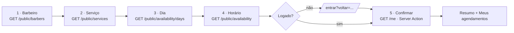

# Spec — Agendamento pelo cliente

- **Issues:** #57 (S3.08), #80 (S4.07, aparência com a base visual nova)
- **Fase:** 1 (MVP) (ver `docs/produto/roadmap.md`)
- **Status:** implementada

## Contexto
É o centro do MVP: o cliente marca o próprio horário pelo celular, sem ligar para a barbearia (O1), e o sistema garante que ninguém fica com o mesmo horário (O2). A vitrine (S3.05) já leva a `/agendar`, e o motor de disponibilidade (S3.07) já sabe quais horários estão livres e impede a sobreposição no banco. Esta funcionalidade junta as duas coisas: o fluxo de escolha, a confirmação e a criação do agendamento com as regras do cliente.

## Quem usa
Cliente (agenda). O visitante percorre as escolhas e entra com o Google para confirmar. A administração não agenda por este fluxo (RN-70); o agendamento manual é da S5.05 ([agendamento-admin.md](agendamento-admin.md)).

## Histórias
- Como **cliente**, quero **escolher o barbeiro, o serviço, o dia e o horário em poucos toques** para **marcar sem precisar ligar**.
- Como **cliente**, quero **ver só os serviços que o barbeiro escolhido faz e só os dias e horários livres** para **não escolher algo que não existe**.
- Como **visitante**, quero **ver os horários livres antes de entrar com o Google** para **decidir se vale a pena agendar**.
- Como **cliente sem telefone no perfil**, quero **informar o telefone na própria confirmação** para **não sair do fluxo**.
- Como **barbearia**, quero **que o agendamento nasça confirmado, com o preço e a duração do momento, e que cada cliente tenha no máximo 2 horários marcados** para **não ter reserva em excesso nem cobrança divergente**.

## Regras envolvidas
- RN-05 — Horário disponível (via `ensure_slot_available`, S3.07)
- RN-06 — Antecedência mínima
- RN-07 — Janela de agendamento
- RN-08 — Sem sobreposição (exclusion constraint e `is_slot_conflict`, S3.07)
- RN-10 — Login para agendar (telefone obrigatório)
- RN-11 — Limite de agendamentos
- RN-12 — Confirmação imediata
- RN-13 — Preço e duração congelados
- RN-16 — Privacidade entre clientes (o cliente vem sempre do token)
- RN-70 — Perfis e permissões (só o cliente agenda para si)
- RN-14 — Prazo para cancelar e remarcar (só a política na confirmação)
- RN-50 — Confirmação por e-mail (S5.03, em [notificacoes-email.md](notificacoes-email.md))

## Decisão de produto: barbeiro antes do serviço
A ordem do fluxo é **barbeiro → serviço → dia → horário → confirmar**. Ela substitui a ordem serviço → barbeiro do roadmap e da proposta em `referencia-beard-x.md`. Registrada como **D11** em [registro.md](../cliente/registro.md). O motivo: o cliente de barbearia costuma escolher primeiro **com quem** quer cortar, e o Squire, que é a referência do fluxo, também pergunta o profissional antes do serviço. A tela de serviço mostra só os serviços que aquele barbeiro realiza.

## Critérios de aceite

**CA-1 — Agendar do zero (RN-05, RN-12, RN-13)**
- **Dado** um cliente logado, com telefone, sem agendamentos
- **Quando** envia `POST /me/appointments` com `barber_id`, `service_id` e um `starts_at` que está entre os horários disponíveis (RN-05 a RN-07)
- **Então** a API responde `201` com o agendamento: `id`, `status` = `SCHEDULED`, o barbeiro e o serviço (`id` e `name`), `starts_at` e `ends_at` com `-03:00`, `price` (string decimal, `"35.00"`) e `duration_minutes`. No banco, `source` = `ONLINE`, e o preço e a duração são os do serviço naquele momento. Mudar o serviço depois não altera o agendamento.

**CA-2 — Telefone obrigatório (RN-10)**
- **Dado** um cliente sem telefone no cadastro
- **Quando** tenta agendar
- **Então** a API responde `409` com `code` = `PHONE_REQUIRED` e "Informe seu telefone para agendar. A barbearia usa o telefone para falar com você.", e nada é gravado.

**CA-3 — No máximo 2 agendamentos ativos no futuro (RN-11)**
- **Dado** um cliente com 2 agendamentos `SCHEDULED` que ainda não terminaram
- **Quando** tenta um terceiro
- **Então** a API responde `409` com `code` = `APPOINTMENT_LIMIT_REACHED` e "Você já tem 2 agendamentos marcados, que é o máximo. Para marcar outro, cancele um deles ou espere o próximo atendimento.", e nada é gravado.
- Agendamentos cancelados, concluídos, com falta ou que já terminaram não contam. O de outro cliente também não.
- O limite aparece antes das escolhas (#155): para o cliente logado, `/agendar` lê `GET /me/appointments`, que traz `can_book` (calculado pela API, RN-11). Com `can_book` = `false`, todas as etapas de escolha mostram o `Alert` `warning` "Você já tem 2 horários marcados, que é o máximo." com o botão "Ver meus agendamentos". Na confirmação, a recusa `APPOINTMENT_LIMIT_REACHED` traz o link "Ver meus agendamentos" no lugar de "Escolher outro horário". Sem sessão, para a administração ou se a API não responder, nada aparece.
- Dois pedidos simultâneos do mesmo cliente não passam do limite: a criação trava a linha do cliente (`FOR NO KEY UPDATE`) antes de contar.

**CA-4 — Horário indisponível (RN-05 a RN-07)**
- **Dado** um `starts_at` fora da grade, com menos de 1 hora de antecedência, além da janela de 30 dias, já ocupado, num dia fechado, ou um barbeiro ou serviço inativo, ou um barbeiro que não realiza o serviço
- **Quando** o cliente tenta agendar
- **Então** a API responde `409` com `code` = `SLOT_UNAVAILABLE` e "Este horário não está mais disponível. Escolha outro.". Barbeiro ou serviço inexistente responde `404` (`BARBER_NOT_FOUND`, `SERVICE_NOT_FOUND`). `starts_at` sem fuso ou campo inválido responde `422 VALIDATION_ERROR`.

**CA-5 — Disputa pelo mesmo horário (RN-08)**
- **Dado** dois clientes que confirmam o mesmo horário do mesmo barbeiro ao mesmo tempo
- **Quando** os dois pedidos passam pela conferência de disponibilidade e gravam
- **Então** só um recebe `201`. O outro recebe `409 SLOT_UNAVAILABLE` com a mesma mensagem do CA-4, venha a recusa da exclusion constraint ou do deadlock entre as duas transações (`is_slot_conflict`).

**CA-6 — Só o cliente agenda para si (RN-16, RN-70)**
- Sem token, a API responde `401`. A administração recebe `403` e não vira cliente. O cliente vem sempre do token: o corpo não aceita `customer_id` nem campos extras (`422`).

**CA-7 — Dias com horário**
- **Dado** um barbeiro e um serviço
- **Quando** se chama `GET /public/availability/days?barber_id=&service_id=`
- **Então** a API devolve, em ordem, as datas de hoje até hoje + 30 dias (RN-07) que têm pelo menos um horário disponível (RN-05, RN-06), com a mesma conta de `GET /public/availability`. Barbeiro ou serviço inexistente responde `404`; inativo ou sem o serviço devolve a lista vazia.

**CA-8 — Fluxo no web, uma escolha por tela**
- **Dado** um visitante em `/agendar`, numa tela de 360px
- **Quando** escolhe o barbeiro, o serviço, o dia e o horário
- **Então** cada toque leva à próxima etapa, e a escolha fica na URL (`/agendar?barbeiro=1&servico=2&data=2026-11-03&hora=10:00`). Voltar e avançar do navegador funcionam, e tudo funciona sem JavaScript.
- A etapa de serviço mostra só os serviços que o barbeiro realiza. A de dia mostra só os dias com horário (CA-7). A de horário mostra os horários do dia, agrupados em Manhã e Tarde.
- Cada etapa diz "Etapa N de 5" e mostra as escolhas anteriores, cada uma com o link "Trocar".

**CA-9 — Entrada pela vitrine**
- `/agendar?barbeiro=<id>` (card do barbeiro) abre direto a etapa de serviço daquele barbeiro.
- `/agendar?servico=<id>` (card do serviço) abre a etapa de barbeiro só com quem realiza aquele serviço. Escolhido o barbeiro, o fluxo segue para o dia, com o serviço já escolhido.
- Um id que não está na vitrine (inexistente, inativo, ou um serviço que o barbeiro não faz) é ignorado, e o fluxo volta para a etapa que falta.

**CA-10 — Login só na confirmação, voltando ao mesmo ponto**
- **Dado** um visitante sem sessão
- **Quando** chega à confirmação (`hora` escolhida)
- **Então** o servidor leva a `/entrar?voltar=<a URL completa da confirmação>`. Depois do Google, ele volta para a confirmação com tudo escolhido.
- A administração logada que chega à confirmação vê o resumo e o aviso "Você entrou com a conta da administração.", sem o botão de confirmar, e o botão "Agendar para um cliente", que abre o "Novo agendamento" da agenda (`/admin/agenda/novo`) com o mesmo barbeiro, serviço, dia e horário (RN-70, #143).

**CA-11 — Telefone na confirmação (RN-10)**
- **Dado** um cliente sem telefone (`has_phone` = `false` em `GET /me`)
- **Quando** abre a confirmação
- **Então** vê o campo Telefone antes do botão "Confirmar agendamento". Ao confirmar, a Server Action salva o telefone (`PATCH /me/profile`) e cria o agendamento. Telefone inválido mostra o `message` da API ("Informe o telefone com DDD.") e mantém o que foi digitado. O link "Escolher outro horário" só acompanha a recusa do horário (`SLOT_UNAVAILABLE`); nas outras recusas, o problema não é o horário (#148).

**CA-12 — Confirmação e resumo**
- A confirmação mostra o barbeiro, o serviço, a data completa, o horário de início e de fim, a duração, o preço e a política de alteração num `Alert` `info` ("Imprevistos acontecem.": remarcar ou cancelar pelo site até o horário marcado, avisando com 2 horas de antecedência quando possível; RN-14, D16), com o botão "Confirmar agendamento".
- Se o horário escolhido já não está entre os disponíveis quando a tela abre, ela avisa e oferece "Escolher outro horário", sem o botão de confirmar.
- Depois de confirmar, a Server Action leva a `/agendar/confirmado/{id}` (#155), uma URL própria que lê `GET /me/appointments/{id}` e mostra "Seu horário está confirmado." com o resumo e o link "Ver meus agendamentos" (`/meus-agendamentos`, S3.09). Recarregar essa página mostra o mesmo horário, e não a confirmação com "Este horário não está mais disponível". Se o agendamento foi cancelado depois, ela diz "Este agendamento não está mais ativo.".
- Qualquer erro da API (CA-2 a CA-6) aparece com o `message` dela num `Alert`, com o link para escolher outro horário. O web não decide regra.

## Fluxo e telas
Rota `/agendar`, no grupo `(cliente)`. Uma página só, que decide a etapa pelos parâmetros da URL, na ordem `barbeiro`, `servico`, `data`, `hora`. A primeira escolha que falta é a etapa atual. Cada escolha é um link (um toque avança), então não há botão "Continuar" nem barra fixa no rodapé.

1. **Barbeiro:** cards com a foto (ou a inicial) e o nome. Com `?servico=`, só quem realiza o serviço.
2. **Serviço:** cards com nome, duração e preço, só os que o barbeiro realiza.
3. **Dia:** os dias com horário livre, como links ("Ter, 3 de nov"), numa grade de 3 colunas no celular. Sem dia: estado vazio com "Escolher outro barbeiro".
4. **Horário:** chips de horário (links), em grupos Manhã (antes do meio-dia) e Tarde, 3 colunas no celular. Sem horário: estado vazio com "Escolher outro dia".
5. **Confirmar:** o resumo, a política de alteração num `Alert` `info`, o campo Telefone quando falta e o botão principal. Depois de confirmar, `/agendar/confirmado/{id}`, com "Seu horário está confirmado.", o resumo e os links "Ver meus agendamentos" e "Voltar para o início".

**Aparência (S4.07, #80):** a base visual da vitrine, com o ritmo de tarefa. O título da etapa em Barlow 900 (`text-display-3`), o botão principal no tamanho `md` (60px no celular, 84px a partir de 768px), chips de horário com 44px e de dia com 80px, número em Barlow 600, e hover de 300ms `ease-standard`. A moldura fica em `paper`, logo abaixo do cabeçalho escuro, **sem a faixa escura parcial** das páginas internas: o fluxo segue o Squire, e uma faixa em cada etapa empurraria as opções para fora da primeira tela do celular. Nada mudou na ordem das etapas, nas regras nem nos textos de erro.

Estados: `loading.tsx` com esqueleto; falha de leitura da API mostra um `Alert` `danger` com "Não foi possível carregar os horários. Tente novamente em instantes." e o resto da página continua; erro da Server Action mostra o `message` da API.

O "Trocar" de uma escolha leva à etapa dela, sem ela e sem as que dependem dela (trocar o barbeiro volta para `/agendar`; trocar o dia mantém o barbeiro e o serviço). Voltar pelo navegador faz o mesmo, porque cada etapa tem a própria URL.

As telas de dia e de horário são os componentes `DayPicker` e `TimePicker` (`web/src/components/booking/`), que recebem a lista da API e uma função `hrefFor` com o destino de cada opção. A remarcação (S3.09) os reaproveita com outros destinos.

## API
| Método | Caminho | Quem | O que faz |
|---|---|---|---|
| `POST` | `/me/appointments` | Cliente (`current_customer`) | Cria o agendamento `SCHEDULED`/`ONLINE` com o preço e a duração do serviço. Corpo: `barber_id`, `service_id`, `starts_at` (com fuso). Responde `201` com o agendamento |
| `GET` | `/public/availability/days?barber_id=&service_id=` | Qualquer um | Datas da janela do cliente com pelo menos um horário disponível |

- A criação fica no módulo novo `app/modules/booking/` (router, schemas e service), que depende de `appointments`, `availability`, `catalog`, `barbers` e `customers`. Ela não fica em `appointments/service.py` porque `appointments` não pode importar `availability`: `availability` → `barbers` → `appointments` formaria um ciclo (a trava da RN-60). As próximas operações do cliente (listar, cancelar, remarcar, S3.09) entram no mesmo módulo.
- Ordem da criação, numa transação: trava o cliente (`FOR NO KEY UPDATE`), confere o telefone (RN-10), conta os ativos (RN-11), trava o serviço (`get_service(..., lock=True)`, `FOR SHARE`), confere o horário com `ensure_slot_available` (RN-05 a RN-07, trava o barbeiro e o dia do expediente com `FOR SHARE`), grava e confirma. Uma falha no insert reconhecida por `is_slot_conflict` vira `409 SLOT_UNAVAILABLE` (RN-08), inclusive quando o autoflush acontece na leitura do cliente pelo `notify`: o registro da confirmação fica dentro do mesmo tratamento de erro do commit, e a recusa não deixa agendamento nem aviso (RN-50).
- A trava do serviço faz uma edição dele ao mesmo tempo esperar a reserva: a duração conferida é a gravada, e o agendamento não passa do fechamento (RN-05, RN-13, #149). É a mesma trava do agendamento pela administração, e nos dois fluxos ela vem antes da do barbeiro.
- A trava do cliente é `FOR NO KEY UPDATE`, e não `FOR UPDATE`, para não segurar a chave estrangeira de um agendamento que a administração grava para o mesmo cliente. Essa reserva já segura o dia do expediente; se esperasse o cliente, enquanto o cliente espera o dia travado por uma edição do expediente (RN-02) e a edição espera o dia dela, as três transações fechariam um deadlock (#105). Dois pedidos do próprio cliente continuam se esperando, porque `FOR NO KEY UPDATE` conflita consigo mesmo.
- "Ativo no futuro" (RN-11) é `SCHEDULED` com `ends_at` depois de agora, o mesmo critério da RN-60.
- `GET /public/availability/days` reaproveita a função pura `available_slots`, com uma leitura do expediente, da oferta e dos ocupados da janela inteira.

## Fora do escopo desta spec
- **E-mail de confirmação (RN-50):** entrou na S5.03 (#95). `create_customer_appointment` registra a confirmação na mesma transação e a envia depois do commit; ver [notificacoes-email.md](notificacoes-email.md).
- **"Meus agendamentos", cancelar e remarcar (RN-14, RN-15):** S3.09 (#58), em [meus-agendamentos.md](meus-agendamentos.md).
- Agendamento pela administração (RN-20, RN-21): S5.05 ([agendamento-admin.md](agendamento-admin.md)).
- A opção "qualquer barbeiro".
- Calendário mensal e "próximo horário livre" no card do barbeiro.
- Página `/barbeiros/[slug]`.

## Dúvidas em aberto
Escolhas desta implementação que nenhuma RN decide, a confirmar:
- **Login só na confirmação:** o visitante vê barbeiros, serviços, dias e horários sem entrar, e o login vem quando ele escolhe o horário. A alternativa, exigir login logo em `/agendar`, faz o visitante entrar com o Google antes de saber se há horário.
- **Dias como lista dos que têm horário,** e não a faixa de 7 dias com calendário mensal proposta no design system: com 31 dias no máximo e só os que têm horário, a lista cabe em poucas linhas e não precisa de JS.
- **Cada escolha é um link** que avança na hora, sem botão "Continuar" nem barra fixa no rodapé. Os horários são links com a cara do `ChoiceChip`, não `radio`.
- **RN-11 conta o agendamento em andamento** (`ends_at` depois de agora), como a RN-60. Um `SCHEDULED` que já terminou e espera a conclusão não conta.
- **Códigos 409** para telefone ausente (`PHONE_REQUIRED`) e limite (`APPOINTMENT_LIMIT_REACHED`): são conflitos com o estado do cadastro, não erros de formato.
- **O resumo aparece no lugar do formulário,** na mesma URL. Recarregar a página mostra a confirmação de novo, e um segundo envio é recusado pela API (o horário já é dele). A S3.09 manteve esse resumo, com o link para "Meus agendamentos".
