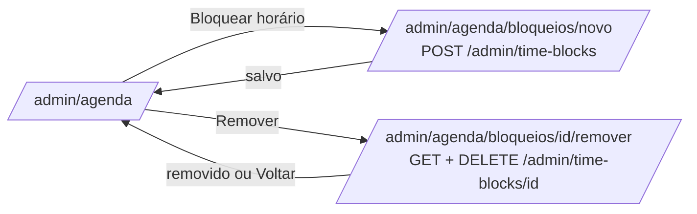

# Spec — Bloqueios e folgas na agenda dos barbeiros

- **Issue:** #96 (S5.04)
- **Fase:** 1 (MVP) (ver `docs/produto/roadmap.md`)
- **Status:** implementada

## Contexto
Hoje a agenda online oferece todos os horários do expediente, mesmo quando o barbeiro está almoçando, de folga ou num compromisso. A barbearia precisa tirar esses horários do ar na hora, sem depender de deploy e sem desmarcar ninguém por engano (O2, sem sobreposição). Esta funcionalidade cria o **bloqueio** (RN-03), que entra na lista de intervalos ocupados do cálculo de disponibilidade (RN-05, item 3), e as telas da administração para criar e remover bloqueios na agenda (S5.01).

## Quem usa
Administração (cria, vê e remove). O cliente e o visitante não veem os bloqueios: só deixam de ver os horários bloqueados.

## Histórias
- Como **administração**, quero **bloquear o almoço de um barbeiro, das 12h às 13h** para **ninguém agendar nesse horário**.
- Como **administração**, quero **dar folga de um dia inteiro a um barbeiro** para **o site não oferecer nenhum horário dele naquele dia**.
- Como **administração**, quero **ver os bloqueios na agenda do dia e da semana** para **saber quem está disponível**.
- Como **administração**, quero **remover um bloqueio** para **liberar os horários quando o compromisso for desmarcado**.
- Como **barbearia**, quero **que um bloqueio nunca caia em cima de um cliente agendado** para **não deixar ninguém esperando**.

## Regras envolvidas
- RN-01 — Fuso horário
- RN-02 — Horário de funcionamento
- RN-03 — Bloqueios
- RN-05 — Horário disponível (item 3)
- RN-08 — Sem sobreposição (a mesma trava, agora entre bloqueio e agendamento)
- RN-15 e RN-21 — a remarcação e o agendamento pela administração seguem a RN-05, então também respeitam os bloqueios
- RN-30 — Status (só `SCHEDULED` impede o bloqueio)
- RN-70 — Perfis e permissões
- RN-71 — Acesso à administração

## Modelo
- **Bloqueio (`TimeBlock`)**, tabela `time_blocks`, no módulo `app/modules/time_blocks/` (migração `0010`):
  - `barber_id`: obrigatório, com chave estrangeira para `barbers`;
  - `starts_at` e `ends_at`: `timestamptz` (RN-01). O intervalo é `[starts_at, ends_at)`, como o do agendamento: um bloqueio que termina às 13h não cruza um agendamento que começa às 13h;
  - `reason`: motivo opcional, até 120 caracteres ("Almoço", "Folga", "Médico");
  - `created_at`.
- `CHECK` no banco: `ends_at > starts_at`.
- **Sem sobreposição entre bloqueios:** a exclusion constraint `ex_time_blocks_barber_overlap` (`barber_id WITH =`, `tstzrange(starts_at, ends_at, '[)') WITH &&`) impede dois bloqueios do mesmo barbeiro que se cruzem. O serviço confere antes e responde com mensagem; a constraint é a última barreira.
- **Folga de dia inteiro** (RN-03) é um bloqueio da meia-noite do dia até a meia-noite do dia seguinte, no fuso de São Paulo. Ele cobre o expediente do dia, qualquer que seja, e continua cobrindo se o horário de funcionamento mudar depois. Não há coluna própria: a resposta calcula `all_day` a partir do intervalo.
- Um bloqueio fica **dentro de um dia**: o início e o fim são horas do mesmo dia local, ou o dia inteiro. Uma folga de vários dias são vários bloqueios (ver "Fora do escopo").
- Não há edição: para mudar um bloqueio, a administração remove e cria outro.

## Disponibilidade (RN-05, item 3)
Os bloqueios do barbeiro que cruzam o dia entram na lista de **intervalos ocupados** de `available_slots`, ao lado dos agendamentos `SCHEDULED`, em `_busy` (`availability/service.py`). A função pura não muda. Por isso o bloqueio vale, sem código a mais, para:
- os horários e os dias de `/agendar` (`GET /public/availability` e `/public/availability/days`);
- a criação pelo cliente (`ensure_slot_available`, S3.08);
- os horários e a confirmação da remarcação (S3.09);
- o agendamento pela administração (S5.05, #97), que usa o mesmo motor.

O bloqueio vale na hora: o cálculo lê o banco a cada consulta.

## Concorrência (RN-03 × RN-08)
Um bloqueio só é criado num intervalo sem agendamentos ativos (RN-03). A disputa com uma reserva simultânea é resolvida pela **mesma trava do barbeiro** que a criação de agendamento já usa:
- a criação e a remarcação de agendamento chamam `ensure_slot_available`, que trava a linha do barbeiro com `FOR SHARE` antes de ler os ocupados e mantém a trava até o fim da transação;
- a criação do bloqueio trava a mesma linha com `FOR UPDATE` antes de procurar agendamentos `SCHEDULED` que cruzem o intervalo.

`FOR UPDATE` espera qualquer `FOR SHARE` em andamento, e vice-versa. Então:
- se a reserva chegou primeiro, o bloqueio espera ela terminar e, depois, enxerga o agendamento e é recusado com `409 TIME_BLOCK_CONFLICT`;
- se o bloqueio chegou primeiro, a reserva espera ele terminar e, depois, enxerga o bloqueio entre os ocupados e é recusada com `409 SLOT_UNAVAILABLE`.

No Postgres, em `READ COMMITTED`, cada comando enxerga o que foi confirmado antes dele começar; por isso a leitura feita depois da trava já vê o que a outra transação gravou. A trava `FOR UPDATE` também serializa a criação de dois bloqueios do mesmo barbeiro e a inativação (RN-60), que usa a mesma trava.

## Critérios de aceite

**CA-1 — Criar um bloqueio com horário (RN-03)**
- **Dado** a administração e o barbeiro Edvaldo, sem agendamentos na segunda-feira 2/11/2026
- **Quando** envia `POST /admin/time-blocks` com `{ barber_id, date: "2026-11-02", start_time: "12:00", end_time: "13:00", reason: "Almoço" }`
- **Então** a API responde `201` com `id`, `barber` (`id`, `name`, `active`), `starts_at` `2026-11-02T12:00:00-03:00`, `ends_at` `2026-11-02T13:00:00-03:00`, `all_day: false` e `reason: "Almoço"`. O motivo é aparado; motivo vazio vira `null`.

**CA-2 — Folga de dia inteiro (RN-03)**
- **Quando** a administração envia o mesmo pedido sem `start_time` e `end_time` (ou com os dois `null`)
- **Então** o bloqueio vai de `2026-11-02T00:00:00-03:00` a `2026-11-03T00:00:00-03:00`, com `all_day: true`.

**CA-3 — Horários inválidos**
- Só um dos dois horários responde `422` com `code` = `INVALID_TIME_BLOCK` e "Informe o início e o fim, ou marque o dia inteiro.".
- Fim igual ou antes do início responde `422` com `code` = `INVALID_TIME_BLOCK` e "O fim do bloqueio precisa ser depois do início.".
- O último dia do calendário (`9999-12-31`) responde `422` com `code` = `INVALID_TIME_BLOCK` e "Escolha uma data válida.".
- Data ou hora em outro formato, ou motivo com mais de 120 caracteres, respondem `422 VALIDATION_ERROR`.
- Um `barber_id` que não existe responde `404 BARBER_NOT_FOUND`.

**CA-4 — Recusa sobre agendamento ativo (RN-03)**
- **Dado** um agendamento `SCHEDULED` do Edvaldo das 12h30 às 13h15
- **Quando** a administração tenta bloquear das 12h às 13h, ou o dia inteiro
- **Então** a API responde `409` com `code` = `TIME_BLOCK_CONFLICT` e "Este barbeiro tem agendamento marcado nesse intervalo. Cancele ou remarque o agendamento antes de bloquear.", e nada é gravado.
- Agendamento cancelado, concluído ou com falta, de outro barbeiro, ou que só encosta no intervalo (termina às 12h ou começa às 13h) não impede.

**CA-5 — Sem dois bloqueios cruzados**
- **Dado** um bloqueio do Edvaldo das 12h às 13h
- **Quando** a administração bloqueia das 12h30 às 14h, ou o dia inteiro
- **Então** a API responde `409` com `code` = `TIME_BLOCK_OVERLAP` e "Este intervalo cruza outro bloqueio do barbeiro. Remova o bloqueio existente ou escolha outro horário.". Encostar (das 13h às 14h) e outro barbeiro são aceitos. O banco também recusa (exclusion constraint).

**CA-6 — Corrida com uma reserva (RN-03, RN-08)**
- **Dado** uma reserva em andamento que já passou por `ensure_slot_available` e ainda não confirmou
- **Quando** a administração cria um bloqueio no mesmo intervalo
- **Então** o bloqueio espera a reserva e, quando ela confirma, é recusado com `TIME_BLOCK_CONFLICT`. Se a reserva desistir, o bloqueio é criado.
- **E, ao contrário,** com um bloqueio em andamento, a reserva espera e, quando o bloqueio confirma, é recusada com `SLOT_UNAVAILABLE`.

**CA-7 — Bloqueio tira os horários na hora (RN-05, item 3)**
- **Dado** um bloqueio do Edvaldo das 12h às 13h numa segunda das 10h às 19h
- **Quando** se consulta `GET /public/availability` do Corte Simples (30 min) nesse dia
- **Então** 12h00 e 12h30 não aparecem, e 11h30 e 13h00 aparecem. Com o Corte + Barba (45 min), 11h30 também some (terminaria às 12h15). Com folga de dia inteiro, o dia não tem horário nenhum e some de `/public/availability/days`. A criação (`POST /me/appointments`) e a remarcação nesse horário respondem `409 SLOT_UNAVAILABLE`. Bloqueio de outro barbeiro não afeta.

**CA-8 — Bloqueios do período**
- **Quando** a administração chama `GET /admin/time-blocks?start=2026-11-02&end=2026-11-08` (e, opcionalmente, `barber_id`)
- **Então** recebe `200` com a lista dos bloqueios que **cruzam** o período (dias de São Paulo, RN-01), por início, nome do barbeiro e id, no mesmo formato do CA-1. O período segue as regras da agenda (S5.01): até 7 dias, `422 INVALID_PERIOD` nos mesmos casos. Um `barber_id` que não existe responde `404 BARBER_NOT_FOUND`.
- `GET /admin/time-blocks/{id}` devolve um bloqueio; um id que não existe responde `404` com `code` = `TIME_BLOCK_NOT_FOUND` e "Bloqueio não encontrado.".

**CA-9 — Remover**
- **Quando** a administração chama `DELETE /admin/time-blocks/{id}`
- **Então** recebe `204`, o bloqueio some, e os horários voltam a ser oferecidos na hora. Um id que não existe responde `404 TIME_BLOCK_NOT_FOUND`.

**CA-10 — Só a administração (RN-70, RN-71)**
- Sem token, `401`. Um cliente recebe `403` em todas as rotas `/admin/time-blocks`.

**CA-11 — Bloqueios na agenda (tela)**
- **Dado** a administração em `/admin/agenda`
- **Então**, na visão do dia, cada barbeiro mostra, depois dos agendamentos, os bloqueios dele no dia ("Bloqueios", com "12:00–13:00" ou "Dia inteiro" e o motivo). Na visão da semana, cada dia mostra os bloqueios do dia, com o nome do barbeiro quando a agenda mostra todos. Sem bloqueios, nada aparece (sem aviso de vazio).
- Falha ao ler os bloqueios mostra um `Alert` `warning` "Não foi possível carregar os bloqueios." e a agenda continua.

**CA-12 — Criar pela tela, sem JS**
- A barra da agenda tem "Bloquear horário", que leva a `/admin/agenda/bloqueios/novo`, com o estado da agenda na URL (data, visão e barbeiro).
- O formulário tem barbeiro (os ativos; o da agenda já escolhido), data (a da agenda), "Dia inteiro", início e fim (`type="time"`) e motivo (opcional). Com "Dia inteiro" marcado, início e fim são ignorados.
- Salvar chama `POST /admin/time-blocks` por Server Action. Deu certo: volta para a agenda **no dia do bloqueio**, mantendo a visão e o barbeiro, com o `Alert` `success` "Horário bloqueado.". Recusa: o formulário volta com o que foi digitado e o `message` da API num `Alert` `danger`.

**CA-13 — Remover pela tela, sem JS**
- Cada bloqueio na agenda tem o link "Remover" (nome acessível com o barbeiro e o horário), que leva a `/admin/agenda/bloqueios/{id}/remover`, uma página de confirmação (padrão "Confirmação destrutiva" do design system): o resumo (barbeiro, dia, horário, motivo), o aviso "Os horários voltam a ficar disponíveis para agendamento.", o `ghost` "Voltar" e o `danger` "Remover bloqueio", nessa ordem.
- Remover chama `DELETE /admin/time-blocks/{id}` por Server Action e volta para a agenda com o `Alert` `success` "Bloqueio removido.". Bloqueio inexistente mostra "Bloqueio não encontrado." e o link de volta.
- Tudo funciona em 360px.

## Fluxo e telas

- **Agenda:** a página lê `GET /admin/time-blocks` em paralelo com a agenda e o filtro de barbeiros, com o mesmo período e barbeiro. Os bloqueios entram pelos pontos de extensão da S5.01: `barberExtra` (dia) e `dayExtra` (semana), com o componente `TimeBlockList` (`time-blocks.tsx`); "Bloquear horário" entra em `actions` da barra.
- **Novo bloqueio:** `TimeBlockForm` (componente cliente com `useActionState`, funciona sem JS). Os campos de hora usam `type="time"`. O link "Voltar para a agenda" volta para a mesma visão.
- **Remover:** página de confirmação, porque a área da administração também funciona sem JS.
- **Estados:** a página nova usa o `loading.tsx` da agenda; falha ao ler os barbeiros no formulário mostra o `Alert` `danger` com a mensagem de leitura.

## API
| Método | Caminho | Quem | O que faz |
|---|---|---|---|
| `GET` | `/admin/time-blocks?start=&end=&barber_id=` | Administração (`require_admin`) | Os bloqueios que cruzam o período (até 7 dias), por início |
| `GET` | `/admin/time-blocks/{id}` | Administração | Um bloqueio |
| `POST` | `/admin/time-blocks` | Administração | Cria um bloqueio (`date`, `start_time`/`end_time` ou dia inteiro, `reason`), recusando agendamento ativo no intervalo (RN-03) e outro bloqueio cruzado |
| `DELETE` | `/admin/time-blocks/{id}` | Administração | Remove um bloqueio; os horários voltam na hora |

- **Rota própria, e não dentro de `GET /admin/appointments`:** o bloqueio tem ciclo de vida próprio, e a leitura separada deixa a agenda (que recebe também o agendamento manual e a conclusão) sem mudar de contrato. A página faz as duas leituras em paralelo.
- As datas e horas entram como horário local de São Paulo e viram instantes no `service.py`; as respostas saem em `-03:00` (RN-01). O período reaproveita `check_period` e `period_bounds` de `agenda/service.py`.
- O módulo `time_blocks` fica abaixo de `availability` (que importa só o modelo, para os ocupados) e acima de `barbers` e `appointments` (a trava e a busca de conflito).

## Fora do escopo desta spec
- **Folga de vários dias de uma vez** (férias): hoje são vários bloqueios de dia inteiro. Se a barbearia pedir, vira issue.
- **Bloqueio recorrente** (almoço todo dia): cada dia é um bloqueio.
- **Editar um bloqueio:** remover e criar outro.
- **Bloquear todos os barbeiros de uma vez** (feriado): um bloqueio por barbeiro.
- **Mudar o horário de funcionamento deixando agendamentos fora do expediente** (a dúvida que `barbearia-horarios.md` deixou para esta sprint): não entra aqui. Não é bloqueio, mexe na tela de horários e precisa de decisão de produto (avisar ou impedir). Virou a issue #105 (`[Backlog]`).
- Mostrar o bloqueio na grade do agendamento manual (S5.05) além do que o motor já faz.

## Dúvidas em aberto
Escolhas desta implementação que nenhuma RN decide, a confirmar:
- **Dia inteiro = da meia-noite à meia-noite** de São Paulo, e não só o expediente daquele dia. Assim a folga continua valendo se o horário de funcionamento mudar.
- **Dois bloqueios do mesmo barbeiro não se cruzam** (`409 TIME_BLOCK_OVERLAP`). A alternativa seria aceitar e mostrar os dois.
- **Bloqueio fora do expediente, em dia fechado, no passado ou de barbeiro inativo** é aceito: não atrapalha nada e não há regra contra. O formulário só oferece os barbeiros ativos.
- **Um agendamento `SCHEDULED` que já terminou** (ainda sem conclusão nem falta) também impede o bloqueio, porque continua ativo (RN-30).
- **Remover pede confirmação** numa página, como cancelar agendamento.
- **Motivo de até 120 caracteres.**
