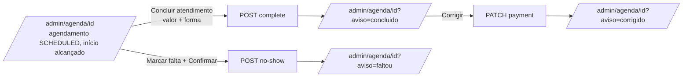

# Spec — Conclusão do atendimento com pagamento e falta

- **Issue:** #98 (S5.06)
- **Fase:** 1 (MVP) (ver `docs/produto/roadmap.md`)
- **Status:** implementada

## Contexto
Depois do corte, a administração precisa fechar o agendamento: registrar quanto foi cobrado e como o cliente pagou, ou anotar que ele não veio. Isso fecha o ciclo da agenda (O1) e é a única fonte do relatório financeiro (S5.07, #99): o faturamento é a soma dos pagamentos dos atendimentos concluídos (RN-43, RN-44). O atendimento sem agendamento prévio também passa por aqui: é um agendamento da administração (S5.05) começando agora, concluído como qualquer outro. **Não existe lançamento avulso.**

## Quem usa
Administração. O cliente e o visitante não acessam (RN-70).

## Histórias
- Como **administração**, quero **concluir um atendimento com o valor e a forma de pagamento** para **fechar a agenda do dia e alimentar o financeiro**.
- Como **administração**, quero **dar desconto ou cortesia no momento de cobrar** para **registrar o que realmente entrou no caixa**.
- Como **administração**, quero **marcar que o cliente faltou** para **liberar a pendência da agenda e contar a falta**.
- Como **administração**, quero **corrigir o valor ou a forma de pagamento de um atendimento já concluído** para **consertar um erro de digitação sem refazer o atendimento**.

## Regras envolvidas
- RN-13 — Preço e duração congelados (o valor sugerido é o preço do agendamento, não o do cadastro do serviço)
- RN-30 — Status
- RN-31 — Transições permitidas (`SCHEDULED` → `COMPLETED` e `SCHEDULED` → `NO_SHOW`, só a administração, só com o início já alcançado)
- RN-32 — Liberação da vaga (sair de `SCHEDULED` libera o horário; a exclusion constraint da RN-08 só olha `SCHEDULED`)
- RN-33 — Rastreabilidade (quem concluiu ou marcou falta, e quando)
- RN-40 — Conclusão com pagamento
- RN-41 — Correção
- RN-42 — O valor conta para o barbeiro do agendamento (o `Payment` liga ao `Appointment`, que tem o barbeiro)
- RN-44 — Atendimento sem agendamento prévio
- RN-70 e RN-71 — Só a administração

Nenhuma regra nova: as escolhas abaixo detalham as existentes e estão listadas em "Dúvidas em aberto".

## Definições desta funcionalidade
- **Início alcançado:** `starts_at <= agora`. No instante exato do início já vale. O agora vem de `utc_now` (`app/clock.py`), injetado por `Depends`.
- **Valor cobrado (`amount`):** `numeric(10,2)`, maior ou igual a zero. **Zero é válido** (cortesia). Trafega como string decimal (`"35.00"`), como o preço em `cadastro-servicos.md`; a entrada também aceita a vírgula de quem digita (`"35,50"`). Nunca `float`.
- **Padrão do valor:** se o pedido não traz `amount`, vale o `price` congelado do agendamento (RN-13, RN-40). A tela já abre o campo preenchido com ele.
- **Forma de pagamento (`method`):** `CASH` (Dinheiro), `PIX`, `DEBIT` (Débito) ou `CREDIT` (Crédito). Obrigatória, sem padrão: a administração escolhe. Guardada como texto com `CHECK`, no estilo dos outros enums (`native_enum=False`).
- **Pagamento (`Payment`):** no máximo um por agendamento (`appointment_id` único) e só existe para agendamento `COMPLETED`. Quem garante o "só se concluído" é o service, na mesma transação da mudança de status; o banco garante o "um por agendamento", o valor `>= 0` e a forma válida.
- **Quem e quando (RN-33):** o `Appointment` ganha `closed_at` (instante da conclusão ou da falta) e `closed_by` (o **e-mail da conta da administração** que fez, vindo do JWT). Os dois existem juntos, e só quando o status é `COMPLETED` ou `NO_SHOW`: a constraint `ck_appointments_closing` tem o mesmo estilo da `ck_appointments_cancellation`. O cancelamento continua com `canceled_at`/`canceled_by`.
- **Correção (RN-41):** muda `amount` e/ou `method` do `Payment`. O status e o `closed_at`/`closed_by` não mudam. O `updated_at` do pagamento registra quando foi mexido por último.

## Critérios de aceite

**CA-1 — Concluir com o valor padrão (RN-31, RN-40, RN-13)**
- **Dado** um agendamento `SCHEDULED` de R$ 35,00 cujo início já passou
- **Quando** a administração chama `POST /admin/appointments/{id}/complete` com `{ "method": "PIX" }`
- **Então** a API responde `200` com o agendamento em `COMPLETED`, `closed_at`, `closed_by` (e-mail da administração) e `payment` = `{ amount: "35.00", method: "PIX" }`. Mudar o preço do serviço depois não altera o valor sugerido nem o registrado.

**CA-2 — Desconto e cortesia (RN-40)**
- **Quando** o pedido traz `amount` `"30.00"` (ou `"30,00"`), o pagamento guarda `30.00`, e o preço do agendamento continua `35.00`.
- **Quando** traz `amount` `"0"`, o pagamento guarda `0.00` e o atendimento fica concluído (cortesia).

**CA-3 — Concluir o que ainda não começou ou não está ativo (RN-31)**
- Início no futuro: `409` com `code` = `APPOINTMENT_NOT_STARTED` e "O horário de início ainda não chegou (03/11 às 14:30). Só dá para concluir ou marcar falta a partir dele.". No instante exato do início, funciona.
- Agendamento `CANCELED`, `COMPLETED` ou `NO_SHOW`: `409` com `code` = `APPOINTMENT_NOT_ACTIVE` e a mensagem do status ("Este agendamento foi cancelado, então não pode ser concluído nem marcado como falta.", "Este atendimento já foi concluído.", "Este agendamento já foi marcado como falta."). Nada é gravado.
- Id inexistente: `404` com `code` = `APPOINTMENT_NOT_FOUND`.

**CA-4 — Valor e forma inválidos (RN-40)**
- `amount` negativo: `422` com `code` = `INVALID_PAYMENT_AMOUNT` e "O valor cobrado não pode ser negativo.". Mais de duas casas decimais, fora de `numeric(10,2)`, texto que não é número ou **número JSON com casas decimais** (`35.5`, que chegaria como `float`): `422` `VALIDATION_ERROR`. O valor vai como texto decimal (`"35.50"`) ou inteiro.
- `method` ausente ou fora dos quatro valores: `422` `VALIDATION_ERROR`.
- Em todos, o agendamento continua `SCHEDULED`.

**CA-5 — Marcar falta (RN-31, RN-33)**
- **Dado** um `SCHEDULED` cujo início já passou
- **Quando** a administração chama `POST /admin/appointments/{id}/no-show`
- **Então** responde `200` com o agendamento em `NO_SHOW`, `closed_at` e `closed_by`, sem `payment` (`null`). A vaga fica livre (RN-32).
- As recusas são as do CA-3 (futuro, não ativo, inexistente).

**CA-6 — Corrigir o pagamento (RN-41)**
- **Dado** um agendamento `COMPLETED` com pagamento de `35.00` em `PIX`
- **Quando** a administração chama `PATCH /admin/appointments/{id}/payment` com `{ "method": "CASH" }`, com `{ "amount": "40.00" }` ou com os dois
- **Então** responde `200` com o pagamento atualizado, o status continua `COMPLETED` e `closed_at`/`closed_by` não mudam. Só os campos enviados mudam. Valor negativo: `422` `INVALID_PAYMENT_AMOUNT`. Corpo sem nenhum dos dois campos: `422` com `code` = `EMPTY_PAYMENT_UPDATE` e "Informe o valor ou a forma de pagamento para corrigir.".
- Agendamento que não está `COMPLETED` (agendado, cancelado, falta): `409` com `code` = `APPOINTMENT_NOT_COMPLETED` e "Só dá para corrigir o pagamento de um atendimento concluído.". Inexistente: `404`.

**CA-7 — Duas conclusões ao mesmo tempo**
- **Dado** o mesmo agendamento
- **Quando** dois pedidos de concluir (ou de concluir e marcar falta) chegam juntos
- **Então** a linha é travada (`FOR UPDATE`) e relida: um funciona, o outro recebe `409 APPOINTMENT_NOT_ACTIVE`. Há um só `Payment` e um só `closed_by`.

**CA-8 — O banco garante a coerência (RN-33)**
- Gravar `COMPLETED` ou `NO_SHOW` sem `closed_at` e `closed_by`, ou preencher `closed_at`/`closed_by` com outro status, é recusado pela `ck_appointments_closing`. Um segundo `Payment` para o mesmo agendamento, um valor negativo e uma forma fora da lista são recusados.

**CA-9 — O detalhe e a agenda trazem o pagamento**
- `GET /admin/appointments/{id}` e os itens de `GET /admin/appointments` ganham `payment` (`{ amount, method }` ou `null`), `closed_at` e `closed_by` (`-03:00`, RN-01).

**CA-10 — Só a administração (RN-70, RN-71)**
- As três rotas: sem token, `401`; cliente, `403`.

**CA-11 — Tela: concluir (sem JS)**
- **Dado** um agendamento `SCHEDULED` cujo início já passou, em `/admin/agenda/{id}`
- **Então** abaixo do detalhe há a seção "Concluir atendimento": o campo "Valor cobrado" já preenchido com o preço ("35,00"), as quatro formas como botões grandes de escolha única (Dinheiro, Pix, Débito, Crédito), nenhuma marcada, e o botão "Concluir atendimento". Ao lado, "Marcar falta".
- Enviar sem escolher a forma não envia (campo obrigatório do navegador; sem JS, a API recusa e a tela mostra o `message`).
- Deu certo: volta ao mesmo detalhe (mesmo `?data=&visao=&barbeiro=`) com o aviso "Atendimento concluído." e o status "Concluído". Recusado: a página mostra o `message` da API num `Alert` `danger`, e o campo mantém o que foi digitado.
- Os valores usam `formatPrice`; nada passa por `number`.

**CA-12 — Tela: marcar falta**
- "Marcar falta" abre uma confirmação (`
`, sem JS): "O cliente não compareceu? Isso não pode ser desfeito." e o botão "Confirmar falta". Confirmou: volta ao detalhe com "Falta registrada." e o status "Faltou". Por ser definitivo (status final, RN-31), a falta exige esse segundo toque.

**CA-13 — Tela: o concluído mostra o pagamento e "Corrigir" (RN-41)**
- **Dado** um agendamento `COMPLETED`
- **Então** a seção "Pagamento" mostra o valor cobrado, a forma, e quem concluiu e quando (RN-33), e um "Corrigir" (`
`) com o formulário já preenchido (valor e forma atuais) e "Salvar correção". Deu certo: aviso "Pagamento corrigido.".
- O `NO_SHOW` mostra "Falta registrada por <e-mail> em <data>". O `SCHEDULED` que ainda não começou mostra "O atendimento pode ser concluído a partir das 14:30." no lugar dos formulários. O `CANCELED` não mostra a seção.

**CA-14 — 360px**
- Os campos e botões ocupam a largura toda no celular, com alvos de no mínimo 44px; as formas de pagamento ficam em duas colunas. Valores e e-mails longos quebram sem rolagem horizontal.

## Fluxo e telas

- A seção fica em `web/src/app/admin/agenda/conclusao/`, **fora** de `AppointmentDetail`: a página do detalhe só a renderiza abaixo do cartão. Assim `AppointmentDetail` e seu slot `actions` ficam livres para o cancelamento e a remarcação (S5.05).
- Os formulários são Client Components (`useActionState`) que chamam Server Actions e funcionam sem JS. A Server Action recebe o id e o estado da agenda por `bind`, chama a API e dá `redirect` para o mesmo detalhe com `?aviso=`.
- Quem decide a regra é a API. A tela só **não oferece** o formulário de um agendamento que ainda não começou (compara `starts_at` com o relógio do servidor web), para não mostrar um botão que sabemos que será recusado; se o relógio do web divergir, a API recusa com o `message` e a tela o mostra.

## API
| Método | Caminho | Quem | O que faz |
|---|---|---|---|
| `POST` | `/admin/appointments/{id}/complete` | Administração (`require_admin`) | Conclui com `method` (obrigatório) e `amount` (opcional, padrão = preço congelado). Devolve o agendamento |
| `POST` | `/admin/appointments/{id}/no-show` | Administração (`require_admin`) | Marca a falta. Devolve o agendamento |
| `PATCH` | `/admin/appointments/{id}/payment` | Administração (`require_admin`) | Corrige `amount` e/ou `method` de um concluído. Devolve o agendamento |

- O módulo é `app/modules/payments/` (`models.py` com `Payment` e `PaymentMethod`, `schemas.py`, `service.py`, `router.py`). `agenda` importa os modelos e schemas de `payments` para trazer o pagamento no detalhe; o `router` de `payments` importa a montagem da resposta de `agenda`. Os módulos não se importam em ciclo: `payments.models` e `payments.schemas` não conhecem `agenda`.
- As três rotas devolvem o mesmo `AdminAppointmentResponse` da agenda, que ganhou `payment`, `closed_at` e `closed_by`.
- O `service.py` trava a linha do agendamento com `SELECT ... FOR UPDATE` e `populate_existing`, confere o status e o início, grava e faz `commit`.
- Migração `0009_create_payments`: cria `payments`, adiciona `closed_at`/`closed_by` e `ck_appointments_closing` em `appointments`. Agendamento `COMPLETED`/`NO_SHOW` que já exista (nenhuma rota os produzia antes) é preenchido com `closed_at = updated_at` e `closed_by = 'sistema'` antes da constraint.

## Fora do escopo desta spec
- Relatório financeiro e totais (S5.07, #99). Os dados dele nascem aqui.
- Lançamento avulso sem agendamento (RN-44 proíbe). O encaixe é o agendamento da administração (S5.05).
- Desfazer a conclusão ou a falta (status final, RN-31) e estornar pagamento.
- Gorjeta, pagamento dividido em duas formas, parcelamento, troco e taxa da maquininha.
- Histórico das correções (só o `updated_at` do pagamento).
- E-mail ao cliente na conclusão (RN-50 a RN-54 não pedem).
- Rótulo "Aguardando registro" para o `SCHEDULED` que já terminou na lista da agenda, citado em `agenda-admin.md`: o detalhe passa a oferecer o fechamento, mas a lista continua mostrando "Agendado".

## Dúvidas em aberto
Escolhas desta implementação que nenhuma RN decide, a confirmar com a barbearia:
- **E-mail de quem concluiu:** `closed_by` guarda o e-mail da conta que fez a conclusão ou a falta (RN-33), em vez de só "administração". É dado de quem trabalha na barbearia, visível só na administração. A alternativa é guardar apenas o papel.
- **Sem forma de pagamento padrão:** a administração sempre escolhe. Preselecionar uma (ex.: Pix) acelera, mas um toque errado vira dado errado no financeiro.
- **Falta com confirmação** (segundo toque), por ser irreversível. Concluir não pede confirmação porque tem "Corrigir".
- **Concluir só a partir do início**, mesmo para um serviço de 45 min que a pessoa acabou em 30: vale `starts_at <= agora` (RN-31), não o fim do serviço. Atendimentos antigos ainda `SCHEDULED` podem ser concluídos a qualquer tempo depois (não há prazo).
- **Correção sem trilha:** só o `updated_at` do pagamento muda. Se os proprietários quiserem saber quem corrigiu e o valor anterior, vira uma tabela de histórico.
- **Cortesia (R$ 0,00) conta como atendimento concluído** no relatório (RN-43), com faturamento zero.
