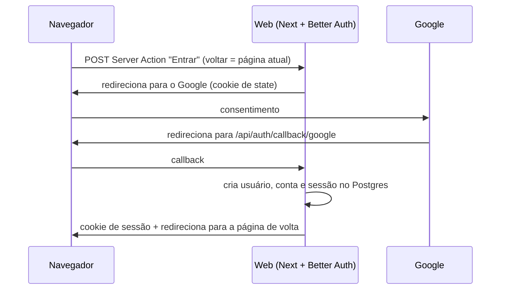

# Spec — Login com Google

- **Issue:** #30 (S2.08)
- **Fase:** 0 (ver [roadmap](../produto/roadmap.md))
- **Status:** implementada

## Contexto
O cliente agenda com a conta Google (D3), e a administração entra pela mesma porta (RN-71). O [ADR 0003](../decisoes/0003-autenticacao.md) põe o login no Next.js com o Better Auth e faz o web chamar a API com um JWT curto. Esta spec entrega o login, a sessão e a emissão desse JWT. A validação na API é a #31.

## Quem usa
Cliente e administração. O visitante vê o botão de entrar.

## Histórias
- Como visitante, quero entrar com a minha conta Google, sem criar senha.
- Como cliente logado, quero ver que estou logado e poder sair.
- Como mantenedor, quero obter no servidor um JWT da sessão atual, para chamar a API em nome do usuário.

## Regras envolvidas
- RN-70 — Perfis e permissões (o papel é decidido na API, na #31)
- RN-71 — Acesso à administração (a lista `ADMIN_EMAILS` é lida pela API, não pelo web)
- RN-72 — LGPD (o login guarda só nome, e-mail e foto que o Google entrega)

## Critérios de aceite
**CA-1 — Entrar**
- **Dado** um visitante não logado
- **Quando** toca em "Entrar" no cabeçalho, ou em "Entrar com Google" na página `/entrar`, e conclui o login no Google
- **Então** volta para a página de onde saiu, e o cabeçalho mostra o primeiro nome e "Sair".

**CA-2 — Sessão persiste**
- **Dado** um usuário logado
- **Quando** recarrega a página ou abre outra
- **Então** continua logado (cookie httpOnly do Better Auth).

**CA-3 — Sair**
- **Dado** um usuário logado
- **Quando** toca em "Sair"
- **Então** a sessão termina, e o cabeçalho volta a mostrar "Entrar".

**CA-4 — Erro no login**
- **Dado** um login que falha ou é cancelado no Google
- **Quando** o Google devolve o usuário ao site
- **Então** ele cai em `/entrar` com o aviso "Não foi possível entrar com o Google. Tente de novo."

**CA-5 — JWT para a API**
- **Dado** um usuário logado
- **Quando** o servidor chama `getApiToken()`
- **Então** recebe um JWT EdDSA (Ed25519) que vale 15 minutos, com `iss` e `aud` vindos de `AUTH_ISSUER` e `AUTH_AUDIENCE` e só os claims `sub` (id do usuário), `email` e `name` além dos de registro (`iat`, `exp`, `iss`, `aud`). A assinatura confere com as chaves de `/api/auth/jwks`.
- **Dado** um visitante sem sessão, **então** `getApiToken()` devolve `null`.

**CA-6 — Funciona sem JavaScript**
- **Dado** o navegador sem JS
- **Quando** toca em "Entrar" ou "Sair"
- **Então** a ação funciona do mesmo jeito, porque os botões são formulários com Server Actions.

**CA-7 — Volta segura**
- **Dado** um pedido de login com destino de volta externo (ex.: `//exemplo.com` ou `https://exemplo.com`)
- **Quando** o login termina
- **Então** o usuário volta para `/`, nunca para outro site.

## Fluxo e telas

- **Cabeçalho:** à direita, "Entrar" (botão `outline` `sm`; "Entrar com Google" a partir de `sm`). Logado: o primeiro nome (a partir de `sm`) e o botão `ghost` "Sair".
- **`/entrar`:** título, uma frase sobre o uso dos dados, o botão "Entrar com Google" e o `Alert` de erro quando a URL traz `?error=`. Quem já está logado é levado direto para o destino. Aceita `?voltar=/caminho`, que as rotas protegidas vão usar a partir das próximas tarefas.
- Se o banco estiver fora do ar, o cabeçalho trata o visitante como não logado em vez de derrubar a página.
- Usa os componentes do [design system](../design/design-system.md): `Button`, `Alert`.

## Banco
As tabelas `user`, `session`, `account`, `verification` e `jwks` são do Better Auth (ADR 0002). Elas são criadas por `pnpm auth:migrate`, que usa a CLI do Better Auth, e não pelo Alembic.

## API
Nenhuma rota da FastAPI. No web, o handler `/api/auth/[...all]` expõe as rotas do Better Auth, entre elas o callback do Google, `/api/auth/token` e `/api/auth/jwks`.

## Modo demonstração
Com `DEMO_LOGIN_ENABLED=true` (desligado por padrão e travado na produção), `/entrar` também oferece "Entrar como administração (demo)" e "Entrar como cliente (demo)", em contas fictícias fixas, sem Google. A sessão e o JWT são os mesmos desta spec. Ver [modo-demonstracao.md](modo-demonstracao.md) e o [ADR 0011](../decisoes/0011-entrada-de-demonstracao.md).

## Fora do escopo desta spec
- Validar o JWT e decidir o papel na API (#31).
- Proteger `/agendar`, `/meus-agendamentos`, `/perfil` e `/admin` (nascem com as próprias telas; a página `/entrar?voltar=` já atende).
- Página de privacidade (RN-72), cadastro do telefone e vínculo com o `Customer` (RN-23).

## Dúvidas em aberto
Nenhuma.
