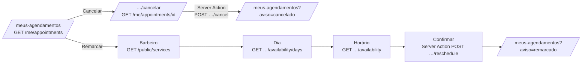

# Spec — Meus agendamentos: ver, remarcar e cancelar

- **Issues:** #58 (S3.09), #80 (S4.07, aparência com a base visual nova)
- **Fase:** 1 (MVP) (ver `docs/produto/roadmap.md`)
- **Status:** implementada

## Contexto
Depois de agendar (S3.08), o cliente precisa acompanhar os próprios horários e resolver um imprevisto sem ligar para a barbearia: cancelar ou trocar o dia, o horário ou o barbeiro. O prazo de 2 horas (D6) protege a agenda contra a desistência de última hora (O3), e a vaga cancelada volta na hora para outros clientes (O1). Fora do prazo, a tela mostra o contato da barbearia. Esta funcionalidade reaproveita o motor de disponibilidade (S3.07) e as telas de dia e horário do agendamento (S3.08).

## Quem usa
Cliente. A administração não usa estas telas nem estas rotas (RN-70); as alterações pela administração (RN-22) são da S5.05 ([agendamento-admin.md](agendamento-admin.md)).

## Histórias
- Como **cliente**, quero **ver meus próximos horários e o histórico** para **lembrar quando e com quem marquei**.
- Como **cliente**, quero **cancelar um horário até 2 horas antes** para **liberar a vaga quando não puder ir**.
- Como **cliente**, quero **trocar o dia, o horário ou o barbeiro sem perder o serviço** para **não precisar cancelar e agendar de novo**.
- Como **cliente**, quero **ver o contato da barbearia quando o prazo já passou** para **resolver por telefone ou WhatsApp**.
- Como **barbearia**, quero **saber quem cancelou e quando** para **acompanhar as desistências**.

## Regras envolvidas
- RN-14 — Prazo para cancelar e remarcar
- RN-15 — Remarcação
- RN-16 — Privacidade entre clientes
- RN-31 — Transições permitidas
- RN-32 — Liberação da vaga
- RN-33 — Rastreabilidade
- RN-05 a RN-08 — Disponibilidade do novo horário (via `ensure_slot_available`, S3.07)
- RN-13 — Preço e duração congelados (mantidos na remarcação)
- RN-70 — Perfis e permissões
- RN-52 — E-mails de alteração (S5.03, em [notificacoes-email.md](notificacoes-email.md))

## Definições desta funcionalidade
- **Próximos:** agendamentos `SCHEDULED` que ainda não terminaram (`ends_at` depois de agora), inclusive o que está em andamento, em ordem de início (o mais próximo primeiro). É o mesmo critério de "ativo no futuro" da RN-11 e da RN-60.
- **Histórico:** todos os outros (cancelados, concluídos, faltas e `SCHEDULED` que já terminaram e esperam a conclusão), do mais recente para o mais antigo. Sem paginação no MVP.
- **Prazo (RN-14):** o cliente pode cancelar ou remarcar enquanto `agora ≤ início − 2 horas`. O limite é inclusivo, como a antecedência da RN-06. Na remarcação, o prazo vale sobre o horário **atual**; o novo horário segue a antecedência de 1 hora (RN-06).
- **Remarcar (RN-15, RN-31):** o mesmo agendamento continua `SCHEDULED`, com outro início e, se o cliente quiser, outro barbeiro. O serviço não muda. O preço e a duração continuam os congelados na criação (RN-13): a remarcação não é um agendamento novo. O novo horário é calculado com essa duração congelada.
- **O próprio horário não ocupa a agenda na remarcação:** o novo horário pode se sobrepor ao atual (ex.: passar das 10h00 para as 10h30 com o mesmo barbeiro). O horário atual exato, com o mesmo barbeiro, não é oferecido de novo.

## Critérios de aceite

**CA-1 — Lista separada em próximos e histórico (RN-16)**
- **Dado** um cliente com agendamentos em vários status e outro cliente com agendamentos
- **Quando** chama `GET /me/appointments`
- **Então** a API devolve `{ upcoming, history }` só com os agendamentos dele, separados e ordenados como em "Definições". Cada item traz `id`, `status`, `barber`, `service`, `starts_at`, `ends_at` (`-03:00`), `price`, `duration_minutes`, `canceled_at`, `canceled_by`, `change_deadline` (início − 2h, só para `SCHEDULED`) e `can_cancel` / `can_reschedule` calculados pela API (RN-14). O web não calcula o prazo: só usa esses campos.

**CA-2 — Agendamento de outro cliente (RN-16)**
- **Dado** um agendamento de outro cliente
- **Quando** o cliente tenta ler, cancelar, remarcar ou ver os horários de remarcação dele
- **Então** a API responde `404` com `code` = `APPOINTMENT_NOT_FOUND` e "Agendamento não encontrado.", igual a um id que não existe, para não revelar que ele existe. Nada muda no banco.

**CA-3 — Cancelar dentro do prazo (RN-14, RN-31, RN-32, RN-33)**
- **Dado** um agendamento `SCHEDULED` do cliente que começa daqui a 2 horas ou mais
- **Quando** chama `POST /me/appointments/{id}/cancel`
- **Então** a API responde `200` com o agendamento `CANCELED`, `canceled_by` = `CUSTOMER` e `canceled_at` = agora. O horário volta a aparecer em `GET /public/availability` na mesma hora (a exclusion constraint só considera `SCHEDULED`).

**CA-4 — Fora do prazo (RN-14)**
- **Dado** um agendamento que começa em menos de 2 horas (ou já começou)
- **Quando** o cliente tenta cancelar ou remarcar
- **Então** a API responde `409` com `code` = `CHANGE_DEADLINE_PASSED` e "Faltam menos de 2 horas para o seu horário. Para cancelar ou remarcar, fale com a barbearia.", e nada muda. A tela mostra o contato da barbearia.

**CA-5 — Agendamento que não está ativo (RN-31)**
- **Dado** um agendamento `CANCELED`, `COMPLETED` ou `NO_SHOW`
- **Quando** o cliente tenta cancelar ou remarcar
- **Então** a API responde `409` com `code` = `APPOINTMENT_NOT_ACTIVE` e "Este agendamento não está mais ativo.". Os status finais não mudam.

**CA-6 — Remarcar dentro do prazo (RN-15, RN-05 a RN-08)**
- **Dado** um agendamento `SCHEDULED` do cliente, dentro do prazo
- **Quando** chama `POST /me/appointments/{id}/reschedule` com `starts_at` (com fuso) e, opcionalmente, `barber_id`
- **Então** a API responde `200` com o mesmo `id`, ainda `SCHEDULED`, o novo início e fim, o barbeiro novo (ou o mesmo), o mesmo serviço, preço e duração.
- Sem `barber_id`, o barbeiro continua o mesmo. O corpo não aceita `service_id` nem outros campos (`422 VALIDATION_ERROR`, RN-15).
- O novo horário precisa estar entre os oferecidos para o serviço com o barbeiro escolhido (RN-05 a RN-07, com a duração congelada); senão, `409 SLOT_UNAVAILABLE` com "Este horário não está mais disponível. Escolha outro.". Um barbeiro que não realiza o serviço, inativo, ou um serviço que foi inativado também recebe `SLOT_UNAVAILABLE` (RN-05, item 5). Barbeiro inexistente responde `404 BARBER_NOT_FOUND`.
- O novo horário pode se sobrepor ao atual do mesmo agendamento.
- O mesmo barbeiro e o mesmo início responde `409` com `code` = `SAME_SLOT` e "Este já é o horário do seu agendamento. Escolha outro.".

**CA-7 — Remarcação disputada (RN-08)**
- **Dado** um cliente remarcando para um horário enquanto outro cliente agenda o mesmo horário
- **Quando** os dois pedidos passam pela conferência e gravam ao mesmo tempo
- **Então** só um consegue. O outro recebe `409 SLOT_UNAVAILABLE`, venha a recusa da exclusion constraint ou do deadlock (`is_slot_conflict`). Se a remarcação perde, o agendamento continua no horário antigo.

**CA-8 — Horários da remarcação**
- `GET /me/appointments/{id}/availability/days?barber_id=` devolve os dias com horário para remarcar, e `GET /me/appointments/{id}/availability?barber_id=&date=` os horários de um dia, com os mesmos formatos das rotas públicas. Elas usam o serviço do agendamento, a duração congelada, ignoram o próprio agendamento nos ocupados e não oferecem o horário atual com o mesmo barbeiro. Sem `barber_id`, usam o barbeiro atual.
- Elas seguem as mesmas recusas da remarcação: `404 APPOINTMENT_NOT_FOUND`, `409 APPOINTMENT_NOT_ACTIVE` e `409 CHANGE_DEADLINE_PASSED`. O parâmetro de exclusão não existe nas rotas públicas.

**CA-9 — Só o cliente (RN-70)**
- Sem token, `401`. A administração recebe `403`.

**CA-10 — Tela "Meus agendamentos"**
- **Dado** um cliente logado em `/meus-agendamentos`, numa tela de 360px
- **Então** vê "Próximos" e "Histórico", com um cartão por agendamento: serviço, barbeiro, data completa, horário de início e fim, valor e o status (`StatusBadge`; um `SCHEDULED` que já terminou aparece como "Aguardando registro").
- Cartão de "Próximos" com `can_cancel` / `can_reschedule`: os links "Remarcar" (`outline`) e "Cancelar" e o texto "Você pode cancelar ou remarcar até HH:MM de <data>." (de `change_deadline`).
- Cartão de "Próximos" sem as ações: o aviso "Faltam menos de 2 horas para o seu horário. Para cancelar ou remarcar, fale com a barbearia." com os links de contato da barbearia (WhatsApp, telefone, Instagram, e-mail, os que estiverem preenchidos).
- Sem nenhum agendamento: o estado vazio "Você ainda não tem horários" com "Agendar horário". Sem próximos, mas com histórico: "Nenhum horário marcado" com "Agendar horário".
- Sem sessão, o servidor leva a `/entrar?voltar=/meus-agendamentos` (e para as subpáginas, `voltar=` a URL completa). A administração vai para `/admin`.

**CA-11 — Cancelar com confirmação, sem JS**
- "Cancelar" leva a `/meus-agendamentos/{id}/cancelar`, que mostra o resumo do agendamento, "O horário fica livre para outros clientes." e dois controles: o botão `danger` "Cancelar agendamento" (um `<form>` com Server Action) e o link `ghost` "Voltar".
- Ao confirmar, a Server Action chama a API e leva a `/meus-agendamentos?aviso=cancelado`, que mostra "Agendamento cancelado." num `Alert` `success`. Qualquer recusa mostra o `message` da API num `Alert` `danger` na mesma página; a recusa do prazo mostra também o contato.
- Se o agendamento já não pode ser cancelado quando a página abre, ela mostra o aviso (com o contato, se for o prazo) sem o botão.

**CA-12 — Remarcar reaproveitando as telas do agendamento**
- "Remarcar" leva a `/meus-agendamentos/{id}/remarcar?barbeiro=<atual>`. A URL guarda as escolhas (`barbeiro`, `data`, `hora`), e a primeira que falta é a etapa: barbeiro → dia → horário → confirmar ("Etapa N de 4").
- O topo mostra "Horário atual" (dia, hora e barbeiro) e as escolhas feitas, cada uma com "Trocar". Trocar o barbeiro leva à etapa de barbeiro, só com os barbeiros da vitrine que realizam o serviço.
- Dia e horário usam o `DayPicker` e o `TimePicker` da S3.08, com os dias e horários das rotas do CA-8.
- A confirmação mostra o horário atual e o novo, o serviço e o valor, e o botão "Confirmar remarcação". A Server Action chama a API e leva a `/meus-agendamentos?aviso=remarcado` ("Agendamento remarcado."). Qualquer recusa mostra o `message` da API com o link "Escolher outro horário".
- Fora do prazo ou fora do status ativo, a página mostra o aviso (com o contato, se for o prazo) no lugar das etapas.

## Fluxo e telas

- Rotas no grupo `(cliente)`: `/meus-agendamentos`, `/meus-agendamentos/[id]/cancelar` e `/meus-agendamentos/[id]/remarcar`. As três exigem sessão no servidor.
- **Cartões:** um `article` por agendamento, título com o serviço (`h3`), a data e o horário, o barbeiro, o valor e o `StatusBadge`. No celular, uma coluna; as ações ficam lado a lado, cada uma com 44px de altura.
- **Aparência (S4.07, #80):** a mesma moldura do `/agendar`, sem a faixa escura parcial. O texto de apoio abaixo do título usa `text-body`; "Agendar horário" do estado vazio, "Cancelar agendamento" e "Confirmar remarcação" usam o botão `md`, e as ações do cartão continuam `sm`.
- **Confirmação destrutiva sem JS:** em vez de um `<dialog>`, que precisa de JS para abrir, o cancelamento tem a própria página de confirmação. O foco natural da página fica no título; "Voltar" é a primeira opção depois do resumo, e "Cancelar agendamento" é o botão `danger`.
- **Depois de cancelar ou remarcar,** o cliente volta para a lista com `?aviso=`, para ver o estado novo em um lugar só. O `/agendar` continua mostrando o resumo depois de confirmar, com o link "Ver meus agendamentos".
- Estados: `loading.tsx` com esqueleto de cartões; falha de leitura da API mostra um `Alert` `danger` com "Não foi possível carregar seus agendamentos. Tente novamente em instantes."; erro da Server Action mostra o `message` da API.

## API
| Método | Caminho | Quem | O que faz |
|---|---|---|---|
| `GET` | `/me/appointments` | Cliente (`current_customer`) | `{ upcoming, history }` com os agendamentos do próprio cliente |
| `GET` | `/me/appointments/{id}` | Cliente | Um agendamento do próprio cliente |
| `POST` | `/me/appointments/{id}/cancel` | Cliente | Cancela (RN-14, RN-31 a RN-33). Responde `200` com o agendamento |
| `POST` | `/me/appointments/{id}/reschedule` | Cliente | Corpo: `starts_at` (com fuso) e `barber_id` opcional. Remarca (RN-14, RN-15, RN-05 a RN-08). Responde `200` com o agendamento |
| `GET` | `/me/appointments/{id}/availability/days?barber_id=` | Cliente | Dias com horário para remarcar |
| `GET` | `/me/appointments/{id}/availability?barber_id=&date=` | Cliente | Horários de um dia para remarcar |

- Tudo no módulo `app/modules/booking/` (`service.py` e `router.py`), pelo mesmo motivo da criação: `appointments` não pode importar `availability`.
- O agendamento é sempre buscado por `id` **e** pelo cliente do token. Cancelar e remarcar travam a linha (`FOR UPDATE`) antes de conferir o status e o prazo, então dois pedidos do mesmo agendamento não passam juntos.
- Remarcar chama `ensure_slot_available` com o agendamento que está sendo remarcado (`Rescheduling`, em `availability/service.py`): ele sai dos ocupados, a duração é a congelada e o início atual com o mesmo barbeiro não é oferecido. A atualização é na mesma linha, então a exclusion constraint compara o novo intervalo só com os outros agendamentos. Uma falha reconhecida por `is_slot_conflict` vira `409 SLOT_UNAVAILABLE`.
- O resumo de `POST /me/appointments` (S3.08) ganha os mesmos campos novos da lista (`can_cancel`, `can_reschedule`, `change_deadline`, `canceled_at`, `canceled_by`).

## Fora do escopo desta spec
- **E-mails de remarcação e de cancelamento (RN-52):** entraram na S5.03 (#95). Cancelar e remarcar registram o aviso na mesma transação e o enviam depois do commit. Na remarcação, o `notify` fica dentro do tratamento de erro do commit: mesmo com o cliente fora da sessão, um autoflush recusado pelo banco responde `409 SLOT_UNAVAILABLE`, preserva o horário anterior e não registra nem envia aviso (RN-08, RN-52); ver [notificacoes-email.md](notificacoes-email.md).
- Cancelar e remarcar pela administração, sem prazo (RN-22): S5.05 ([agendamento-admin.md](agendamento-admin.md)).
- Trocar o serviço na remarcação (RN-15: o cliente cancela e agenda de novo).
- Paginação ou filtro do histórico.
- Link "Meus agendamentos" no cabeçalho do site.

## Dúvidas em aberto
Escolhas desta implementação que nenhuma RN decide, a confirmar:
- **Preço e duração congelados na remarcação:** a remarcação mantém os valores da criação (RN-13), mesmo que o serviço tenha mudado depois. A alternativa seria recongelar com os valores atuais.
- **Serviço inativado depois do agendamento:** a remarcação segue a RN-05 inteira, então não há horário para remarcar (item 5); o cliente pode cancelar e falar com a barbearia.
- **Prazo inclusivo:** exatamente 2 horas antes ainda pode.
- **`SCHEDULED` que já terminou** vai para o histórico, com o rótulo "Aguardando registro", até a administração concluir ou marcar falta.
- **Remarcar para o mesmo horário** é recusado com `SAME_SLOT` em vez de aceito sem mudança.
- **Página de confirmação** do cancelamento no lugar do `<dialog>` do design system, para funcionar sem JS.
- **Depois de cancelar ou remarcar, a volta é para a lista** com `?aviso=`. O `/agendar` mantém o resumo depois de confirmar.
- **`404` para o agendamento de outro cliente,** igual ao inexistente, em vez de `403`.
