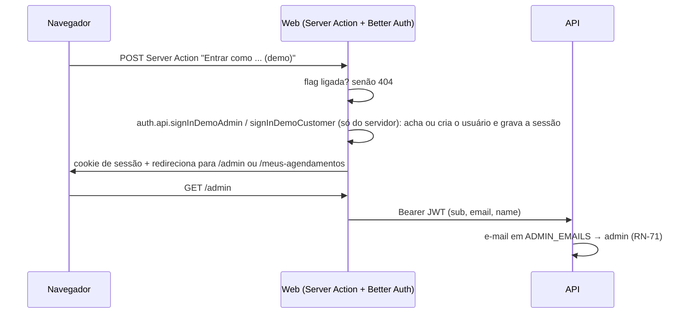

# Spec — Modo demonstração (entrada sem Google)

- **Issue:** #199 (S6.02)
- **Fase:** Portfólio (Sprint 6)
- **Status:** implementada

## Contexto
O projeto vira portfólio público. Recrutadores e o vídeo de demonstração precisam entrar como administração e como cliente sem uma conta Google cadastrada no OAuth (o app está "em teste"). O [ADR 0011](../decisoes/0011-entrada-de-demonstracao.md) complementa o [0003](../decisoes/0003-autenticacao.md): com uma flag, `/entrar` oferece duas entradas sem Google, em contas fictícias fixas, pelo próprio Better Auth. A API não muda.

## Quem usa
Visitante da demonstração pública (recrutador), e o Vitor gravando o vídeo.

## Histórias
- Como recrutador, quero entrar como administração com um toque, para ver a agenda, a conclusão e o relatório sem pedir acesso.
- Como recrutador, quero entrar como cliente, para ver "Meus agendamentos" preenchido e agendar.
- Como mantenedor, quero que a produção nunca ofereça essa entrada, mesmo com a flag esquecida ligada.

## Regras envolvidas
- RN-70 e RN-71 — o papel continua vindo de `ADMIN_EMAILS`, na API; a conta fictícia de administração só é administração onde está na lista
- RN-23 — o primeiro login do cliente fictício o vincula, pelo e-mail, ao cadastro criado pelo `seed_demo`
- RN-10 e RN-11 — o cliente fictício tem telefone e um só agendamento marcado, para poder agendar ao vivo

## Configuração

| Variável | Onde | Valor |
|---|---|---|
| `DEMO_LOGIN_ENABLED` | web | `true` liga. Qualquer outro valor, ou ausente, desliga (padrão) |
| `DEMO_LOGIN_ACKNOWLEDGE` | web | Só na imagem de produção (`NODE_ENV=production`): precisa ser exatamente `public-demo`. Sem ela, o web ignora a flag e registra o erro no log |
| `ADMIN_EMAILS` | api | Inclui `admin@demo.augustobarbearia.local` para a entrada de administração abrir `/admin` |

- **Compose da demonstração** (`docker-compose.demo.yml`): liga as duas variáveis do web (`DEMO_LOGIN_ENABLED` pode ser desligada no `.env.demo` com `false`) e põe a conta fictícia **em primeiro** no `ADMIN_EMAILS` da API e do `setup`. Assim, o `closed_by` dos dados fictícios é a conta fictícia, e não o e-mail de alguém real.
- **Compose de desenvolvimento** (`docker-compose.yml`): repassa `DEMO_LOGIN_ENABLED` do `.env` (padrão `false`). Como o `pnpm dev` não é produção, basta a flag. Para entrar como administração, acrescente `admin@demo.augustobarbearia.local` ao `ADMIN_EMAILS` do `.env` e rode `docker compose up -d api web`. Sem o `seed_demo` (que só roda num banco `_demo`), o cliente fictício nasce sem telefone no primeiro acesso, como qualquer cliente novo.
- **Produção (Railway):** não defina nenhuma das duas variáveis.

## Contas

| Botão | E-mail | Nome | Leva a |
|---|---|---|---|
| "Entrar como administração (demo)" | `admin@demo.augustobarbearia.local` | Administração Demo | `/admin` |
| "Entrar como cliente (demo)" | `cliente@demo.augustobarbearia.local` | Cliente Demo | `/meus-agendamentos` |

Se `/entrar` recebeu `?voltar=` (ex.: a confirmação de `/agendar`), o botão volta para lá em vez do destino padrão. O domínio `.local` não recebe e-mail: as confirmações do cliente fictício ficam no log ou como `FAILED` (RN-54), sem chegar a ninguém.

## Critérios de aceite
**CA-1 — Desligado por padrão**
- **Dado** `DEMO_LOGIN_ENABLED` ausente ou diferente de `true`
- **Então** `/entrar` mostra só "Entrar com Google", nenhuma página mostra a faixa, e a Server Action de demonstração responde 404 (`demo-mode.test.ts`, `auth-actions.test.ts`, `page.test.tsx`).

**CA-2 — Dois botões**
- **Dado** a flag ligada
- **Quando** abro `/entrar`
- **Então** vejo, abaixo do Google, "Entrar como administração (demo)" e "Entrar como cliente (demo)", cada um um formulário que funciona sem JavaScript.

**CA-3 — Sessão real**
- **Dado** a flag ligada e a conta fictícia de administração em `ADMIN_EMAILS`
- **Quando** toco em "Entrar como administração (demo)"
- **Então** volto logado em `/admin`, com o mesmo cookie de sessão e o mesmo JWT do login com Google. Com "Entrar como cliente (demo)", abro `/meus-agendamentos`.

**CA-4 — Trava da produção**
- **Dado** `NODE_ENV=production` e `DEMO_LOGIN_ENABLED=true` sem `DEMO_LOGIN_ACKNOWLEDGE=public-demo`
- **Então** a flag é ignorada (CA-1 vale) e o log do web registra o erro uma vez.

**CA-5 — Sem cadastro aberto**
- **Então** não existe rota pública de e-mail e senha (`/api/auth/sign-in/email` e `/api/auth/sign-up/email` recusam), e os endpoints do plugin (`signInDemoAdmin`, `signInDemoCustomer`) são só do servidor, sem caminho em `/api/auth/*` (`auth-demo.test.ts`). Só as duas contas fixas são criadas.

**CA-6 — Faixa**
- **Dado** a flag ligada
- **Então** todas as páginas mostram, no topo do cabeçalho, "Ambiente de demonstração — dados fictícios".

**CA-7 — Cliente preenchido**
- **Dado** o banco da demonstração recém-criado
- **Então** o cliente fictício tem telefone, um agendamento marcado a pelo menos um dia de distância, dois concluídos e um cancelado por ele (`tests/test_seed_demo.py`).

## Fluxo

## Código
- `web/src/lib/demo-mode.ts`: as contas, a trava (`demoLoginStatus`, `isDemoLoginEnabled`) e o papel do formulário.
- `web/src/lib/auth-demo.ts`: o plugin do Better Auth com o endpoint só do servidor.
- `web/src/lib/auth-actions.ts`: a Server Action `signInAsDemo`.
- `web/src/components/demo-sign-in.tsx` e `demo-banner.tsx`: os botões e a faixa.
- `web/src/instrumentation.ts`: registra o erro da trava na subida do servidor.
- `api/app/jobs/seed_demo.py`: o cliente fictício e os agendamentos dele.

## Fora do escopo
- Restaurar sozinho os dados fictícios depois que um visitante os altera (use `scripts/demo.sh reset`).
- Limitar o que a conta fictícia de administração pode fazer.
- Hospedar a demonstração pública fora do notebook.
