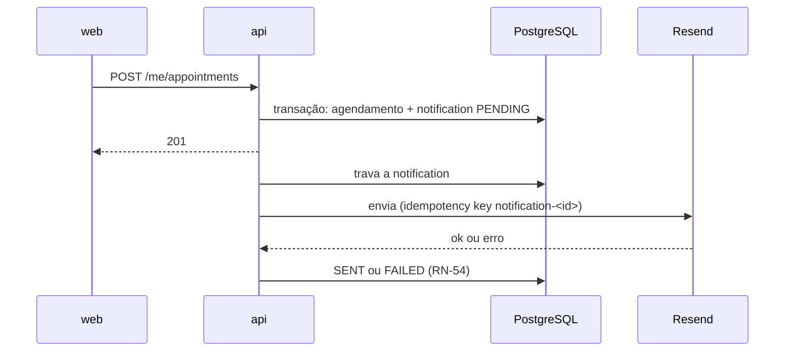

# Spec — Notificações por e-mail

- **Issues:** #95 (S5.03, confirmação, remarcação e cancelamento pelo cliente), #100 (S5.08, lembrete), #101 (S5.09, ações da administração)
- **Fase:** 1 (MVP) (ver `docs/produto/roadmap.md`)
- **Status:** implementada (confirmação, remarcação e cancelamento pelo cliente); o lembrete e as ações da administração reaproveitam o módulo nas próprias issues

## Contexto
Quem agenda pelo site quer uma prova de que o horário está marcado e um aviso quando ele muda. O e-mail transacional reduz faltas (O3) e dá segurança ao cliente sem que a barbearia precise ligar para ninguém (O1). A decisão técnica está no [ADR 0006](../decisoes/0006-email-e-jobs.md): Resend pelo SDK Python, registro na mesma transação da ação e envio depois do commit.

## Quem usa
Cliente (recebe). A administração não recebe e-mails; ela vê as falhas no banco, para diagnóstico (RN-54).

## Histórias
- Como **cliente**, quero **receber a confirmação do meu agendamento por e-mail** para **ter os dados à mão e saber que deu certo**.
- Como **cliente**, quero **ser avisado por e-mail quando remarco ou cancelo** para **ter o estado novo registrado**.
- Como **barbearia**, quero que **uma falha de e-mail nunca desfaça um agendamento** para **não perder clientes por causa de um serviço externo**.

## Regras envolvidas
- RN-01 — Fuso de São Paulo (data e hora no e-mail)
- RN-50 — Confirmação
- RN-51 — Lembrete (seção reservada abaixo; implementado na #100)
- RN-52 — Alterações
- RN-53 — Conteúdo
- RN-54 — Falha de envio

## Definições desta funcionalidade

### O registro (`Notification`)
- Tabela `notifications`, no módulo `app/modules/notifications/`. Uma linha por e-mail: o agendamento, o tipo, o destinatário, o status, o erro e as datas.
- **Tipos (`kind`):** `CONFIRMATION`, `REMINDER`, `RESCHEDULED`, `CANCELED`. O `REMINDER` já existe no banco para a #100.
- **Status:** `PENDING` (registrado, ainda não enviado), `SENT` (aceito pelo provedor, com `sent_at`) e `FAILED` (com `error`). O banco garante que só o `SENT` tem `sent_at` e só o `FAILED` tem `error`.
- O destinatário é o e-mail do cliente no momento da ação. **Cliente sem e-mail não recebe nada** e não ganha registro (RN-50): é o caso de quem a barbearia cadastra só com telefone (RN-62).
- O conteúdo do e-mail não é guardado. Ele é montado na hora do envio, a partir do agendamento.

### Registro e envio em dois tempos (ADR 0006)
1. **Na transação da ação:** `notify(session, appointment, kind)` cria o registro `PENDING`. Se a ação for desfeita (horário tomado, por exemplo), o registro some junto.
2. **Depois do commit:** o service entrega o registro à `Outbox`. Na API, a `Outbox` da requisição agenda o envio como *background task* do FastAPI: a resposta sai primeiro e o envio usa a mesma sessão, que só fecha depois das tarefas.
3. **No envio:** `send_notification(session, notification_id, sender)` trava o registro, monta o e-mail e chama o remetente. Sucesso → `SENT`; qualquer exceção do remetente → `FAILED` com a mensagem do erro. O agendamento nunca é desfeito (RN-54).

O envio é **idempotente**: só um registro `PENDING` é enviado. Chamar de novo para um registro `SENT` ou `FAILED` não faz nada. No Resend, o envio leva a chave de idempotência `notification-<id>`, então uma repetição do mesmo registro não gera um segundo e-mail.

Um registro que fica `PENDING` indica que o processo caiu entre o commit e o envio. No MVP não há reenvio automático.

### API interna para as próximas issues
O módulo expõe pouco, de propósito:

| Nome | Onde | Para quê |
|---|---|---|
| `notify(session, appointment, kind) -> Notification \| None` | `service.py` | Registra na transação da ação. Não faz commit. `None` quando o cliente não tem e-mail |
| `Outbox` (protocolo) com `send_after_commit(notification)` | `service.py` | O que o service chama **depois** do commit. Aceita `None` |
| `send_notification(session, notification_id, sender)` | `service.py` | Envia um registro `PENDING` e marca `SENT` ou `FAILED`, com commit |
| `RequestOutbox` / `OutboxDep` | `dependencies.py` | A `Outbox` das rotas: background task com a sessão da requisição |
| `get_email_sender()` | `sender.py` | O remetente da configuração: Resend com `RESEND_API_KEY`, ou o remetente de log sem ela. É dependência do FastAPI, e os testes a substituem |

Uso numa ação nova (#101):

```python
def cancel_by_admin(session: Session, appointment_id: int, *, outbox: Outbox, now: datetime) -> ...:
    appointment = ...                     # regras e alterações
    notification = notify(session, appointment, NotificationKind.CANCELED)
    session.commit()
    outbox.send_after_commit(notification)  # depois do commit, nunca antes
```

A rota recebe `outbox: OutboxDep` e passa ao service.

Uso fora de uma requisição (o job da #100): commit dos registros e, em seguida, `send_notification(session, notification.id, get_email_sender())` para cada um, sem `Outbox`.

### Remetentes
- **Resend** (`ResendSender`): com `RESEND_API_KEY` definida. `EMAIL_FROM` é obrigatória junto, e a API não sobe sem ela. Tempo limite de 10 segundos por envio.
- **Log** (`LogSender`): sem `RESEND_API_KEY` (desenvolvimento e testes). Registra no log, em nível `WARNING` (aparece sem configurar o logging e denuncia uma produção sem a chave), o destinatário, o assunto e o texto, e conta como enviado (`SENT`).

### Templates (RN-53)
Ficam em `templates.py`, em português, com versão em HTML simples (estilos inline, sem imagens) e em texto. Todo e-mail traz:
- o nome do cliente na saudação;
- o serviço, o barbeiro, a data por extenso e a hora, no fuso de São Paulo (RN-01): "terça-feira, 3 de novembro de 2026, às 10h00";
- o endereço da barbearia, quando cadastrado;
- o link "Meus agendamentos" (`WEB_BASE_URL` + `/meus-agendamentos`);
- os contatos preenchidos da barbearia (WhatsApp, telefone, Instagram, e-mail).

Os dados vindos do banco são escapados no HTML. Um campo opcional da barbearia vazio (endereço ou contato) não aparece, em vez de aparecer em branco.

| Tipo | Assunto | Primeira frase |
|---|---|---|
| `CONFIRMATION` | "Agendamento confirmado: terça-feira, 3/11, às 10h00" | "Seu horário está confirmado." + o prazo de 2 horas para remarcar ou cancelar pelo site (RN-14) |
| `RESCHEDULED` | "Agendamento remarcado: …" | "Seu agendamento foi remarcado. Veja o novo horário." |
| `CANCELED` | "Agendamento cancelado: …" | "Seu agendamento foi cancelado." + convite para marcar outro horário |
| `REMINDER` | "Lembrete: seu horário é terça-feira, 3/11, às 10h00" | "Passando para lembrar do seu horário." |

### Onde dispara nesta issue
- `create_customer_appointment` → `CONFIRMATION` (RN-50).
- `cancel_customer_appointment` → `CANCELED` (RN-52).
- `reschedule_customer_appointment` → `RESCHEDULED`, com o novo horário e o novo barbeiro (RN-52).

### Lembrete (RN-51) — reservado para a #100
O comando `python -m app.jobs.send_reminders` (ADR 0006) registra `REMINDER` com `notify` para os agendamentos `SCHEDULED` que começam entre 23h e 25h à frente e ainda não têm lembrete, faz o commit e envia com `send_notification`. O template já existe. A #100 decide e documenta aqui:
- como impedir dois lembretes do mesmo agendamento (por exemplo, índice único parcial em `(appointment_id)` para `kind = 'REMINDER'`) e se um lembrete `FAILED` é tentado de novo;
- o caso do agendamento criado com menos de 24h de antecedência (sem lembrete, RN-51) e o do remarcado depois do lembrete.

## Critérios de aceite

**CA-1 — Confirmação (RN-50)**
- **Dado** um cliente com e-mail
- **Quando** agenda pelo site (`POST /me/appointments`)
- **Então** um e-mail `CONFIRMATION` vai para o e-mail dele, e o registro fica `SENT`.

**CA-2 — Remarcação e cancelamento (RN-52)**
- **Dado** um agendamento ativo do cliente
- **Quando** ele remarca ou cancela pelo site
- **Então** recebe um e-mail `RESCHEDULED` com o novo horário e o novo barbeiro, ou um `CANCELED`.

**CA-3 — Conteúdo (RN-53)**
- **Dado** a barbearia com endereço e contatos
- **Quando** um e-mail é enviado
- **Então** o HTML e o texto trazem o serviço, o barbeiro, a data e a hora de São Paulo, o endereço, o link `WEB_BASE_URL/meus-agendamentos` e os contatos.

**CA-4 — Falha de envio (RN-54)**
- **Dado** o provedor de e-mail indisponível
- **Quando** o cliente agenda
- **Então** a API responde `201`, o agendamento existe e o registro fica `FAILED` com o erro.

**CA-5 — Ação desfeita não envia**
- **Dado** um horário que outra reserva tomou
- **Quando** o cliente tenta agendar e recebe `409 SLOT_UNAVAILABLE`
- **Então** nenhum registro é gravado e nenhum e-mail sai.

**CA-6 — Cliente sem e-mail (RN-50)**
- **Dado** um cliente cadastrado só com telefone
- **Quando** uma ação gera notificação
- **Então** nada é registrado e nada é enviado.

**CA-7 — Sem chave do Resend**
- **Dado** `RESEND_API_KEY` vazia
- **Quando** um e-mail é enviado
- **Então** ele aparece no log da API e o registro fica `SENT`.

## Fluxo



## API
Nenhuma rota nova nem mudança de contrato. As rotas do cliente (`POST /me/appointments`, `POST /me/appointments/{id}/cancel` e `POST /me/appointments/{id}/reschedule`) passam a disparar os e-mails.

### Configuração
| Variável | Para quê |
|---|---|
| `RESEND_API_KEY` | Chave do Resend. Vazia: os e-mails vão para o log |
| `EMAIL_FROM` | Remetente, como `Augusto Barbearia <agenda@dominio.com.br>`. Obrigatória com a chave |
| `WEB_BASE_URL` | Base do link "Meus agendamentos". Vazia ou ausente: `http://localhost:3000` |

Para usar o Resend de verdade: criar a conta gratuita, gerar uma chave com permissão só de envio e definir o remetente. No domínio de testes do Resend (`onboarding@resend.dev`), os e-mails só chegam ao endereço dono da conta. Para enviar a qualquer cliente, é preciso verificar um domínio próprio (registros DNS indicados pelo Resend).

## Fora do escopo desta spec
- O job do lembrete e a seleção dos agendamentos (RN-51): #100.
- Os e-mails das ações da administração (agendar, remarcar, cancelar, RN-52): #101.
- Reenvio automático de `FAILED` ou `PENDING`, tela de notificações na administração e webhooks de entrega do Resend.
- WhatsApp (Fase 2): a tabela ganha um canal quando ele entrar (ADR 0006).

## Dúvidas em aberto
Escolhas desta implementação que nenhuma RN decide, a confirmar:
- O e-mail não mostra o preço. A RN-53 não pede, e o preço já aparece no site.
- O remetente de log conta o e-mail como `SENT`, para o desenvolvimento seguir o mesmo caminho da produção.
