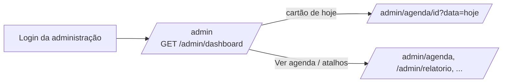

# Spec — Painel de indicadores da administração

- **Issue:** #198 (S6.01)
- **Fase:** Sprint 6 — Portfólio, fora das fases do roadmap (ver `docs/produto/roadmap.md`); é um ajuste da administração no espírito da Fase 2
- **Status:** implementada

## Contexto
Até aqui, `/admin` era só uma lista de atalhos. Para saber como a barbearia está, os proprietários precisavam abrir a agenda e o relatório e fazer contas de cabeça. O painel junta numa tela os números que respondem "o mês vai bem?", "quem está com a agenda cheia?", "quando a barbearia lota?" e "quem vem hoje?". É leitura pura: nenhuma rota desta issue altera o banco. Tudo é calculado na API e desenhado no servidor, sem biblioteca de gráfico e sem JS no navegador.

## Quem usa
Administração. O cliente e o visitante não acessam (RN-70).

## Histórias
- Como **proprietário**, quero **ver o faturamento, os atendimentos, o ticket médio e a taxa de faltas do mês comparados ao mês anterior** para **saber se o mês vai bem sem esperar ele acabar**.
- Como **proprietário**, quero **ver o faturamento de cada dia do último mês** para **perceber dias fracos e a tendência**.
- Como **proprietário**, quero **ver a ocupação de cada barbeiro na semana que passou e na que vem** para **saber quem tem espaço para encaixe e quem está lotado**.
- Como **proprietário**, quero **ver os horários de pico por dia da semana** para **decidir horário de funcionamento e folgas**.
- Como **atendente**, quero **ver os próximos atendimentos de hoje** e **abrir cada um** para **receber o cliente e concluir o atendimento**.

## Regras envolvidas
- RN-01 — Fuso horário (hoje, o mês e as janelas são dias de São Paulo; as datas saem em `-03:00`)
- RN-02 — Horário de funcionamento (o expediente é a base da ocupação e da grade de pico)
- RN-03 — Bloqueios (saem do tempo disponível na ocupação)
- RN-30 — Status (o que conta em cada número)
- RN-40, RN-41, RN-44 — O faturamento é o valor cobrado dos concluídos, já corrigido
- RN-45 — **Indicadores do painel (nova)**: as definições de cada número
- RN-70 e RN-71 — Só a administração

## Definições desta funcionalidade
Todas estão na RN-45; aqui ficam os detalhes de cálculo.

- **Agora e hoje:** o instante vem de `utc_now` (dependência da rota, fixada nos testes); "hoje" é a data dele em São Paulo. Às 21h30 de 18/11 em São Paulo (00h30 de 19/11 em UTC), hoje é 18/11.
- **Data de referência:** como na agenda e no relatório ([relatorio-financeiro.md](relatorio-financeiro.md)), o atendimento pertence ao dia e à hora em que **começa** (`starts_at`).
- **Mês até hoje (`current`):** do dia 1 do mês de hoje até hoje, inclusive. **Mesmo trecho do mês anterior (`previous`):** do dia 1 do mês anterior até o mesmo dia; se o mês anterior for mais curto, até o último dia dele (31/03 compara com 01/02 a 28/02; 15/01 com 01/12 a 15/12 do ano anterior).
- **Faturamento:** soma do `amount` do `Payment` dos `COMPLETED` do período (RN-40, RN-41), em `Decimal`. Cortesia (R$ 0,00) é um concluído.
- **Concluídos e faltas:** quantidade de `COMPLETED` e de `NO_SHOW`. `SCHEDULED` e `CANCELED` não entram.
- **Taxa de faltas:** faltas ÷ (concluídos + faltas) × 100, com uma casa (`ROUND_HALF_UP`); `null` se não houve concluído nem falta.
- **Ticket médio:** faturamento ÷ concluídos, com duas casas (`ROUND_HALF_UP`); `null` sem concluído.
- **Variação (`changes`):** (atual − anterior) ÷ anterior × 100, com uma casa, para faturamento, concluídos e ticket médio; `null` quando o anterior é zero ou nulo (não há base). A da taxa de faltas é a **diferença em pontos percentuais** (atual − anterior), `null` se uma das duas é nula.
- **Faturamento diário:** hoje e os 29 dias anteriores (30 dias), em ordem, com zero nos dias sem concluído.
- **Ocupação:** para cada barbeiro **ativo**, por nome, em duas janelas de 7 dias inteiros: `past` (os 7 dias antes de hoje) e `upcoming` (hoje e os 6 seguintes).
  - **Disponível:** os minutos de expediente de cada dia da janela (RN-02, o horário da semana atual) menos os minutos bloqueados dentro dele (RN-03).
  - **Ocupado:** os minutos dos agendamentos `SCHEDULED`, `COMPLETED` e `NO_SHOW` do barbeiro dentro do expediente, com a união dos intervalos (dois que se cruzam contam uma vez) e nunca acima do disponível do dia. A falta conta: o horário ficou preso. O cancelado não.
  - **Taxa:** ocupado ÷ disponível × 100, com uma casa; `null` sem expediente na janela (ex.: a semana toda bloqueada).
  - Hoje entra inteiro na janela `upcoming`, inclusive a parte do expediente que já passou.
- **Horários de pico:** quantos atendimentos `SCHEDULED`, `COMPLETED` e `NO_SHOW` **começaram** em cada dia da semana e hora cheia, nos 90 dias antes de hoje (hoje não entra). A grade de horas vai da primeira hora de abertura à última hora com expediente da semana (19h fecha → última hora 18h), estendida para caber qualquer atendimento fora dela. Cada dia da semana traz `open` (se abre hoje, RN-02).
- **Hoje:** `total_count` conta os agendamentos que começam hoje, menos os cancelados; `completed_count`, os concluídos; `upcoming` lista os `SCHEDULED` de hoje que ainda não terminaram, por início, com `in_progress` quando já começaram.
- **Dinheiro e percentuais:** strings decimais (`"125.00"`, `"12.5"`); nada passa por `float` na API. O web só converte em `number` a altura das barras do gráfico e o texto mostrado sai sempre da string da API.

## Critérios de aceite

**CA-1 — Mês até hoje comparado (RN-45)**
- **Dado** concluídos e faltas em novembro até o dia 18 e em outubro até o dia 18, mais agendados, cancelados e concluídos fora dos trechos
- **Quando** a administração chama `GET /admin/dashboard` em 18/11
- **Então** `current` e `previous` trazem `start`, `end`, `revenue`, `completed_count`, `no_show_count`, `no_show_rate` e `average_ticket` só dos trechos, e `changes` traz as variações. Os agendados e cancelados não entram em nada.

**CA-2 — Sem base de comparação (RN-45)**
- Sem concluídos nem faltas no trecho anterior, `previous.no_show_rate` e `previous.average_ticket` são `null`, e todas as variações são `null`. A tela mostra "Sem base".

**CA-3 — Faturamento diário (RN-01, RN-45)**
- `daily_revenue` tem 30 dias, do 29º dia antes de hoje até hoje, com `revenue` e `completed_count`, zero nos dias vazios. Um atendimento às 22h de São Paulo conta no dia em que começa.

**CA-4 — Ocupação (RN-02, RN-03, RN-45)**
- Cada barbeiro ativo, por nome, tem `past` e `upcoming` com `start`, `end`, `booked_minutes`, `available_minutes` e `rate`. A folga de um dia sai do disponível; o cancelado não ocupa; a falta ocupa; dois agendamentos no mesmo horário contam uma vez. Sem expediente na janela, `rate` é `null`. O inativo não aparece.

**CA-5 — Horários de pico (RN-45)**
- `peak_hours` traz `start`/`end` (90 dias antes de hoje), `hours`, sete `rows` (`weekday` 0 a 6, `open`, `counts` alinhado a `hours`) e `max_count`. Cancelados, hoje e o que é anterior à janela não contam.

**CA-6 — Hoje**
- `today` traz a data, `total_count`, `completed_count` e `upcoming` com `id`, `starts_at`, `ends_at` (`-03:00`), cliente, barbeiro, serviço e `in_progress`.

**CA-7 — Só a administração (RN-70, RN-71)**
- Sem token, `401`; cliente, `403`.

**CA-8 — Tela `/admin`**
- O título é "Painel", com a data de hoje por extenso. Abaixo:
  - **Mês até hoje:** quatro cartões (Faturamento, Atendimentos concluídos, Ticket médio, Taxa de faltas), cada um com o valor, a variação (seta, número e, para o leitor de tela, "Alta de…", "Queda de…", "Estável" ou "Sem base de comparação") e o valor do trecho anterior. A cor reforça o que é bom (verde) e ruim (vermelho); para a taxa de faltas, subir é ruim.
  - **Faturamento diário:** barras em SVG, o maior dia como referência, hoje em vermelho e os dias vazios como um traço; cada barra tem o valor no `title`. O SVG é `aria-hidden`, e uma tabela só para leitor de tela traz os mesmos 30 dias.
  - **Hoje:** os próximos atendimentos, cada um um link para `/admin/agenda/[id]?data=<hoje>`, com "Agora" no que está em andamento, e o link "Ver agenda".
  - **Ocupação por barbeiro:** duas barras por barbeiro ("Últimos 7 dias" e "Próximos 7 dias"), com o percentual e as horas ("25h de 50h"), ou "Sem expediente".
  - **Horários de pico:** uma tabela de horas (linhas) por dia da semana (colunas), com o número em cada célula e a cor em cinco intensidades, a legenda "Menos/Mais" e a frase do horário mais cheio. O dia fechado e sem atendimento não aparece.
  - **Atalhos:** Agenda, Relatório, Clientes e Cadastros.
- Falha da API: um `Alert` `danger` com o `message` da API, ou "Não foi possível carregar os indicadores. Tente novamente em instantes.", e os atalhos continuam.

**CA-9 — Sem JS e em 360px**
- Tudo é HTML e SVG do servidor; nenhum componente do painel é de cliente. Em 360px, os cartões ficam em duas colunas, os blocos um embaixo do outro, o mapa de pico cabe na largura (dias nas colunas) e não há rolagem horizontal.

## Fluxo e telas

- **Celular:** cartões (2×2), faturamento diário, hoje, ocupação, pico e atalhos, um embaixo do outro.
- **Desktop (`lg`):** cartões em 4 colunas (`xl`); o gráfico ocupa 2/3 com "Hoje" ao lado; ocupação e pico lado a lado; atalhos no fim.
- **Estados:** carregando (`admin/loading.tsx`), erro (`Alert` com os atalhos) e vazio (textos em cada bloco).

## API
| Método | Caminho | Quem | O que faz |
|---|---|---|---|
| `GET` | `/admin/dashboard` | Administração (`require_admin`) | Os indicadores no momento da chamada: `generated_at`, `current`, `previous`, `changes`, `daily_revenue`, `occupancy`, `peak_hours` e `today` |

- Módulo novo `app/modules/dashboard/` (`router.py`, `schemas.py`, `service.py`). Fica **acima** de `payments`, `agenda`, `barbers`, `shop` e `time_blocks`: lê `Appointment`, `Payment`, `Customer`, `Barber`, `Service`, `BusinessHours` e `TimeBlock`, reaproveita `period_bounds` da agenda, `list_active_barbers` e `list_business_hours`, e ninguém o importa.
- O relógio entra por `Depends(utc_now)`; os testes o fixam em 18/11/2026, 15h.
- Consultas pequenas e separadas (mês atual, mês anterior, 30 dias, ocupação, pico, hoje), agregadas em Python com `Decimal`. O volume de uma barbearia (dezenas de atendimentos por dia) não justifica `GROUP BY` com fuso no banco nem índice novo.

## Web
- `web/src/app/admin/page.tsx` lê o painel por `loadDashboard` (`admin/painel/data.ts`) e monta os blocos de `admin/painel/dashboard-view.tsx` (`KpiGrid`, `RevenueChart`, `TodayList`, `OccupancyList`, `PeakHeatmap`), todos Server Components.
- `admin/painel/dashboard-state.ts` tem as contas de exibição, testadas: `formatPercent`, `formatDayRange`, `changeView` (sentido, texto e cor da variação), `revenueBars` (geometria das barras), `heatLevel`, `visiblePeakRows` e `busiestSlot`.
- Sem biblioteca nova. As cores são os tokens (`fill-ink`, `fill-brand`, `fill-line`, `bg-brand/15` a `bg-brand`), nunca hex.

## Fora do escopo desta spec
- Escolher o período ou o barbeiro do painel (o relatório faz isso).
- Metas, previsão de faturamento e receita prevista dos agendados.
- Exportação, atualização automática e gráficos interativos com JS.
- Ocupação por barbeiro com expediente próprio (hoje o expediente é o da barbearia, RN-02).

## Dúvidas em aberto
Decisões desta implementação, a confirmar com a barbearia:
- **Comparação por dia, não por hora:** o mês até hoje inclui o dia de hoje inteiro, e o anterior vai até o mesmo dia inteiro. De manhã, hoje ainda tem pouco faturamento e a variação tende a parecer pior do que é.
- **Falta ocupa a agenda** na ocupação e no pico (o horário ficou preso); a alternativa seria contar só os concluídos e agendados.
- **Hoje inteiro em "Próximos 7 dias"**, inclusive o expediente que já passou.
- **Expediente da semana atual** vale para as janelas passadas: se o horário de funcionamento mudou nos últimos 7 ou 90 dias, o disponível e a grade usam o novo.
- **Barbeiro inativo** não aparece na ocupação, mesmo que tenha atendido nos últimos 7 dias.
- **Pico conta agendados que já passaram** sem conclusão (pendências de fechamento), porque o horário foi ocupado.
